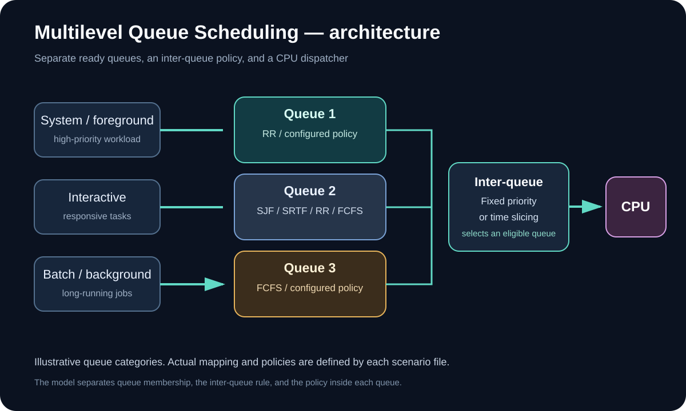
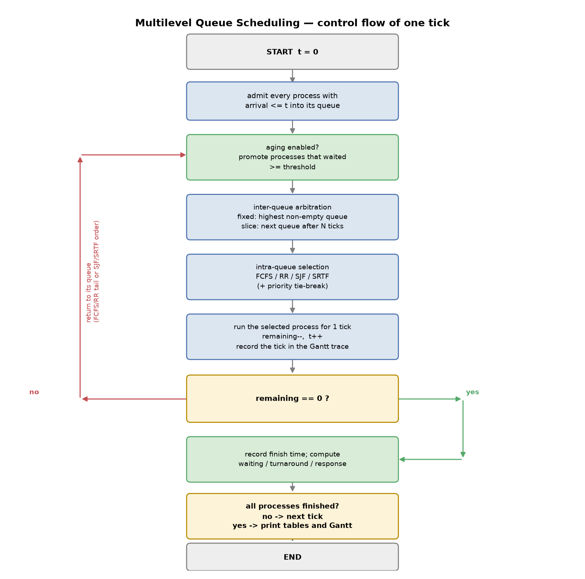
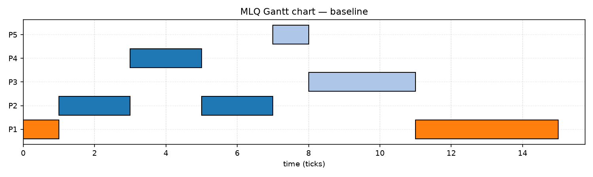
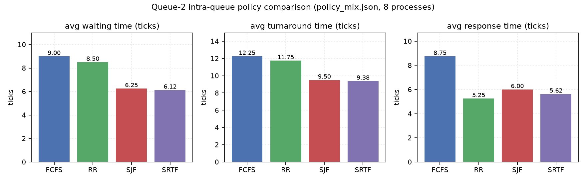

# تمرین ۱ — معرفی کامل الگوریتم Multilevel Queue Scheduling



> راهنمای سریع: ابتدا معماری صف‌ها را ببینید؛ سپس [راهنمای تصویری و خواندن گزارش‌ها](docs/README.md) را دنبال کنید.

**Branch:** `Exercise-1-Algorithm-Introduction`
**Exercise 1 — A complete introduction to Multilevel Queue (MLQ) scheduling**

این شاخه فقط شامل فایل‌های تمرین اول است: گزارش کامل فارسی و انگلیسی، شبیه‌ساز
اجرایی پایتون، تست‌های خودکار، سناریوهای آزمایشی، نمودارها و خروجی‌های واقعی.

**ساختار شاخه:** همه فایل‌های این تمرین در **ریشهٔ شاخه** (و نه در یک پوشهٔ
جداگانه) قرار دارند، بنابراین همین README در صفحهٔ اصلی شاخه نمایش داده می‌شود.

---

## فهرست محتوای این شاخه

| مسیر | توضیح |
|---|---|
| `README.md` | همین فایل: راهنمای شاخه و نحوه بازتولید نتایج |
| `REPORT_FA.md` | گزارش کامل فارسی (Markdown) |
| `REPORT_EN.md` | گزارش کامل انگلیسی (Markdown) |
| `docs/REPORT_FA.docx` | نسخه Word فارسی |
| `docs/REPORT_FA.pdf` | نسخه PDF فارسی |
| `docs/REPORT_EN.docx` | نسخه Word انگلیسی |
| `docs/REPORT_EN.pdf` | نسخه PDF انگلیسی |
| `code/mlq.py` | شبیه‌ساز MLQ و رابط خط فرمان |
| `code/run_experiments.py` | اجرای همه سناریوها و بازسازی نمودارها |
| `code/make_diagrams.py` | ترسیم ساختار، فلوچارت و نمودارهای مفهومی |
| `code/scenarios/*.json` | ۴ سناریوی معتبر و ۳ سناریوی نامعتبر |
| `tests/test_mlq.py` | تست‌های پایه (۱۵ تست) |
| `tests/test_mlq_extra.py` | تست‌های افزونه‌های جدید (۴۴ تست) |
| `diagrams/` | ۱۴ نمودار تولیدشده (گانت، فلوچارت، نمودارهای مقایسه‌ای) |
| `output/` | خروجی متنی، CSV، JSON و نتیجه تست‌ها |
| `requirements.txt` | وابستگی‌های پایتون |

### تعداد صفحات گزارش‌ها

| فایل | تعداد صفحه | روش اندازه‌گیری |
|---|---|---|
| `docs/REPORT_FA.pdf` | ۳۵ | دقیق — خوانده‌شده از خود فایل PDF |
| `docs/REPORT_EN.pdf` | ۳۵ | دقیق — خوانده‌شده از خود فایل PDF |
| `docs/REPORT_FA.docx` | ۳۵ | برآورد اندازه‌گیری‌شده روی فایل DOCX (بیشترین پُرشدگی صفحه: ۷۴٪) |
| `docs/REPORT_EN.docx` | ۳۵ | برآورد اندازه‌گیری‌شده روی فایل DOCX (بیشترین پُرشدگی صفحه: ۷۲٪) |

هر دو فایل DOCX و PDF از یک مدل محتوای یکسان تولید می‌شوند؛ بنابراین شماره
صفحات، فهرست مطالب، جدول‌ها و شکل‌ها در دو قالب دقیقاً یکسان است. بیشترین
پُرشدگی صفحه ۷۴ درصد است، یعنی ۲۶ درصد فضای آزاد برای تفاوت احتمالی شکستن
خطوط در Word باقی مانده است. عدد مربوط به PDF دقیق و عدد مربوط به DOCX
برآورد اندازه‌گیری‌شده است (برای اندازه‌گیری دقیق فایل Word به Microsoft Word
یا LibreOffice نیاز است که در این محیط در دسترس نبود).

---

## اجرا

```bash
# from the branch root (this folder IS the branch root)
pip install -r requirements.txt

# اجرای یک سناریو
python code/mlq.py code/scenarios/baseline.json

# تغییر سیاست یک صف در لحظه اجرا
python code/mlq.py code/scenarios/policy_mix.json --policy 2=SRTF --quiet

# خروجی نمودار گانت، CSV و JSON
python code/mlq.py code/scenarios/baseline.json --png g.png --csv r.csv --json r.json

# ورود دستی پردازه‌ها
python code/mlq.py --interactive

# بازتولید همه نتایج و نمودارها
python code/run_experiments.py
python code/make_diagrams.py

# اجرای تست‌ها
python -m pytest tests/ -q
```

## قالب فایل سناریو

```json
{
  "inter_policy": "fixed",
  "inter_slice": 2,
  "aging": 0,
  "queues": {
    "1": {"policy": "RR", "quantum": 2},
    "2": {"policy": "SJF"},
    "3": {"policy": "FCFS"}
  },
  "processes": [
    {"pid": "P1", "arrival": 0, "burst": 5, "queue": 3},
    {"pid": "P2", "arrival": 1, "burst": 4, "queue": 1}
  ]
}
```

* `inter_policy`: `fixed` (اولویت ثابت بین صف‌ها) یا `slice` (برش زمانی بین صف‌ها)
* `policy` هر صف: `FCFS`، `RR`، `SJF` یا `SRTF`
* `aging`: آستانه پیری بر حسب تیک؛ مقدار صفر یعنی غیرفعال

## قابلیت‌های شبیه‌ساز

* دریافت پردازه‌ها از فایل JSON، از ورودی استاندارد یا به‌صورت تعاملی
* تعیین صف هر پردازه و اعتبارسنجی شماره صف
* دریافت زمان اجرا، زمان ورود و اولویت
* چهار سیاست درون‌صفی و دو سیاست بین‌صفی
* تولید نمودار گانت (متنی و PNG)
* محاسبه Waiting Time، Turnaround Time و Response Time
* محاسبه میانگین شاخص‌ها به‌صورت کلان و به تفکیک هر صف
* محاسبه بهره‌وری پردازنده، توان عملیاتی، تعویض زمینه و پیش‌گیری‌ها
* خروجی جدول متنی، CSV و JSON
* مدیریت کامل ورودی‌های نامعتبر با پیام خطای روشن و کد خروجی ۲

---

## نتایج آزمایش‌ها (همگی از اجرای واقعی گرفته شده‌اند)

منبع همه اعداد: `output/experiments.json` که توسط `code/run_experiments.py`
تولید می‌شود.

| سناریو | تعداد | میانگین انتظار | میانگین چرخش | میانگین پاسخ | بهره‌وری | تعویض زمینه |
|---|---:|---:|---:|---:|---:|---:|
| baseline | 5 | 4.20 | 7.20 | 1.80 | 100% | 6 |
| starvation | 11 | 1.82 | 3.73 | 1.82 | 100% | 10 |
| timeslice | 5 | 12.80 | 17.60 | 6.00 | 100% | 8 |
| policy_mix | 8 | 9.00 | 12.25 | 8.75 | 100% | 8 |

### مقایسه سیاست‌های درون‌صفی (سناریوی policy_mix)

| سیاست صف ۲ | میانگین انتظار | میانگین چرخش | میانگین پاسخ | تعویض زمینه |
|---|---:|---:|---:|---:|
| FCFS | 9.00 | 12.25 | 8.75 | 8 |
| RR (q=2) | 8.50 | 11.75 | 5.25 | 13 |
| SJF | 6.25 | 9.50 | 6.00 | 8 |
| SRTF | 6.12 | 9.38 | 5.62 | 9 |

### مقایسه سیاست‌های بین‌صفی (سناریوی timeslice)

| سیاست بین‌صفی | میانگین انتظار | میانگین چرخش | میانگین پاسخ | تعویض زمینه |
|---|---:|---:|---:|---:|
| اولویت ثابت | 8.40 | 13.20 | 7.80 | 5 |
| برش زمانی = ۲ | 14.20 | 19.00 | 3.60 | 12 |
| برش زمانی = ۳ | 12.80 | 17.60 | 6.00 | 8 |
| برش زمانی = ۵ | 13.20 | 18.00 | 8.60 | 6 |

### اثر پیری بر گرسنگی (سناریوی starvation)

| آستانه پیری | انتظار L1 | چرخش L1 | میانگین انتظار | تعداد ارتقا |
|---:|---:|---:|---:|---:|
| ۰ (غیرفعال) | 20 | 21 | 1.82 | 0 |
| ۲ | 6 | 7 | 1.18 | 2 |
| ۴ | 10 | 11 | 1.36 | 2 |
| ۶ | 14 | 15 | 1.55 | 2 |
| ۸ | 18 | 19 | 1.73 | 2 |
| ۱۲ | 20 | 21 | 1.82 | 1 |

---

## تست‌ها

```
$ python -m pytest tests/ -q
...........................................................              [100%]
59 passed in 0.62s
```

خروجی کامل در `output/pytest_result.txt` ذخیره شده است. تست‌ها شامل موارد زیر
هستند: درستی نمودار گانت سناریوی مرجع، اتحادهای شاخص‌ها، رفتار چهار سیاست
درون‌صفی، رفتار دو سیاست بین‌صفی، رشد خطی گرسنگی، اثر پیری، انطباق تعداد تعویض
زمینه با نمودار گانت، خروجی CSV/JSON/PNG، بازنویسی سیاست از خط فرمان، ورودی
تعاملی و مجموعه کامل سناریوهای نامعتبر.

## نمودارهای تولیدشده

| فایل | موضوع |
|---|---|
| `diagrams/fig_mlq_structure.png` | ساختار سه‌سطحی صف‌ها و نگهبان بین‌صفی |
| `diagrams/fig_flowchart.png` | فلوچارت کامل یک تیک زمان‌بند |
| `diagrams/fig_metrics_timeline.png` | تعریف تصویری Burst، Waiting، TAT و Response |
| `diagrams/fig_queue_waiting.png` | رشد زمان انتظار با کاهش سطح صف |
| `diagrams/gantt_baseline.png` | نمودار گانت سناریوی مرجع |
| `diagrams/gantt_starvation.png` | نمودار گانت سناریوی گرسنگی |
| `diagrams/gantt_timeslice.png` | نمودار گانت سناریوی برش زمانی |
| `diagrams/gantt_policy_mix.png` | نمودار گانت سناریوی مقایسه سیاست‌ها |
| `diagrams/chart_queue_policy.png` | مقایسه چهار سیاست درون‌صفی |
| `diagrams/chart_aging.png` | جاروب آستانه پیری |
| `diagrams/chart_interqueue.png` | مقایسه اولویت ثابت و برش زمانی |
| `diagrams/chart_scenarios.png` | شاخص‌های چهار سناریو |
| `diagrams/chart_overhead.png` | سربار زمان‌بندی و بهره‌وری |
| `diagrams/chart_starvation.png` | زمان انتظار به تفکیک صف |

## محدودیت‌های این مدل

* زمان گسسته و بر حسب تیک است.
* طول Burst از پیش معلوم فرض شده است.
* هزینه تعویض زمینه صفر در نظر گرفته شده است.
* یک پردازنده واحد مدل شده است.
* سناریوها مصنوعی و کوچک‌اند تا امکان محاسبه دستی فراهم باشد.

این یک مدل آموزشی و قابل‌سنجش است و جایگزین زمان‌بند واقعی هسته نیست.

---

## راهنمای تصویری و مسیر مطالعه

برای دیدن ساختار صف‌ها، چرخه تصمیم‌گیری و نمودارهای خروجی، [راهنمای تصویری پوشه docs](docs/README.md) را باز کنید.


### سه تصویر مهم از اجرای واقعی

**فلوچارت زمان‌بند** — مسیر تصمیم‌گیری در هر تیک:



**نمودار گانت سناریوی پایه** — ترتیب اجرای پردازه‌ها در نمونه مرجع:



**مقایسه سیاست‌های درون‌صفی** — اثر انتخاب FCFS، RR، SJF و SRTF در سناریوی مقایسه:



برای مطالعه تحلیلی اثر Aging نیز [نمودار Aging](diagrams/chart_aging.png) را ببینید. همه نمودارهای این شاخه در پوشه diagrams و فایل‌های بازتولید آن‌ها در پوشه code قرار دارند.