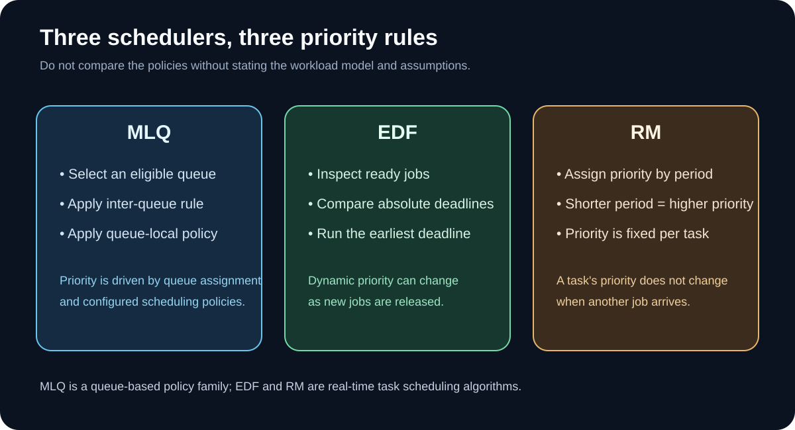
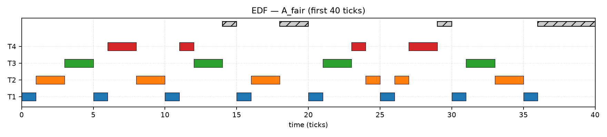
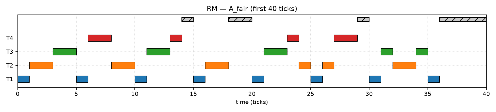
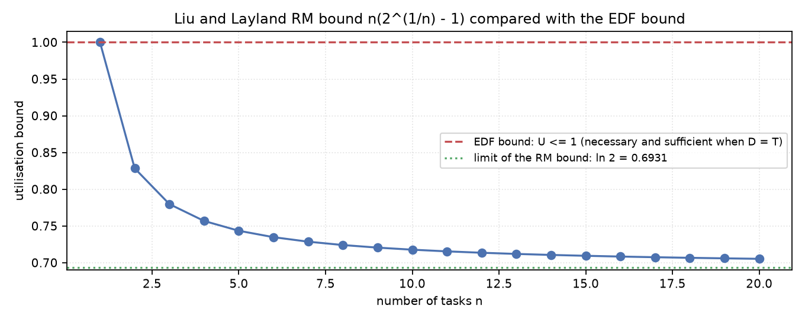
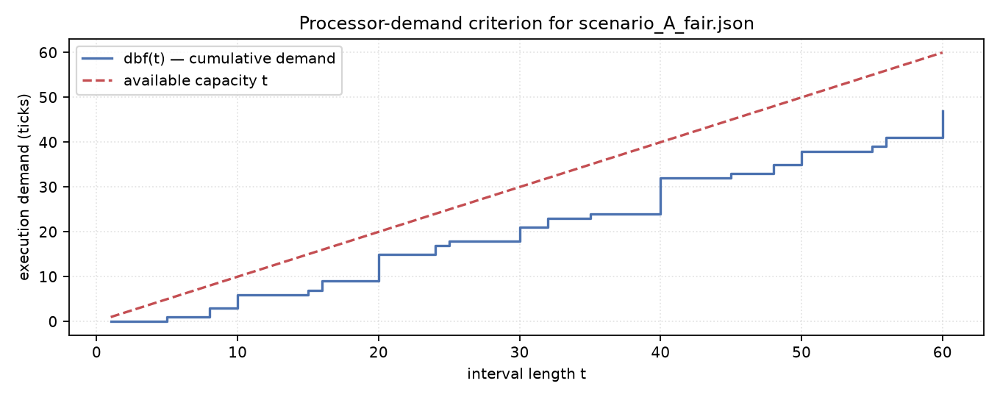
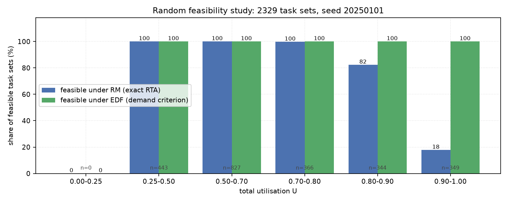

# تمرین ۲ — مقایسه کامل MLQ با EDF و RM



> برای دیدن تفاوت قواعد اولویت و روش تحلیل، [راهنمای تصویری docs](docs/README.md) را ببینید.

**Branch:** `Exercise-2-MLQ-EDF-RM-Comparison`
**Exercise 2 — A complete comparison of Multilevel Queue scheduling with EDF and RM**

این شاخه فقط شامل فایل‌های تمرین دوم است: گزارش مقایسه‌ای فارسی و انگلیسی،
چارچوب شبیه‌سازی مشترک، آزمون‌های تحلیلی، تست‌های خودکار، سناریوها، نمودارها و
خروجی‌های واقعی.

**ساختار شاخه:** همه فایل‌های این تمرین در **ریشهٔ شاخه** (و نه در یک پوشهٔ
جداگانه) قرار دارند، بنابراین همین README در صفحهٔ اصلی شاخه نمایش داده می‌شود.

---

## فهرست محتوای این شاخه

| مسیر | توضیح |
|---|---|
| `README.md` | همین فایل |
| `COMPARISON_FA.md` | گزارش مقایسه‌ای فارسی (Markdown) |
| `COMPARISON_EN.md` | گزارش مقایسه‌ای انگلیسی (Markdown) |
| `docs/COMPARISON_FA.docx` / `.pdf` | نسخه Word و PDF فارسی |
| `docs/COMPARISON_EN.docx` / `.pdf` | نسخه Word و PDF انگلیسی |
| `code/rt_sched.py` | چارچوب مشترک شبیه‌سازی و آزمون‌های تحلیلی |
| `code/run_experiments.py` | اجرای سناریوها، مطالعه تصادفی و تولید نمودارها |
| `code/scenarios/*.json` | چهار سناریو |
| `tests/test_rt_sched.py` | ۳۸ تست خودکار |
| `diagrams/` | ۱۲ نمودار گانت و ۸ نمودار تحلیلی |
| `output/` | خروجی متنی و JSON هر اجرا |
| `requirements.txt` | وابستگی‌های پایتون |

### تعداد صفحات گزارش‌ها

| فایل | تعداد صفحه | روش اندازه‌گیری |
|---|---|---|
| `docs/COMPARISON_FA.pdf` | ۳۵ | دقیق — خوانده‌شده از خود فایل PDF |
| `docs/COMPARISON_EN.pdf` | ۳۵ | دقیق — خوانده‌شده از خود فایل PDF |
| `docs/COMPARISON_FA.docx` | برآورد اندازه‌گیری‌شده | بیشترین پُرشدگی صفحه ۷۰٪ |
| `docs/COMPARISON_EN.docx` | برآورد اندازه‌گیری‌شده | بیشترین پُرشدگی صفحه ۶۸٪ |

هر دو قالب از یک مدل محتوای یکسان تولید می‌شوند؛ بنابراین صفحه‌بندی، فهرست
مطالب، جدول‌ها و شکل‌ها در Word و PDF یکسان است. عدد PDF دقیق و عدد DOCX
برآورد اندازه‌گیری‌شده است (اندازه‌گیری دقیق فایل Word نیازمند Microsoft Word یا
LibreOffice است که در این محیط در دسترس نبود).

---

## اجرا

```bash
# from the branch root (this folder IS the branch root)
pip install -r requirements.txt

# بازتولید همه نتایج، نمودارها و خروجی‌ها
python code/run_experiments.py

# اجرای تست‌ها
python -m pytest tests/ -q
```

## مدل وظیفه

هر وظیفه با سه‌تای `(C, T, D)` تعریف می‌شود:

* `C` زمان اجرای بدترین حالت
* `T` دوره تناوب
* `D` مهلت پایان نسبی (پیش‌فرض برابر `T`)

در فایل سناریو، فیلد `queue` سطح صف را برای اجرای MLQ تعیین می‌کند. اگر تعیین
نشود، سطح صف بر پایه دوره تناوب تخصیص می‌یابد (دوره کوتاه‌تر یعنی صف بالاتر).

## آزمون‌های تحلیلی پیاده‌سازی‌شده

| آزمون | الگوریتم | دقت |
|---|---|---|
| شرط کافی لیو و لی‌لند | RM | فقط کافی |
| تحلیل زمان پاسخ (جوزف و پاندیا) | RM / DM | دقیق |
| شرط بهره‌وری `U <= 1` | EDF با مهلت ضمنی | لازم و کافی |
| معیار تقاضای پردازنده (بارواه و همکاران) | EDF با مهلت محدود | دقیق |

این آزمون‌ها مستقل از شبیه‌ساز هستند؛ شبیه‌ساز تنها نشان می‌دهد در یک افق محدود
چه رخ داده است و اثبات قطعی زمان‌بندی‌پذیری از آزمون‌های تحلیلی به دست می‌آید.

---

## سناریوها و نتایج (همگی از اجرای واقعی)

منبع همه اعداد: `output/experiments.json`.

| سناریو | n | U | آزمون دقیق RM | آزمون دقیق EDF |
|---|---:|---:|---|---|
| A — مقایسه منصفانه | 4 | 0.800 | تأیید | تأیید |
| B — فشار بالا | 2 | 0.9714 | رد (R_B = 8 > D_B = 7) | تأیید |
| C — بار غیرمتناوب | 7 | 0.900 | رد | تأیید |
| D — اضافه‌بار | 3 | 1.2333 | رد | رد (U > 1) |

### سناریو A — مقایسه منصفانه (افق ۱۲۰ تیک)

| شاخص | EDF | RM | MLQ |
|---|---:|---:|---:|
| نقض مهلت | 0 | 0 | 0 |
| میانگین زمان پاسخ | 3.000 | 3.105 | 3.105 |
| لغزش | 2.891 | 3.272 | 3.255 |
| تعویض زمینه | 54 | 57 | 54 |
| پیش‌گیری | 9 | 12 | 9 |

### سناریو B — فشار بالا (افق ۱۰۵ تیک)

| شاخص | EDF | RM | MLQ |
|---|---:|---:|---:|
| نقض مهلت | 0 | 3 | 3 |
| میانگین زمان پاسخ | 3.833 | 4.000 | 4.000 |
| لغزش | 1.424 | 2.449 | 2.449 |
| تعویض زمینه | 36 | 48 | 48 |
| پیش‌گیری | 3 | 15 | 15 |

### سناریو C — بار غیرمتناوب (افق ۳۰ تیک)

| شاخص | EDF | RM | MLQ |
|---|---:|---:|---:|
| نقض مهلت | 0 | 3 | 0 |
| میانگین زمان پاسخ | 10.857 | 13.000 | 10.857 |
| تعویض زمینه | 6 | 6 | 7 |

### سناریو D — اضافه‌بار (افق ۱۲۰ تیک)

| شاخص | EDF | RM | MLQ |
|---|---:|---:|---:|
| نقض مهلت | 31 | 10 | 10 |
| بیشینه زمان پاسخ | 30 | 96 | 96 |
| لغزش | 6.975 | 20.612 | 20.612 |

توزیع نقض مهلت‌ها در سناریو D به تفکیک وظیفه:

| وظیفه | اولویت | نقض تحت EDF | نقض تحت RM و MLQ |
|---|---|---|---|
| X | بالا | 13 از 15 | 0 از 15 |
| Y | متوسط | 10 از 12 | 0 از 12 |
| Z | پایین | 8 از 10 | 10 از 10 |

### مطالعه تصادفی زمان‌بندی‌پذیری (۲۳۲۹ مجموعه، دانه ۲۰۲۵۰۱۰۱)

| بازه بهره‌وری | تعداد | زمان‌بندی‌پذیر تحت RM | زمان‌بندی‌پذیر تحت EDF |
|---|---:|---:|---:|
| 0.25 – 0.50 | 443 | 100.0% | 100.0% |
| 0.50 – 0.70 | 827 | 100.0% | 100.0% |
| 0.70 – 0.80 | 366 | 99.7% | 100.0% |
| 0.80 – 0.90 | 344 | 82.3% | 100.0% |
| 0.90 – 1.00 | 349 | 17.8% | 100.0% |

---

## تست‌ها

```
$ python -m pytest tests/ -q
......................................                                   [100%]
38 passed in 0.04s
```

خروجی کامل در `output/pytest_result.txt`. تست‌ها شامل: اعتبارسنجی مدل وظیفه،
قواعد اولویت، مقادیر کران لیو و لی‌لند، تابع کران تقاضا، تطبیق آزمون تحلیلی با
شبیه‌سازی، گرسنگی وظیفه کم‌اولویت در اضافه‌بار، چرخش RR در MLQ و قفل‌کردن اعداد
ثبت‌شده برای همه سناریوها (Regression Lock).

## نمودارها

| فایل | موضوع |
|---|---|
| `diagrams/gantt_A_fair_*.png` | گانت EDF / RM / MLQ در سناریوی منصفانه |
| `diagrams/gantt_B_stress_*.png` | گانت در سناریوی فشار بالا |
| `diagrams/gantt_C_aperiodic_*.png` | گانت در سناریوی غیرمتناوب |
| `diagrams/gantt_D_overload_*.png` | گانت در سناریوی اضافه‌بار |
| `diagrams/chart_misses.png` | نقض مهلت پایان |
| `diagrams/chart_response.png` | میانگین زمان پاسخ |
| `diagrams/chart_jitter.png` | لغزش زمان پاسخ |
| `diagrams/chart_overhead.png` | تعویض زمینه |
| `diagrams/chart_utilization.png` | بهره‌وری |
| `diagrams/chart_rm_bound.png` | کران لیو و لی‌لند در برابر کران EDF |
| `diagrams/chart_dbf.png` | تابع کران تقاضا |
| `diagrams/chart_feasibility_study.png` | مطالعه تصادفی زمان‌بندی‌پذیری |

## محدودیت‌ها

* مدل تک‌پردازنده و پیش‌گیرانه است.
* وظایف مستقل‌اند: انسداد، اشتراک منبع و وارونگی اولویت مدل نشده است.
* هزینه تعویض زمینه صفر فرض شده است.
* سناریوها مصنوعی و کوچک‌اند تا امکان بررسی دستی فراهم باشد.
* شبیه‌سازی یک افق محدود را پوشش می‌دهد؛ تضمین قطعی از آزمون‌های تحلیلی است.

---

## Visual guide / راهنمای تصویری

برای مطالعه شکل‌ها، تعریف فرضیات و مسیر بازتولید نمودارها، [راهنمای تصویری پوشه docs](docs/README.md) را باز کنید.


### Scenario A — three scheduler timelines






### Analytical views







این شکل‌ها باید همراه فرضیات گزارش خوانده شوند: MLQ یک زمان‌بند مبتنی بر صف است؛ EDF و RM در این شاخه در چارچوب وظایف بلادرنگ دوره‌ای تحلیل می‌شوند.