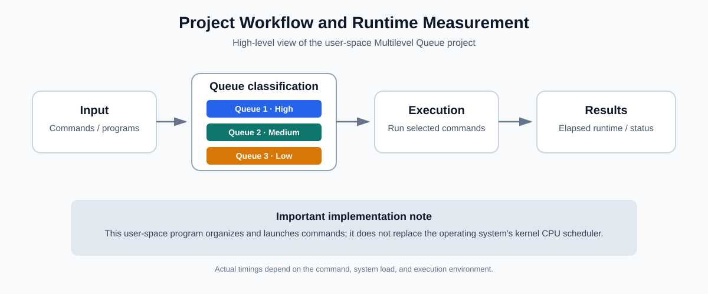
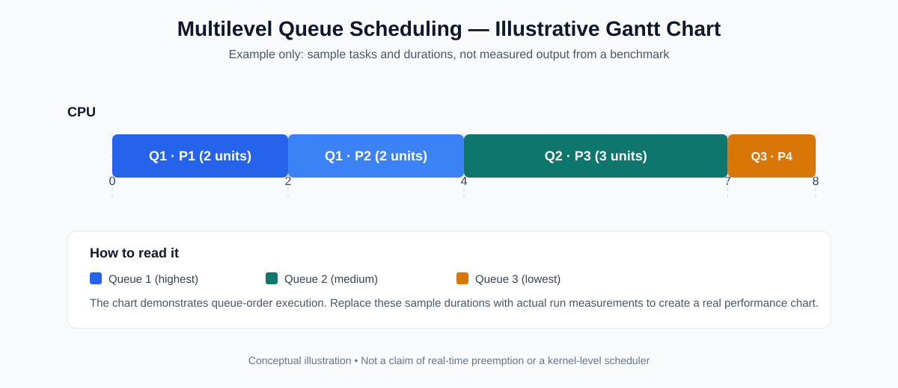

# Multilevel Queue Scheduling

A small educational project demonstrating **Multilevel Queue (MLQ) Scheduling** by organizing programs/commands into three queues and running them according to the project's queue policy. The program also measures elapsed execution time for the commands it runs.

> **Scope note:** This is a user-space demonstration, not a replacement for the operating system's kernel scheduler. The Gantt chart below is an illustrative example; it is not measured benchmark data from a particular run.

## Overview

Multilevel Queue Scheduling divides the ready work into separate queues. Each queue represents a category or priority level. In this project, the queues are numbered from 1 to 3:

- **Queue 1:** highest-priority queue
- **Queue 2:** medium-priority queue
- **Queue 3:** lowest-priority queue

The program accepts commands/programs, associates them with a queue, executes them according to its queue-order policy, and reports elapsed runtime/status. The exact runtime depends on the commands and the machine on which the project is run.

## Workflow

1. Provide the commands/programs and their queue assignments.
2. The project groups the work into three queues.
3. Commands are launched according to the implemented queue policy.
4. The program measures elapsed time and reports execution results.

## Gantt Chart

The following chart illustrates queue-order execution with **made-up example tasks and durations**. Replace the example values with actual output from your own run before presenting them as experimental results.

Example timeline:

| Task | Queue | Example start | Example finish | Example duration |
|---|---:|---:|---:|---:|
| P1 | 1 | 0 | 2 | 2 |
| P2 | 1 | 2 | 4 | 2 |
| P3 | 2 | 4 | 7 | 3 |
| P4 | 3 | 7 | 8 | 1 |

These numbers are only for explaining how to read a Gantt chart. They are not benchmark results from the repository.

## Comparison with EDF and RM

**EDF (Earliest Deadline First)** and **RM (Rate Monotonic)** are real-time scheduling algorithms designed around task deadlines and periodicity. MLQ organizes work into predefined priority queues. They solve related but different scheduling problems, so a fair quantitative comparison requires the same workload and relevant task parameters.

| Property | This MLQ project | EDF | RM |
|---|---|---|---|
| Main decision rule | Queue assignment and queue policy | Run the ready task with the earliest absolute deadline | Fixed priority based on period; shorter period gets higher priority |
| Priority | Based on queue/category | Dynamic; can change as deadlines approach | Fixed for a task set |
| Needs deadlines? | Not inherently | Yes | Usually uses task periods; deadlines are often assumed equal to periods in the classical model |
| Best fit | Demonstrating queue-based organization of commands | Dynamic-priority real-time workloads | Periodic real-time workloads with fixed priorities |
| Main limitation | Lower queues may wait longer depending on the inter-queue policy; not a kernel scheduler | Scheduling overhead and deadline misses when workload is infeasible | Can miss deadlines for some task sets that EDF could schedule |
| Meaningful evaluation | Queue order, elapsed runtime, and fairness under a defined workload | Deadline-miss rate, response times, utilization | Deadline-miss rate, response times, utilization |

### Summary

- **MLQ** is useful when tasks should be separated into fixed categories or priority classes.
- **EDF** is suitable when tasks have deadlines and the scheduler should favor the earliest deadline.
- **RM** is suitable for periodic tasks with fixed priorities derived from task periods.
- No algorithm is universally best. To compare performance numerically, run the same workload under each algorithm and record metrics such as completion time, waiting time, response time, CPU utilization, and missed deadlines where applicable.

## Limitations

- A user-space command runner cannot fully control the kernel's CPU scheduling decisions.
- Elapsed runtime is affected by system load, I/O, and other processes; it is not the same as CPU time.
- A meaningful Gantt chart and performance comparison should be generated from recorded execution traces rather than illustrative numbers.
- EDF and RM comparisons require deadline/period information that a basic MLQ command runner may not collect.

## Suggested experiment

1. Choose a repeatable set of commands and record each command's queue, start time, finish time, and exit status.
2. Generate a Gantt chart from those measurements.
3. If comparing with EDF or RM, define a real-time task set with execution times, periods, and deadlines.
4. Run all algorithms against the same task set and compare the same metrics.

## Repository

[Multilevel-Queue-Scheduling on GitHub](https://github.com/kaspian021/Multilevel-Queue-Scheduling)
