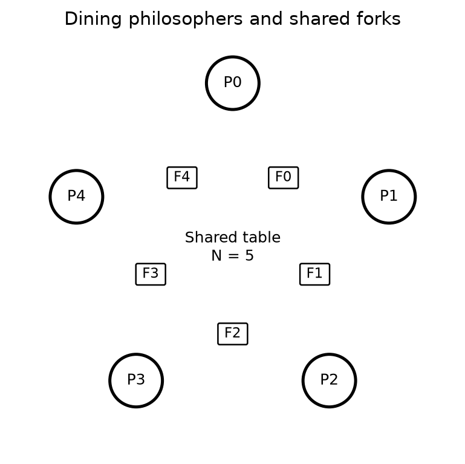
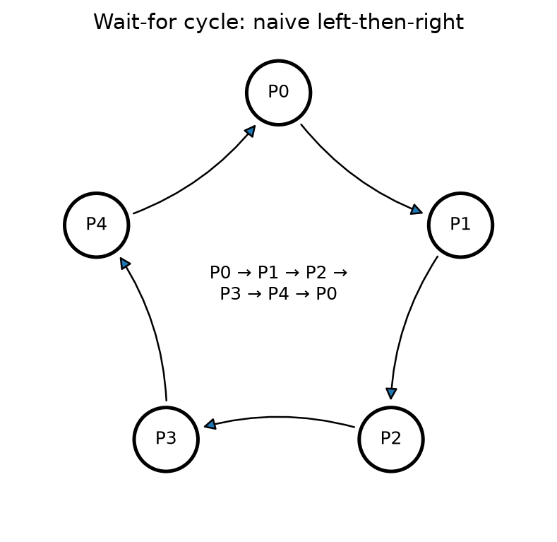
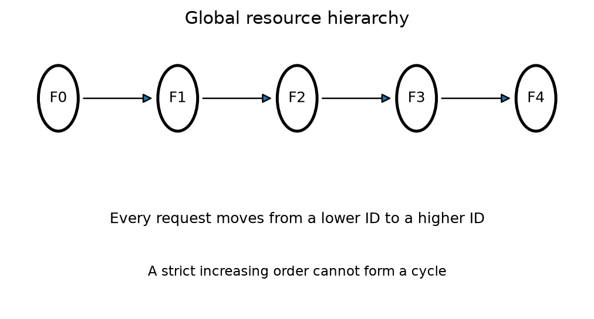
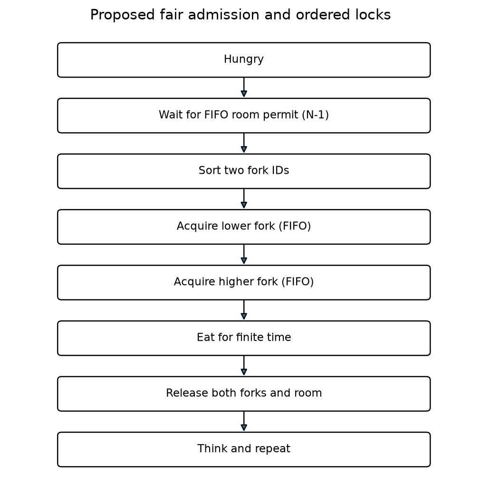
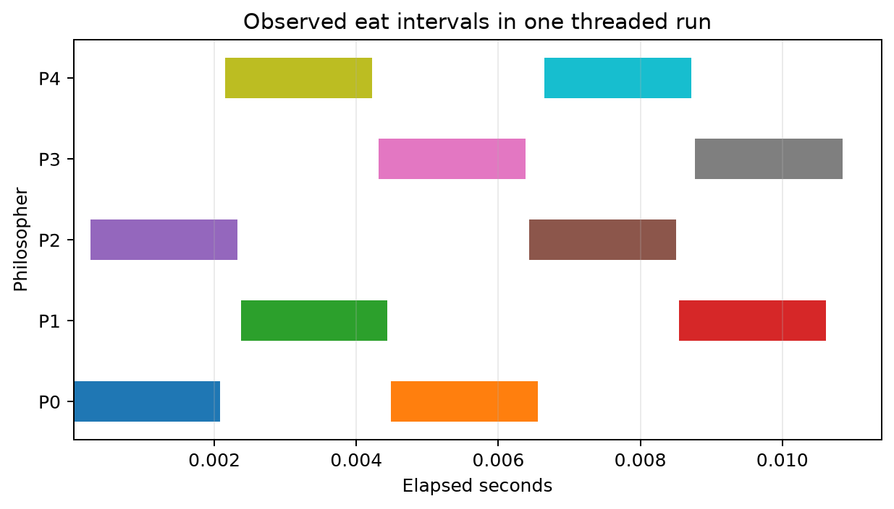

# تمرین ۸ - کاربرد منطق MLQ در مسئله فیلسوفان غذاخور

> گزارش ۳۸ صفحه‌ای فارسی | شاخه `Exercise-8-Dining-Philosophers-Deadlock-Starvation`

**نتیجه اصلی:** منطق صف‌بندی قابل اقتباس است، اما الگوریتم فعلی مخزن به تنهایی بن‌بست و گرسنگی را حل نمی‌کند. راهکار توسعه‌یافته در این گزارش از FIFO، ترتیب سراسری چنگال‌ها و محدودیت ورود N−1 استفاده می‌کند.

## صفحه 1: صفحه عنوان

تمرین ۸ - کاربرد منطق زمان‌بندی صف چندسطحی در مسئله فیلسوفان غذاخور

بررسی جلوگیری از بن‌بست و گرسنگی با تحلیل، نمودار، شبه‌کد، پیاده‌سازی Python، مدل‌بررسی و آزمون چندنخی

مخزن مبنا: kaspian021/Multilevel-Queue-Scheduling

شاخه: Exercise-8-Dining-Philosophers-Deadlock-Starvation

نسخه گزارش: ۱.۰ | تعداد صفحات هدف: ۳۸ صفحه

نام دانشجو: ........................................    شماره دانشجویی: ........................................

درس: سیستم‌عامل / زمان‌بندی و همگام‌سازی فرآیندها

> نکته: این گزارش میان رفتار واقعی برنامه موجود و نسخه توسعه‌یافته پیشنهادی تفاوت می‌گذارد. نتیجه‌ها با کد همراه قابل بازتولید هستند.

---

## صفحه 2: چکیده و واژگان کلیدی

در این تمرین بررسی می‌شود که آیا منطق به‌کاررفته در پروژه زمان‌بندی صف چندسطحی (Multilevel Queue Scheduling یا MLQ) می‌تواند برای مسئله کلاسیک فیلسوفان غذاخور به کار رود یا نه. در نسخه فعلی مخزن، کارها به سه صف با اولویت ثابت تقسیم می‌شوند و سپس فهرست نهایی از اتصال صف اول، دوم و سوم ساخته شده و فرمان‌ها به‌صورت ترتیبی اجرا می‌شوند. این برنامه یک زمان‌بند هسته سیستم‌عامل یا مدیر منابع هم‌روند نیست و در کد اصلی آن سازوکار قفل چنگال‌ها وجود ندارد.

نتیجه اصلی دو بخش دارد. نخست، الگوریتم فعلی MLQ به‌تنهایی راه‌حل بن‌بست یا گرسنگی نیست؛ تقدم ثابت صف‌ها می‌تواند باعث انتظار نامحدود صف کم‌اولویت شود و اجرای ترتیبی نیز مسئله رقابت هم‌زمان بر سر دو چنگال را مدل نمی‌کند. دوم، ایده سازمان‌دهی و صف‌بندی درخواست‌ها قابل استفاده مجدد است، به شرط آن‌که با قواعد تخصیص منابع ترکیب شود.

راهکار پیشنهادی، پذیرش حداکثر N−1 فیلسوف در بخش رقابت، اخذ چنگال‌ها با ترتیب سراسری شماره، و استفاده از سمافورهای FIFO منصفانه برای اتاق و هر چنگال است. ترتیب منابع مانع چرخه انتظار می‌شود؛ FIFO و فرض زمان محدود غذاخوردن، گرسنگی را در سطح پروتکل محدود می‌کند. مدل‌بررسی پنج‌فیلسوفه، برای روش ساده یک وضعیت بن‌بست و برای روش پیشنهادی صفر وضعیت بن‌بست گزارش کرده است. شبیه‌سازی نخ‌محور نیز تکمیل وعده همه فیلسوفان را مشاهده کرده است.

- واژگان کلیدی: MLQ، فیلسوفان غذاخور، بن‌بست، گرسنگی، ترتیب منابع، سمافور FIFO، بخش بحرانی، عدالت زمان‌بندی.

> نکته: صفر بن‌بست در مدل محدود و موفقیت اجرای نمونه، جایگزین اثبات ریاضی برای همه ورودی‌ها و همه زمان‌بندهای اجرایی نیست.

---

## صفحه 3: راهنمای فصل‌ها و نقشه مطالعه

گزارش از شناخت مخزن آغاز می‌کند، سپس مسئله فیلسوفان غذاخور و تفاوت بن‌بست و گرسنگی را تعریف می‌کند. بعد، رفتار الگوریتم موجود MLQ با نیازهای مسئله مقایسه می‌شود و یک سازوکار توسعه‌یافته پیشنهاد می‌گردد. بخش‌های پایانی شبه‌کد، کد مرجع، مدل‌بررسی، آزمون‌ها، trace آزمایش و محدودیت‌ها را ارائه می‌کنند.

ساختار ۳۸ صفحه‌ای: صفحات ۴ تا ۷ تحلیل پروژه موجود؛ صفحات ۸ تا ۱۴ صورت مسئله و شکست روش ساده؛ صفحات ۱۵ تا ۲۳ طراحی و شبه‌کد راهکار؛ صفحات ۲۴ تا ۲۷ پیاده‌سازی و مدل‌بررسی؛ صفحات ۲۸ تا ۳۲ نتایج و آزمون؛ صفحات ۳۳ تا ۳۶ تحلیل هزینه، محدودیت و ارتباط با MLQ؛ صفحه ۳۷ پاسخ نهایی؛ صفحه ۳۸ منابع و راهنمای اجرا.

برای ارائه شفاهی، ابتدا پاسخ کوتاه صفحه ۴، سپس نمودار چرخه انتظار صفحه ۱۲، فلوچارت صفحه ۲۱، جدول نتایج صفحه ۲۸ و جمع‌بندی صفحه ۳۷ را نشان دهید. برای بررسی فنی، فایل‌های code/dining_philosophers.py، code/model_check.py و tests/test_exercise8.py مرجع اجرایی گزارش هستند.

| بخش | صفحات | سؤال محوری |
| --- | --- | --- |
| شناخت الگوریتم MLQ | ۴–۷ | برنامه فعلی دقیقاً چه می‌کند؟ |
| تحلیل مسئله | ۸–۱۴ | بن‌بست و گرسنگی چگونه شکل می‌گیرند؟ |
| طراحی و شبه‌کد | ۱۵–۲۳ | چه قواعدی لازم است؟ |
| کد و راستی‌آزمایی | ۲۴–۳۲ | شواهد اجرایی و مدل چیست؟ |
| نتیجه و منابع | ۳۳–۳۸ | هزینه، محدودیت و پاسخ نهایی چیست؟ |

---

## صفحه 4: پاسخ مستقیم به سؤال تمرین

پرسش استاد این است: «منطقی که در الگوریتم شما به‌کار گرفته شده آیا ممکن است برای جلوگیری از بن‌بست و گرسنگی فیلسوفان کاربرد داشته باشد؟» پاسخ دقیق این است: منطق طبقه‌بندی و نظم‌دهی صف‌ها قابل اقتباس است، اما الگوریتم موجود با همان قواعد فعلی برای این هدف کافی نیست.

دلیل اول، تفاوت ماهیت مسئله است. برنامه فعلی فرمان‌ها را به ترتیب صف اولویت مرتب و یکی‌یکی اجرا می‌کند؛ در مسئله فیلسوفان، چند نخ هم‌زمان برای دو منبع مشترک (چنگال چپ و راست) رقابت می‌کنند. بدون قفل، مانیتور یا مدیر تخصیص منابع، نمی‌توان مالکیت چنگال و انتظار بر سر آن را کنترل کرد.

دلیل دوم، اولویت ثابت MLQ است. اگر صف با اولویت بالاتر دائماً کار جدید دریافت کند، کارهای صف پایین‌تر ممکن است بارها عقب بیفتند. این وضعیت همان خطر گرسنگی است. برای رفع آن باید FIFO، نوبت‌دهی چرخشی یا aging/bounded-bypass اضافه شود. برای رفع بن‌بست نیز باید چرخه انتظار حذف شود؛ در این گزارش این کار با ترتیب سراسری اخذ منابع انجام می‌شود.

- بن‌بست: با ترتیب کلی شماره چنگال‌ها، چرخه انتظار شکل نمی‌گیرد.
- گرسنگی: با سمافور FIFO، زمان محدود نگهداری منابع و عدالت زمان‌بند، درخواست قدیمی‌تر بی‌نهایت دور زده نمی‌شود.
- نتیجه: MLQ ایده صف‌بندی را می‌دهد؛ ترتیب منابع و FIFO قواعد ضروری تکمیلی‌اند.

> نکته: این تمایز باید در دفاع شفاهی حفظ شود: «قابل توسعه است» با «همین الگوریتم فعلی تضمین می‌کند» یکسان نیست.

---

## صفحه 5: الگوریتم موجود در مخزن: شواهد کد

در فایل ریشه Multilevel_Queue_Scheduling.py سه فهرست queue1، queue2 و queue3 ساخته می‌شود. هر ورودی شامل نام کار و رشته فرمان است. کاربر برای هر فرمان عدد صف ۱ تا ۳ را وارد می‌کند. سپس برنامه با عبارت jobs = queue1 + queue2 + queue3 یک فهرست واحد می‌سازد.

در حلقه پایانی، هر job به‌ترتیب خوانده می‌شود و subprocess.run اجرا می‌گردد. زمان ابتدا و انتهای فرمان با time.perf_counter ثبت می‌شود و زمان سپری‌شده چاپ می‌شود. چون subprocess.run بدون حالت غیرهمگام فراخوانی شده، برنامه تا پایان هر فرمان منتظر می‌ماند و بعد سراغ فرمان بعدی می‌رود.

این رفتار برای نمایش اولویت ثابت سه صف و اندازه‌گیری زمان سپری‌شده فرمان‌ها مناسب است؛ اما وضعیت‌های «چنگال آزاد/گرفته»، «فیلسوف گرسنه»، «درخواست قفل» یا «انتظار برای همسایه» را ندارد. بنابراین نسبت دادن یک تضمین همگام‌سازی به کد فعلی، فراتر از شواهد است.

```text
queue1 = []
queue2 = []
queue3 = []

# ... دریافت فرمان‌ها و قرار دادن در صف مناسب ...
jobs = queue1 + queue2 + queue3

for job in jobs:
    start = time.perf_counter()
    subprocess.run(job["command"], shell=True)
    elapsed = time.perf_counter() - start
    print("Runtime:", round(elapsed, 2), "second")
```

*گزیده‌ای از منطق اصلی مخزن؛ کد کامل در Multilevel_Queue_Scheduling.py قرار دارد.*

---

## صفحه 6: معنای سیاست MLQ در این پروژه

در مدل MLQ، کارها بر اساس دسته یا اولویت در صف‌های مجزا نگهداری می‌شوند. در این پروژه، صف ۱ بالاترین اولویت، صف ۲ اولویت متوسط و صف ۳ پایین‌ترین اولویت را دارد. ترتیب خروجی، ابتدا همه کارهای صف ۱، سپس صف ۲ و در پایان صف ۳ است. این سیاست، در نسخه موجود، round-robin بین صف‌ها یا تقسیم برش زمانی نیست.

اگر پیش از شروع اجرا همه ورودی‌ها معلوم باشند، برنامه فهرست را یک بار می‌سازد و پس از آن همان ترتیب را اجرا می‌کند. اگر مفهوم ورود پیوسته کارها را به آن اضافه کنیم، اولویت ثابت می‌تواند به صف‌های پایین‌تر فرصت کمتر بدهد. حتی بدون ورود پیوسته، صف‌بندی فعلی به خودی خود fairness بین فیلسوفان ایجاد نمی‌کند؛ چون فیلسوفان اصلاً مدل نشده‌اند.

پس دو مفهوم باید جدا بمانند: «اولویت انتخاب کار» و «ایمنی تخصیص منبع». اولی مشخص می‌کند کدام درخواست زودتر بررسی شود؛ دومی تضمین می‌کند یک چنگال هم‌زمان به دو نفر داده نشود و مسیر انتظار به چرخه تبدیل نگردد. زمان‌بند صفی می‌تواند ورودی مدیر منابع را مرتب کند، اما جایگزین مدیر منابع نیست.

| ویژگی | کد موجود | نیاز مسئله فیلسوفان |
| --- | --- | --- |
| صف‌بندی | سه صف ثابت | درخواست‌های هم‌روند |
| اجرا | ترتیبی و blocking | چند نخ/فرآیند |
| منبع مشترک | تعریف نشده | ۵ چنگال انحصاری |
| عدالت | تقدم صف ۱ سپس ۲ سپس ۳ | انتظار کراندار/FIFO |
| بن‌بست | در کد مدل نشده | حذف چرخه انتظار |

---

## صفحه 7: مرز دامنه و فرض‌های تحلیل مخزن

README مخزن تصریح می‌کند پروژه یک نمایش آموزشی در فضای کاربر است و جایگزین زمان‌بند هسته سیستم‌عامل نیست. نمودار گانت موجود نمونه توضیحی است و داده benchmark واقعی محسوب نمی‌شود. این نکته برای تمرین ۸ مهم است: از نام «زمان‌بند» نباید نتیجه گرفت که برنامه فعلی می‌تواند ورود نخ‌ها به بخش بحرانی را کنترل کند.

این گزارش، منطق واقعی موجود را به عنوان نقطه شروع می‌گیرد و یک لایه همگام‌سازی جدید را جداگانه اضافه می‌کند. الگوریتم پیشنهادی نه ادعا می‌کند که فایل اصلی بدون تغییر این تضمین‌ها را دارد و نه ادعا می‌کند که با افزودن چند فهرست صف، مسئله حل می‌شود. تمام تضمین‌ها به قواعد مشخص تخصیص منابع و فرض‌های اجرایی متصل هستند.

فرض‌های مدل: تعداد فیلسوفان N حداقل ۳ است؛ هر فیلسوف فقط دو چنگال مجاور خود را لازم دارد؛ هر چنگال در هر لحظه حداکثر یک مالک دارد؛ مرحله غذاخوردن در زمان محدود پایان می‌یابد؛ درخواست‌های صف‌دار لغو نمی‌شوند، مگر این‌که از صف خارج شوند؛ و نخ‌های آماده در نهایت فرصت اجرا می‌گیرند (weak fairness). اگر یکی از این فرض‌ها برقرار نباشد، استدلال عدالت باید بازبینی شود.

> نکته: نتیجه مدل در این گزارش دقیقاً به پروتکل و فرض‌های بالا محدود است؛ یک برنامه واقعی ممکن است به دلیل crash، توقف نخ، خطای I/O یا لغو درخواست، منابع را آزاد نکند.

---

## صفحه 8: صورت مسئله فیلسوفان غذاخور

N فیلسوف دور یک میز نشسته‌اند. بین هر دو فیلسوف مجاور یک چنگال قرار دارد؛ بنابراین N فیلسوف و N چنگال وجود دارد. فیلسوف i برای خوردن غذا به دو چنگال با شماره‌های i و (i+1) mod N نیاز دارد. زندگی هر فیلسوف بین سه حالت فکر کردن، گرسنه بودن و غذا خوردن جابه‌جا می‌شود.

در حالت ساده، هر فیلسوف ابتدا چنگال سمت چپ را می‌گیرد و سپس برای چنگال سمت راست منتظر می‌ماند. اگر همه فیلسوفان تقریباً هم‌زمان چنگال اول خود را بگیرند، هرکدام چنگالی را در اختیار دارد و منتظر چنگال دوم است؛ اما چنگال دوم در دست همسایه قرار دارد. هیچ‌کس به مرحله غذاخوردن نمی‌رسد و هیچ‌کس چنگال خود را آزاد نمی‌کند.

این مثال فشرده‌ای از مسئله عمومی تخصیص منابع در سیستم‌های هم‌روند است: منابع محدودند، مالکیت انحصاری است، فرآیندها ممکن است هنگام نگه‌داشتن یک منبع منتظر منبع دیگر بمانند و ترتیب تخصیص می‌تواند مسیر انتظار را خطرناک کند.



---

## صفحه 9: مدل سیستم و نمادگذاری رسمی

فیلسوف‌ها را با مجموعه P={P0, P1, ..., P(N−1)} و چنگال‌ها را با F={F0, F1, ..., F(N−1)} نمایش می‌دهیم. فیلسوف Pi به جفت منابع Ri={Fi, F(i+1) mod N} نیاز دارد. حالت هر فیلسوف یکی از THINKING، HUNGRY، WAITING، EATING یا DONE است.

قید انحصار: برای هر چنگال Fj در هر لحظه حداکثر یک فیلسوف مالک آن است. قید غذاخوردن: Pi فقط وقتی وارد EATING می‌شود که هر دو چنگال عضو Ri در مالکیت او باشند. قید آزادسازی: پس از پایان غذا، هر دو چنگال آزاد و مجوز ورود به اتاق بازگردانده می‌شود.

در نسخه پیشنهادی، شناسه چنگال‌ها ترتیب کلی دارند. برای Pi، ابتدا min(i, (i+1) mod N) و سپس max آن درخواست می‌شود. ظرفیت اتاق حداکثر N−1 نفر است. هر سمافورِ چنگال و سمافور اتاق، صف انتظار FIFO دارد. هر بار اجرای مدل یک وعده برای هر فیلسوف را بررسی می‌کند؛ شبیه‌سازی نخ‌محور چند وعده را اجرا می‌کند.

| نماد | معنا | محدودیت |
| --- | --- | --- |
| N | تعداد فیلسوفان | N ≥ 3 |
| Fi | چنگال با شناسه i | مالکیت انحصاری |
| Ri | دو چنگال موردنیاز Pi | دو چنگال مجاور |
| Room | مجوز ورود | ظرفیت N−1 |
| FIFO | ترتیب انتظار | عدم سبقت درخواست جدید از قدیمی‌تر |

---

## صفحه 10: بن‌بست: تعریف و چهار شرط لازم

بن‌بست وضعیتی است که در آن مجموعه‌ای از فرآیندها به دلیل انتظار متقابل برای منابعی که در اختیار یکدیگر است، هیچ‌کدام نمی‌توانند پیشرفت کنند. در تحلیل کلاسیک، چهار شرط لازم برای وقوع بن‌بست مطرح می‌شود: انحصار متقابل، نگه‌داشتن و انتظار، عدم پیش‌دستی و انتظار دوری.

در مسئله فیلسوفان، هر چنگال فقط در اختیار یک فیلسوف است (انحصار متقابل). فیلسوف پس از گرفتن چنگال اول، آن را هنگام انتظار برای دوم نگه می‌دارد (نگه‌داشتن و انتظار). چنگال از دست فیلسوف گرفته نمی‌شود (عدم پیش‌دستی). حلقه همسایگی می‌تواند یک چرخه انتظار بسازد (انتظار دوری). حذف دست‌کم یکی از این شروط، مسیر بن‌بست کلاسیک را می‌شکند.

راهکار این گزارش، شرط انتظار دوری را با ترتیب سراسری منابع حذف می‌کند. اگر هر نخ فقط منابع را به ترتیب شماره صعودی بگیرد، هر یال انتظار از منبع با شماره کمتر به منبع با شماره بیشتر می‌رود. چرخه‌ای که باید به نقطه آغاز برگردد، نیازمند افزایش سخت‌گیرانه شماره‌ها تا بی‌نهایت و بازگشت به مقدار اولیه است که ناممکن است.

- نکته: وجود چرخه در گراف تخصیص منابع در حالت چند نمونه از یک نوع منبع به‌تنهایی همیشه برای اثبات بن‌بست کافی نیست؛ در مدل چنگال‌ها هر چنگال یک منبع یکتا و انحصاری است.
- نکته دوم: جلوگیری از بن‌بست به‌تنهایی تضمین نمی‌کند که هر فیلسوف سرانجام غذا بخورد؛ گرسنگی خاصیت پیشرفت و عدالت است.

---

## صفحه 11: ردیابی مرحله‌ای روش ساده و تشکیل بن‌بست

برای پنج فیلسوف، پروتکل «اول چپ، سپس راست» را در نظر بگیرید. در یک ترتیب ممکن از رخدادها، ابتدا P0 چنگال F0 را می‌گیرد؛ سپس P1 چنگال F1، P2 چنگال F2، P3 چنگال F3 و P4 چنگال F4 را می‌گیرد. در این لحظه هیچ چنگالی آزاد نیست.

اکنون P0 برای F1 منتظر است که در دست P1 است؛ P1 برای F2 منتظر است که در دست P2 است؛ و به همین ترتیب P4 برای F0 منتظر است که در دست P0 است. زنجیره انتظار پس از پنج گام به P0 بازمی‌گردد. این یک چرخه کامل است و هیچ فیلسوفی قادر به آزادسازی چنگال خود نیست، زیرا هنوز غذا نخورده است.

مدل‌بررسی کد همراه، وضعیت هر فیلسوف را با ۰ (هنوز چنگال نگرفته)، ۱ (چنگال چپ را گرفته و منتظر راست است) و ۲ (هر دو را گرفته) نمایش می‌دهد. وضعیت (1,1,1,1,1) همان بن‌بست است: همه یک چنگال گرفته‌اند و هیچ انتقالی فعال نیست.

| گام | رویداد | مالکیت پس از رخداد |
| --- | --- | --- |
| ۱ | P0 ← F0 | F0:P0 |
| ۲ | P1 ← F1 | F0:P0, F1:P1 |
| ۳ | P2 ← F2 | ... F2:P2 |
| ۴ | P3 ← F3 | ... F3:P3 |
| ۵ | P4 ← F4 | F0..F4 اشغال |
| ۶ | همه درخواست چنگال دوم | چرخه انتظار؛ هیچ پیشرفتی ممکن نیست |

---

## صفحه 12: گراف انتظار دوری در حالت بن‌بست

گراف انتظار (Wait-for Graph) با یک گره برای هر فیلسوف رسم می‌شود. اگر Pi منتظر منبعی باشد که Pj در اختیار دارد، یال Pi→Pj ثبت می‌شود. در وضعیت بن‌بست روش ساده، یال‌ها به شکل P0→P1، P1→P2، P2→P3، P3→P4 و P4→P0 هستند.

این گراف یک چرخه جهت‌دار دارد. چون هر منبع چنگال فقط یک نمونه دارد و قابل پیش‌دستی نیست، چرخه به این معناست که هیچ عضو چرخه نمی‌تواند منبع موردنیاز خود را از دیگری دریافت کند. هر کدام باید پیش از دیگری غذا بخورد و چنگال‌ها را آزاد کند، اما این کار بدون چنگال دوم ممکن نیست.

گراف انتظار ابزار تحلیلی خوبی است؛ زیرا نشان می‌دهد مسئله صرفاً کندی یا طولانی بودن صف نیست. در گرسنگی ممکن است گراف چرخه نداشته باشد و سیستم همچنان کار کند، اما یک فیلسوف خاص بارها از نوبت محروم شود. برای همین در کنار گراف بن‌بست، صف انتظار و ترتیب اعطای مجوز نیز باید بررسی شود.



---

## صفحه 13: گرسنگی (Starvation) و تفاوت آن با بن‌بست

گرسنگی زمانی رخ می‌دهد که یک فرآیند یا نخ برای مدت نامحدود به منبع یا فرصت اجرا دست پیدا نکند، در حالی که کل سیستم هنوز پیشرفت می‌کند. برخلاف بن‌بست، لازم نیست همه متوقف شوند؛ ممکن است چهار فیلسوف مرتب غذا بخورند و یک فیلسوف همیشه در صف بماند.

بن‌بست یک شکست پیشرفت گروهی است؛ گرسنگی شکست عدالت نسبت به یک درخواست‌کننده است. امکان دارد الگوریتمی بن‌بست نداشته باشد اما گرسنگی داشته باشد. برای مثال، سمافور یا قفل بدون تضمین FIFO می‌تواند بارها به نخ تازه‌وارد مجوز بدهد و نخ منتظر قدیمی را عقب نگه دارد.

برای ادعای نبود گرسنگی باید سیاست نوبت‌دهی، محدودیت زمان نگهداری منبع و فرض پیشرفت نخ‌ها مشخص باشد. صرف ثبت یک اجرای موفق یا مشاهده این‌که همه در یک آزمایش غذا خوردند، اثبات نامحدود نبود starvation نیست. در این پروژه از FIFO برای محدود کردن سبقت استفاده می‌شود و فرض می‌شود هر وعده در زمان متناهی پایان می‌یابد.

| معیار | بن‌بست | گرسنگی |
| --- | --- | --- |
| وضع سیستم | چند نخ/گروه قفل شده‌اند | سیستم کار می‌کند |
| پیشرفت دیگران | معمولاً متوقف | ممکن است ادامه یابد |
| عامل شاخص | چرخه انتظار | بی‌عدالتی/سبقت نامحدود |
| راهکار این گزارش | ترتیب کلی منابع | FIFO + زمان نگهداری محدود |

---

## صفحه 14: چرا اولویت ثابت MLQ ممکن است گرسنگی بسازد؟

فرض کنید صف ۱ اولویت بالاتر از صف ۲ و صف ۳ دارد و انتخاب همیشه از بالاترین صف غیرخالی انجام می‌شود. اگر ورود کارهای صف ۱ بی‌وقفه ادامه پیدا کند، صف ۲ یا ۳ ممکن است هرگز انتخاب نشود. این رفتار گرسنگی ناشی از اولویت ثابت است؛ حتی اگر هیچ بن‌بستی وجود نداشته باشد.

در کد فعلی، ورودی‌ها ابتدا دریافت می‌شوند و سپس با اتصال سه فهرست اجرا می‌شوند؛ پس یک جریان ورود پیوسته و هم‌زمان در آن پیاده‌سازی نشده است. سناریوی گرسنگی در این صفحه یک تحلیل از تعمیم طبیعی سیاست اولویت ثابت است، نه خروجی اندازه‌گیری‌شده برنامه فعلی. با این حال، این سناریو نشان می‌دهد چرا نمی‌توان اولویت ثابت را به عنوان راهکار fairness برای فیلسوفان به کار برد.

اگر درخواست یک فیلسوف صرفاً در صف کم‌اولویت قرار گیرد و درخواست‌های جدید با اولویت بالاتر از آن جلو بزنند، آن فیلسوف می‌تواند گرسنه بماند. راه حل، حذف صف‌بندی نیست؛ بلکه تغییر سیاست سرویس‌دهی است: FIFO سراسری، اولویت همراه aging، یا محدود کردن تعداد دفعاتی که درخواست جدید می‌تواند از درخواست قدیمی سبقت بگیرد.

| زمان | ورود به صف ۱ | درخواست منتظر صف ۳ | نتیجه |
| --- | --- | --- | --- |
| t0 | A1 | P4 | P4 منتظر |
| t1 | A2 | P4 | A1 اجرا می‌شود |
| t2 | A3 | P4 | A2 جلوتر است |
| t3 | A4 | P4 | درخواست قدیمی هنوز سرویس نگرفته |
| ... | ورود مداوم | P4 | امکان انتظار نامحدود |

> نکته: این جدول counterexample مفهومی برای سیاست اولویت ثابت است، نه trace اجرای اصلی؛ چون برنامه اصلی ورودی‌ها را قبل از اجرای ترتیبی جمع‌آوری می‌کند.

---

## صفحه 15: نیازمندی‌های راهکار مناسب برای فیلسوفان

یک راهکار قابل دفاع باید هم‌زمان چند خاصیت داشته باشد. Safety: هیچ دو فیلسوف مجاور نباید هم‌زمان از یک چنگال استفاده کنند. Progress: اگر منابع آزاد باشند و درخواست معتبر وجود داشته باشد، سیستم باید امکان پیشرفت را فراهم کند. Deadlock freedom: هیچ وضعیت قابل دسترسی نباید مجموعه‌ای از فیلسوفان را در چرخه انتظار متوقف کند.

Starvation freedom: هر فیلسوف گرسنه، با فرض زمان محدود غذاخوردن دیگران و عدالت زمان‌بند نخ‌ها، باید سرانجام به هر دو چنگال دست یابد. Bounded waiting قوی‌تر است و حدی بر تعداد ورود دیگران پیش از نوبت یک درخواست تعیین می‌کند. FIFO برای صف هر منبع یک سیاست روشن برای این محدودیت فراهم می‌سازد.

همچنین پیاده‌سازی باید آزادسازی منابع را در مسیر خطا تضمین کند، ظرفیت سمافور از حد بیشتر نشود، timeout و لغو درخواست صف را خراب نکند و trace کافی برای تست داشته باشد. این الزامات، طراحی را از یک مثال ساده به یک سازوکار قابل ارزیابی تبدیل می‌کند.

- ایمنی مالکیت چنگال‌ها
- حذف چرخه انتظار
- صف انتظار منصفانه FIFO
- پایان متناهی وعده و آزادسازی در finally
- ثبت رخداد برای آزمون و تحلیل

---

## صفحه 16: مقایسه گزینه‌های متداول حل مسئله

راهکارهای مختلفی برای مسئله فیلسوفان وجود دارند. هر کدام بخشی از مسئله را حل می‌کنند و نباید تضمین‌های آن‌ها را با یکدیگر اشتباه گرفت. نامتقارن‌سازی ترتیب چنگال‌ها، محدود کردن تعداد افراد حاضر در اتاق، گرفتن دو منبع به‌صورت اتمی، قفل‌گذاری بر اساس ترتیب کلی و مانیتور مرکزی از گزینه‌های شناخته‌شده‌اند.

برای هدف این تمرین، راهکار مبتنی بر ترتیب کلی منابع انتخاب شده است؛ زیرا استدلال بن‌بست آن ساده و مستقل از زمان‌بندی‌های تصادفی است. محدودیت اتاق N−1 به عنوان کنترل پذیرش و کاهش رقابت افزوده می‌شود. FIFO روی سمافورها نیز برای عدالت است. این سه ویژگی نقش یکسان ندارند و هر کدام باید جداگانه توضیح داده شوند.

| روش | بن‌بست | گرسنگی | ملاحظه |
| --- | --- | --- | --- |
| اول چپ سپس راست | ممکن | ممکن | چرخه انتظار دارد |
| فقط N−1 نفر در اتاق | جلوگیری می‌شود | بدون fairness تضمین نیست | صف ورود باید منصفانه باشد |
| ترتیب کلی چنگال‌ها | جلوگیری می‌شود | بدون fairness تضمین نیست | چرخه انتظار حذف می‌شود |
| گرفتن اتمی هر دو چنگال | جلوگیری می‌شود | به سیاست انتظار وابسته | نیازمند مدیر مرکزی/مانیتور |
| ترتیب کلی + FIFO + N−1 | جلوگیری می‌شود | با فرض‌ها تضمین می‌شود | روش منتخب این گزارش |

---

## صفحه 17: معماری راهکار پیشنهادی

راهکار منتخب از سه لایه تشکیل می‌شود. لایه اول، سمافور اتاق با ظرفیت N−1 است تا حداکثر N−1 فیلسوف وارد مرحله رقابت بر سر چنگال‌ها شوند. لایه دوم، ترتیب سراسری منابع است: هر فیلسوف ابتدا چنگال با شماره کوچک‌تر را می‌گیرد و سپس چنگال بزرگ‌تر را. لایه سوم، صف FIFO در سمافور اتاق و هر چنگال است تا درخواست قدیمی‌تر در همان منبع از درخواست تازه‌وارد سبقت نگیرد.

پس از دریافت هر دو چنگال، فیلسوف غذا می‌خورد و در بلوک finally منابع را به ترتیب معکوس و مجوز اتاق را آزاد می‌کند. ترتیب آزادسازی معکوس با الگوی stack-like و خوانایی مسیر مالکیت هماهنگ است، اگرچه شرط اصلی جلوگیری از چرخه مربوط به ترتیب اخذ منابع است.

نکته مهم: محدودیت N−1 به تنهایی جایگزین ترتیب منابع یا fairness نیست. در این طراحی، ترتیب منابع استدلال مستقیم بن‌بست را می‌دهد؛ N−1 ظرفیت ورود را محدود و رقابت را کاهش می‌دهد؛ FIFO انتظار نامحدود ناشی از سبقت را مهار می‌کند.

- Room semaphore: ظرفیت N−1، FIFO.
- Fork semaphores: ظرفیت ۱ برای هر چنگال، FIFO.
- Resource order: min(fork_i, fork_(i+1)) سپس max(...).
- finally: آزادسازی قطعی منابع در مسیر عادی و خطا.

---

## صفحه 18: چرا ورود حداکثر N−1 فیلسوف؟

سمافور اتاق با ظرفیت N−1 یک مجوز اضافی برای شکستن تقارنِ رقابت همه فیلسوفان ایجاد می‌کند. وقتی حداکثر N−1 فیلسوف در مرحله گرفتن چنگال‌ها هستند، دست‌کم یک صندلی خالی می‌ماند و الگوی «همه پنج نفر یک چنگال گرفته‌اند» در سناریوی پنج‌نفره قابل تشکیل به همان شکل نیست.

این محدودیت، یک قاعده پذیرش است و به خودی خود عدالت را تضمین نمی‌کند. اگر سمافور اتاق بدون FIFO باشد، یک فیلسوف ممکن است بارها از ورود محروم شود. همچنین محدودیت N−1 به تنهایی به معنای عدم گرسنگی نیست؛ تضمین عدالت در نسخه پیشنهادی از صف FIFO استفاده می‌کند.

از دید کارایی، یک مجوز کمتر از N باعث می‌شود همه فیلسوفان هم‌زمان در رقابت نباشند و هزینه contention کاهش یابد. اما محدودیت اتاق ممکن است concurrency را کمتر کند؛ این یک trade-off طراحی است. چون ترتیب کلی منابع هم بن‌بست را حذف می‌کند، room(N−1) در این پیاده‌سازی نقش لایه ایمنی و کنترل ورود دارد، نه تنها پایه اثبات.

| ظرفیت اتاق | اثر | ملاحظه |
| --- | --- | --- |
| N | همه می‌توانند وارد شوند | ترتیب منابع همچنان لازم است |
| N−1 | یک فیلسوف بیرون می‌ماند | رقابت کمتر؛ ورود FIFO لازم |
| ۱ | فقط یک نفر در مرحله چنگال | ایمن اما موازی‌سازی بسیار کم |

---

## صفحه 19: ترتیب سراسری منابع و حذف چرخه انتظار

برای هر چنگال یک شناسه یکتا از صفر تا N−1 در نظر گرفته می‌شود. هر فیلسوف دو شناسه موردنیاز خود را مرتب می‌کند و همیشه ابتدا شناسه کوچک‌تر را قفل می‌کند. بنابراین اگر فیلسوفی منبعی را نگه داشته و منتظر منبع دوم باشد، شناسه منبع دوم بزرگ‌تر از شناسه اول است.

فرض خلاف: چرخه انتظاری وجود دارد. در هر یال چرخه، فرآیند منتظر منبعی با شماره بزرگ‌تر از منبعی است که خود نگه داشته است. دنبال کردن چرخه باید به زنجیره‌ای از نامساوی‌های سخت‌گیرانه f0 < f1 < ... < fk < f0 منجر شود. چنین زنجیره‌ای در ترتیب اعداد صحیح ناممکن است؛ پس چرخه وجود ندارد.

برای فیلسوف آخر، دو چنگال موردنیاز F(N−1) و F0 هستند. او برخلاف عبارت «اول چپ، سپس راست»، ابتدا F0 و سپس F(N−1) را می‌گیرد. همین شکست تقارن مهم است. نمودار بعدی ترتیب کلی و جهت مجاز اخذ منابع را نشان می‌دهد.



---

## صفحه 20: FIFO و منطق جلوگیری از گرسنگی

هر سمافور پیشنهادی یک صف انتظار FIFO نگه می‌دارد. هر درخواست یک token یا ticket یکتا می‌گیرد و به انتهای صف افزوده می‌شود. فقط درخواست ابتدای صف، در صورت آزاد بودن ظرفیت، اجازه ورود دارد. درخواست‌های جدید نمی‌توانند از درخواست قدیمی‌تر جلو بزنند.

اگر هر دارنده منبع در زمان متناهی آن را آزاد کند، تعداد درخواست‌های قرارگرفته پیش از یک ticket مشخص در لحظه ورود محدود است. پس درخواست‌های جدید نمی‌توانند بی‌نهایت بار جلوتر از آن مجوز بگیرند. این استدلال برای سمافور اتاق و هر چنگال اعمال می‌شود؛ زمان‌بند سیستم‌عامل نیز باید نخ‌های بیدارشده را سرانجام اجرا کند.

FIFO لزوماً کمترین latency یا بیشترین throughput را تضمین نمی‌کند. یک درخواست طولانی در ابتدای صف ممکن است باعث head-of-line blocking شود. مزیت آن، ترتیب قابل توضیح و bounded overtaking است. اگر برنامه به بهینه‌سازی concurrency بیشتری نیاز داشته باشد، می‌توان سیاست انتخاب درخواست‌های غیرمتعارض را با aging و حد سبقت طراحی کرد؛ اما اثبات fairness آن دشوارتر خواهد بود.

| بدون FIFO | با FIFO |
| --- | --- |
| ممکن است تازه‌وارد زودتر مجوز بگیرد | ترتیب ورود به همان منبع حفظ می‌شود |
| سیاست عدالت وابسته به پیاده‌سازی است | قانون روشن و قابل آزمون دارد |
| احتمال سبقت تکراری | درخواست قدیمی‌تر از تازه‌وارد سبقت می‌گیرد |

---

## صفحه 21: فلوچارت راهکار پیشنهادی

گردش کار از گرسنه شدن فیلسوف شروع می‌شود. او ابتدا مجوز ورود از سمافور اتاق را دریافت می‌کند. سپس دو شماره چنگال را مرتب می‌کند، چنگال کم‌شماره و بعد چنگال پرشماره را با صف FIFO می‌گیرد. پس از در اختیار داشتن هر دو منبع، غذا می‌خورد. پایان غذا، مسیر آزادسازی منابع و مجوز اتاق را فعال می‌کند.

ترتیب مراحل مهم است: هیچ فیلسوفی چنگال با شماره بالاتر را پیش از چنگال پایین‌تر نمی‌گیرد. اگر اخذ چنگال دوم طول بکشد، فیلسوف چنگال اول را نگه می‌دارد؛ این کار با ترتیب کلی منابع سازگار است و چرخه انتظار تولید نمی‌کند. بلوک finally تضمین می‌کند که حتی اگر در کد غذا خوردن exception رخ دهد، منابعی که گرفته شده‌اند آزاد شوند.

این نمودار، الگوریتم سطح بالا را نمایش می‌دهد. جزئیات ticketing در شبه‌کد صفحات بعد آمده است و پیاده‌سازی اجرایی در code/dining_philosophers.py قابل مشاهده است.



---

## صفحه 22: شبه‌کد سمافور منصفانه FIFO

سمافور منصفانه با یک Condition، شمارنده ظرفیت آزاد و صف waiters پیاده می‌شود. در acquire، درخواست token یکتا می‌سازد و به انتهای صف می‌رود. تا وقتی token سر صف نیست یا ظرفیت آزاد وجود ندارد، نخ منتظر می‌ماند. تنها سر صف می‌تواند ظرفیت را کم و از صف خارج شود.

در release، ابتدا کنترل می‌شود که مقدار ظرفیت از مقدار اولیه بیشتر نشود؛ سپس یک permit آزاد می‌شود و همه نخ‌های منتظر بیدار می‌شوند. همه بیدارشده‌ها شرط را دوباره بررسی می‌کنند؛ فقط عضو head مجاز است. این الگو از شرط while استفاده می‌کند تا بیداری کاذب یا بیدارشدن چند نخ، نقض invariant ایجاد نکند.

```text
FairSemaphore(capacity):
    available = capacity
    waiters = FIFO queue

acquire():
    token = new_unique_ticket()
    waiters.push_back(token)
    while waiters.front != token OR available == 0:
        condition.wait()
    waiters.pop_front()
    available = available - 1
    condition.notify_all()

release():
    assert available < capacity
    available = available + 1
    condition.notify_all()
```

*شبه‌کد مفهومی؛ نسخه Python برای timeout و حذف token لغوشده نیز مسیر خطا دارد.*

---

## صفحه 23: شبه‌کد چرخه زندگی هر فیلسوف

چرخه هر فیلسوف شامل گرفتن مجوز اتاق، محاسبه ترتیب چنگال‌ها، گرفتن هر دو چنگال، خوردن و آزادسازی است. چون دو چنگال مرتب می‌شوند، همه فیلسوفان از یک order کلّی استفاده می‌کنند؛ این موضوع از ایجاد چرخه در wait-for graph جلوگیری می‌کند.

متغیرهای acquired_room، acquired_first و acquired_second نشان می‌دهند کدام منابع واقعاً گرفته شده‌اند. در بخش finally فقط همان منابع آزاد می‌شوند. این الگو از release ناخواسته منبعی که هرگز گرفته نشده و از نشت مجوز در مسیر exception جلوگیری می‌کند.

```text
philosopher(i):
    room.acquire()
    first, second = sort([i, (i + 1) mod N])
    try:
        fork[first].acquire()
        fork[second].acquire()
        eat_for_finite_time()
    finally:
        if second_was_acquired: fork[second].release()
        if first_was_acquired:  fork[first].release()
        room.release()

repeat for each meal
```

> نکته: در کد واقعی، پرچم‌های acquired قبل از ورود به هر مرحله تنظیم می‌شوند و releaseها در finally قرار دارند.

---

## صفحه 24: پیاده‌سازی Python: کلاس FairSemaphore

در پیاده‌سازی Python، Condition هم صف انتظار و هم شمارنده ظرفیت را محافظت می‌کند. هر thread یک token مستقل می‌سازد. شرط while هم head بودن token و هم مثبت بودن available را کنترل می‌کند. پس از دریافت permit، token از head خارج می‌شود و notify_all اجازه می‌دهد عضو بعدی در صورت وجود ظرفیت پیش برود.

اگر timeout تمام شود، token از هر جای صف حذف می‌شود و سایر منتظرها بیدار می‌شوند تا وضعیت جدید را دوباره ارزیابی کنند. اگر exception رخ دهد، handler تلاش می‌کند token را از صف خارج کند و سپس exception را دوباره بالا می‌فرستد. در release، over-release به خطا تبدیل می‌شود؛ این کنترل، ظرفیت سمافور را در محدوده معتبر نگه می‌دارد.

```text
def acquire(self, timeout=None):
    token = object()
    with self._condition:
        self._waiters.append(token)
        while self._waiters[0] is not token or self._available == 0:
            self._condition.wait(timeout)
        self._waiters.popleft()
        self._available -= 1
        self._condition.notify_all()
        return True

def release(self):
    with self._condition:
        if self._available >= self.capacity:
            raise ValueError("over-release")
        self._available += 1
        self._condition.notify_all()
```

*گزیده هسته سمافور؛ فایل منبع شامل deadline، timeout و cleanup صف است.*

---

## صفحه 25: پیاده‌سازی Python: گرفتن و آزادسازی چنگال‌ها

تابع _one_meal برای هر فیلسوف دو شناسه مجاور را می‌سازد و آن‌ها را مرتب می‌کند. مجوز اتاق ابتدا گرفته می‌شود؛ سپس اولین و دومین چنگال. رخدادهای room_enter، first_fork، second_fork، eat_start، eat_end و leave در trace ثبت می‌شوند تا آزمون بتواند مالکیت هم‌زمان و تعداد وعده‌ها را بررسی کند.

هنگام شروع غذا، پیاده‌سازی active_eaters را زیر قفل ثبت رخداد کنترل می‌کند و اشتراک چنگال‌های فیلسوفان در حال غذا را می‌سنجد. اگر دو فیلسوف مجاور هم‌زمان وارد eating شوند، AssertionError بالا می‌آید. این یک invariant اجرایی مفید برای کشف خطا در آزمایش است؛ جایگزین اثبات مستقل مدل نیست.

تابع run برای هر فیلسوف یک thread ایجاد می‌کند، تعداد وعده‌ها را تکرار می‌کند و با deadline به آن‌ها join می‌زند. اگر threadی تا timeout پایان نیابد، TimeoutError تولید می‌شود. پس از join، خطاهای worker به فراخواننده برگردانده می‌شود و تعداد وعده‌های تکمیل‌شده هر فیلسوف بررسی می‌شود.

```text
self.room.acquire()
try:
    self.forks[first].acquire()
    acquired_first = True
    self.forks[second].acquire()
    acquired_second = True
    self._record(i, "eat_start", pair)
    eat()
finally:
    if acquired_second: self.forks[second].release()
    if acquired_first:  self.forks[first].release()
    self.room.release()
```

*ترتیب اصلی اخذ و آزادسازی؛ در نسخه کامل، پرچم مجوز اتاق و ثبت trace نیز مدیریت می‌شود.*

---

## صفحه 26: مدل‌بررسی: روش و فضای حالت

مدل‌بررسی، همه interleavingهای ممکنِ مدل انتزاعی را در یک فضای حالت محدود پیمایش می‌کند. در مدل روش ساده، هر فیلسوف سه مرحله دارد: ۰ هنوز چنگال نگرفته؛ ۱ چنگال چپ را گرفته و منتظر راست است؛ ۲ هر دو چنگال را دارد؛ ۳ وعده را تمام کرده و منابع را آزاد کرده است.

در مدل پیشنهادی، مراحل ۰ تا ۴ عبارت‌اند از بیرون اتاق، ورود به اتاق، گرفتن چنگال اول (کم‌شماره)، گرفتن چنگال دوم (پرشماره) و پایان وعده. انتقال تنها وقتی فعال است که ظرفیت اتاق یا چنگال مناسب در دسترس باشد. BFS از حالت آغازین همه صفر شروع می‌کند و هر حالت جدید را فقط یک بار به صف پیمایش اضافه می‌کند.

اگر حالت غیرنهایی هیچ انتقالی نداشته باشد، به عنوان حالت بن‌بست گزارش می‌شود. این بررسی یک وعده برای هر فیلسوف و N=5 را پوشش می‌دهد. فضای حالت محدود است و زمان‌بندی thread واقعی یا ورود نامحدود درخواست‌ها را مدل نمی‌کند؛ بنابراین نتیجه deadlock freedom از آن قابل گزارش است، اما starvation freedom باید با منطق FIFO جداگانه تحلیل شود.

- حالت: بردار stage برای N فیلسوف.
- گذار: یک عمل مجاز برای یک فیلسوف.
- پیمایش: Breadth-First Search (BFS).
- شاهد: مسیر از حالت آغازین تا وضعیت بدون گذار.

---

## صفحه 27: گزیده کد مدل‌بررسی و حدوده آن

در explore_naive، مدل ابتدا مالکیت چنگال‌ها را از stage فیلسوفان می‌سازد. اگر یک فیلسوف stage=0 باشد و چنگال چپ آزاد باشد، به stage=1 می‌رود. اگر stage=1 باشد و چنگال راست آزاد شود، به stage=2 می‌رود. مرحله ۲ با خوردن غذا به ۳ می‌رسد و منابع آزاد می‌شوند.

در explore_ordered، ورود به اتاق تنها وقتی مجاز است که تعداد افراد حاضر کمتر از N−1 باشد. سپس first و second از زوج چنگال‌ها با sort محاسبه می‌شوند. مرحله دوم فقط بعد از آزاد بودن چنگال با شناسه بزرگ‌تر فعال می‌شود. مرحله ۳ به ۴ می‌رود و هر دو منبع و مجوز اتاق آزاد می‌شوند.

پیمایش، شمار حالت‌ها، گذارها و وضعیت‌های deadlock را ثبت می‌کند. این کد به عمد کوچک و قابل فهم نگه داشته شده تا استاد بتواند transition relation را بررسی کند. برای اثبات کامل الگوریتم‌های نامحدود و starvation، نیاز به مدل‌سازی صف‌های FIFO و fairness scheduler در یک مدل temporal یا ابزار رسمی‌تر است.

```text
while frontier:
    state = frontier.popleft()
    successors = enabled_transitions(state)
    if not successors and state != terminal:
        deadlocks.append(state)
    for nxt in successors:
        if nxt not in seen:
            seen.add(nxt)
            frontier.append(nxt)

return states=len(seen), transitions=count,
       deadlock_states=deadlocks
```

*ساختار BFS در code/model_check.py؛ کد کامل، دو پروتکل را جداگانه بررسی می‌کند.*

---

## صفحه 28: نتایج مدل‌بررسی برای پنج فیلسوف

اجرای python code/model_check.py برای N=5، روش ساده را در ۵۷۳ حالت و ۱۴۷۵ انتقال پیمایش کرد. در این فضا یک حالت بن‌بست یافت شد و اولین شاهد آن (1,1,1,1,1) بود. این بردار نشان می‌دهد هر پنج فیلسوف چنگال اول خود را گرفته‌اند و هیچ‌کدام نمی‌تواند چنگال دوم را بگیرد.

برای پروتکل N−1 + ترتیب منابع، ۲۰۰۶ حالت و ۶۴۲۴ انتقال بررسی شد و هیچ وضعیت بن‌بستی پیدا نشد. بزرگ‌تر بودن تعداد حالت‌ها به معنای بدتر بودن الگوریتم نیست؛ پروتکل پیشنهادی مرحله ورود به اتاق و اخذ چنگال‌ها را تفکیک می‌کند و در نتیجه مدل ریزتر و حالت‌های بیشتری دارد.

نتیجه درست، «در فضای حالت انتزاعی تعریف‌شده، هیچ بن‌بستی برای پروتکل پیشنهادی یافت نشد» است. نباید آن را به این گزاره قوی‌تر تبدیل کرد که «هیچ برنامه همگام‌سازی تحت هر شرایط و هر خطایی هرگز بن‌بست نمی‌کند». فرض‌ها و مدل دقیقاً مشخص شده‌اند.

| مدل | حالت‌ها | گذارها | وضعیت بن‌بست |
| --- | --- | --- | --- |
| اول چپ سپس راست | ۵۷۳ | ۱۴۷۵ | ۱ حالت |
| N−1 + ترتیب سراسری | ۲۰۰۶ | ۶۴۲۴ | صفر حالت |

> نکته: این مقادیر از اجرای محلی code/model_check.py در همین مخزن تولید شده‌اند و در output/model_check.json ذخیره شده‌اند.

---

## صفحه 29: شاهد ملموس بن‌بست در مدل ساده

شاهد مدل‌بررسی یک مسیر شش‌حالته است. حالت آغازین (0,0,0,0,0) است. سپس P0 به ۱ می‌رود، بعد P1، P2، P3 و در پایان P4. هر تغییر به معنی گرفتن چنگال چپ همان فیلسوف است. وقتی همه stageها برابر ۱ شدند، هر فیلسوف برای چنگال راست خود منتظر است.

در وضعیت نهایی شاهد، هیچ انتقالی وجود ندارد: همه چنگال‌های چپ در اختیار فیلسوف مربوطه هستند و چنگال راست هرکدام، چنگال چپ همسایه بعدی است. هیچ فیلسوفی نمی‌تواند مرحله eat را شروع کند؛ بنابراین هیچ release رخ نمی‌دهد. این trace نمونه‌ای از نقض liveness در روش ساده است.

شاهد کوتاه برای گزارش، ارزش بیشتری از یک ادعای کلی دارد: می‌توان آن را به عنوان ورودی بازبینی کد و تست regression نگه داشت. اگر تغییر آینده به هر دلیلی دوباره همین وضعیت را ممکن سازد، تست test_naive_protocol_has_a_deadlock_witness تغییر رفتار مورد انتظار را آشکار می‌کند.

| گام | بردار حالت (P0..P4) | تفسیر |
| --- | --- | --- |
| ۰ | (0,0,0,0,0) | همه آزاد |
| ۱ | (1,0,0,0,0) | P0 چنگال چپ را گرفت |
| ۲ | (1,1,0,0,0) | P1 هم چنگال چپ را گرفت |
| ۳ | (1,1,1,0,0) | P2 هم وارد انتظار شد |
| ۴ | (1,1,1,1,0) | P3 هم وارد انتظار شد |
| ۵ | (1,1,1,1,1) | بن‌بست؛ هیچ گذار فعالی نیست |

---

## صفحه 30: آزمایش چندنخی: روش اجرا و معیارها

برای بررسی اجرایی، پنج thread مستقل ساخته شد که هرکدام دو وعده غذا خوردند. سمافور اتاق ظرفیت چهار داشت؛ پنج سمافور چنگال با ظرفیت یک تعریف شد. مدت غذا خوردن در این trace نمونه دو میلی‌ثانیه و مدت فکر کردن نیم میلی‌ثانیه تعیین شد. این مدت‌ها صرفاً برای ساخت trace قابل مشاهده‌اند و benchmark عملکرد سخت‌افزار نیستند.

معیارهای ثبت‌شده شامل تعداد وعده‌های شروع‌شده و تکمیل‌شده، تعداد رخدادها، شمار وعده هر فیلسوف، زمان سپری‌شده کلی و وضعیت آزاد بودن مجوزها در پایان است. در هر رویداد eat_start، مجموعه چنگال‌های فیلسوفان هم‌زمان در حال غذا بررسی می‌شود؛ اگر دو مجموعه اشتراک داشته باشند، پیاده‌سازی خطا می‌دهد.

یک اجرای نمونه ۶۰ رخداد ثبت کرد، ۱۰ وعده شروع شد و هر ۱۰ وعده پایان یافت. شمار وعده‌های تکمیل‌شده برای P0 تا P4 برابر ۲ بود. ظرفیت سمافور اتاق پس از پایان به چهار و ظرفیت هر چنگال به یک برگشت. این مشاهده نشان می‌دهد منابع در اجرای موردنظر آزاد مانده‌اند؛ اما مدت اجرای یک run کوچک، معیار throughput قابل تعمیم نیست.

| پارامتر | مقدار |
| --- | --- |
| تعداد فیلسوف | ۵ |
| وعده برای هر فیلسوف | ۲ |
| کل وعده تکمیل‌شده | ۱۰ از ۱۰ |
| رخدادهای trace | ۶۰ |
| ظرفیت اتاق | ۴ |
| وعده تکمیل‌شده برای هر نفر | ۲ |

---

## صفحه 31: ردیابی زمانی وعده‌های غذا

نمودار گانت زیر از رخدادهای واقعی یک اجرای چندنخی تولید شده است؛ هر نوار نشان‌دهنده فاصله رخداد eat_start تا eat_end یک وعده است. محور افقی زمان سپری‌شده از ابتدای trace و محور عمودی شناسه فیلسوف است. اجرای نخ‌ها ممکن است بین سیستم‌ها و دفعات اجرا از نظر ترتیب دقیق متفاوت باشد.

نکته‌ای که باید در تفسیر نمودار رعایت شود، نبود هم‌پوشانی وعده‌های فیلسوفان مجاور است. اگر دو فیلسوف غیرمجاور غذا بخورند، ممکن است بازه‌های زمانی آن‌ها هم‌پوشانی داشته باشد؛ این رفتار مطلوب است زیرا چنگال‌های مشترک ندارند. طراحی لازم نیست همه فیلسوفان را کاملاً سری کند.

نمودار، یک trace مشاهده‌شده است نه برنامه زمان‌بندی تضمین‌شده. ضمانت عدم تعارض از قفل‌های انحصاری و invariantهای کد می‌آید؛ fairness از صف FIFO و فرض finite hold؛ و گانت فقط یک نمونه از ترتیب رخدادها را به مخاطب نشان می‌دهد.



---

## صفحه 32: آزمون‌ها و پوشش ویژگی‌ها

مجموعه آزمون tests/test_exercise8.py شامل هشت آزمون است. دو آزمون، وجود شاهد بن‌بست در روش ساده و نبود وضعیت بن‌بست در مدل محدود روش پیشنهادی را بررسی می‌کنند. آزمون سوم FIFO سمافور را با سه thread و ترتیب ورود کنترل می‌کند. آزمون چهارم over-release را رد می‌کند.

سه آزمون پارامتری، اجرای ۳، ۵ و ۷ فیلسوف را با چند وعده بررسی می‌کنند. آن‌ها تکمیل تمام وعده‌ها، برابری شمار وعده‌های هر فیلسوف و بازگشت ظرفیت اتاق و چنگال‌ها به مقدار اولیه را کنترل می‌کنند. آزمون آخر، پیکربندی نامعتبر را رد می‌کند.

خروجی محلی pytest برابر ۸ passed است. تست‌های زمان‌بندی نخ‌محور ممکن است در سیستم‌های بسیار تحت فشار به زمان بیشتری نیاز داشته باشند؛ به همین دلیل timeout در run وجود دارد. قبولی آزمون‌ها به معنی formal verification کامل نیست، بلکه مجموعه‌ای از regression checks برای پیاده‌سازی مرجع است.

| آزمون | ویژگی مورد بررسی | نتیجه |
| --- | --- | --- |
| Naive witness | بن‌بست روش ساده | Pass |
| Ordered model | بدون بن‌بست در فضای محدود | Pass |
| FIFO order | عدم سبقت ticketها | Pass |
| Over-release | حفظ ظرفیت سمافور | Pass |
| N=3,5,7 | تکمیل وعده و عدم تعارض | Pass × 3 |
| Invalid input | اعتبارسنجی تنظیمات | Pass |

---

## صفحه 33: هزینه زمانی، هم‌زمانی و trade-offها

عملیات صف FIFO برای درج و حذف token در پیاده‌سازی deque به‌طور میانگین O(1) است. محاسبه دو چنگال و مرتب‌سازی دو شناسه هزینه O(1) دارد. هر فیلسوف برای یک وعده حداکثر دو acquire روی چنگال و یک acquire روی اتاق انجام می‌دهد. هزینه واقعی بیشتر تابع رقابت روی Condition، تعویض متن و زمان غذا خوردن است.

استفاده از notify_all ممکن است چند نخ را بیدار کند که همگی دوباره شرط را بررسی می‌کنند؛ این کار سربار بیدارسازی دارد. می‌توان از Conditionهای جداگانه یا انتقال مستقیم مجوز به head صف استفاده کرد، اما پیچیدگی correctness بیشتر می‌شود. برای نمونه آموزشی، notify_all شفاف و مناسب است.

سیاست strict FIFO ممکن است باعث head-of-line blocking شود: اگر اولین درخواست هنوز منتظر چنگال باشد، درخواست دیگری که از نظر چنگال‌ها غیرمتعارض است نیز ممکن است در همان صف منبع یا سیاست پذیرش پشت آن بماند. در مقابل، عدالت و استدلال ساده‌تری می‌دهد. بهینه‌سازی throughput باید پس از حفظ invariants و اثبات fairness انجام شود.

| ویژگی | اثر مثبت | هزینه/محدودیت |
| --- | --- | --- |
| FIFO | عدالت و ترتیب مشخص | head-of-line blocking |
| ترتیب منابع | حذف چرخه انتظار | کاهش آزادی انتخاب |
| اتاق N−1 | کاهش رقابت | یک ظرفیت کمتر |
| notify_all | پیاده‌سازی ساده | wake-up اضافی |
| ثبت trace | آزمون‌پذیری | هزینه حافظه و قفل رخداد |

---

## صفحه 34: محدودیت‌ها، فرض‌ها و تهدیدهای اعتبار

اول، تضمین گرسنگی به این فرض وابسته است که هر فیلسوف پس از دریافت هر دو چنگال در زمان متناهی غذا خوردن را تمام کند و منابع را آزاد کند. اگر thread هنگام نگهداری چنگال crash کند یا در یک عملیات مسدودکننده بی‌پایان بماند، دیگران ممکن است منتظر بمانند. در برنامه کاربردی باید cancellation، timeout و cleanup امن طراحی شود.

دوم، fairness سمافور FIFO، عدالت زمان‌بند سیستم‌عامل را به‌تنهایی تضمین نمی‌کند. اگر نخ head هیچ‌وقت CPU نگیرد، قاعده صف به تنهایی کافی نیست. استدلال لiveness متکی به weak fairness است: نخ آماده در نهایت اجرا می‌شود. همچنین threadهای برنامه نباید درخواست‌های قبلی را بدون حذف از صف رها کنند.

سوم، مدل‌بررسی انجام‌شده برای N=5 و یک وعده انتزاعی است. اجرای نخ‌محور، Nهای ۳، ۵ و ۷ را در بار کوچک تست کرده است. این‌ها پوشش مناسبی برای تمرین آموزشی هستند، اما اثبات همه Nها، همه الگوهای زمان‌بندی، همه خطاهای سیستم و کارایی production نیستند.

- مدل و کد آموزشی است، نه پیاده‌سازی kernel.
- بدون finite critical-section assumption، starvation-freedom نتیجه نمی‌شود.
- بدون scheduler fairness، FIFO به تضمین مطلق اجرا تبدیل نمی‌شود.
- اعداد زمان اجرا benchmark عمومی یا قابل مقایسه بین دستگاه‌ها نیستند.

---

## صفحه 35: مقایسه با راهکار مانیتور مرکزی

یک گزینه دیگر استفاده از monitor مرکزی است که وضعیت هر فیلسوف را نگه می‌دارد و ورود به خوردن را تنها وقتی مجاز می‌داند که هر دو همسایه او در حال خوردن نباشند و هر دو چنگال در دسترس باشند. در monitor، تغییر وضعیت و بررسی شرط‌ها در یک ناحیه اتمی انجام می‌شود و condition variableها فیلسوف‌های منتظر را بیدار می‌کنند.

مزیت monitor، امکان مدل‌کردن مستقیم وضعیت فیلسوف و دو همسایه است؛ در نتیجه نیازی نیست هر فیلسوف دو قفل جداگانه را نگه دارد. اما سیاست بیدارسازی مهم است. یک monitor ساده با notify_all و رقابت مجدد، لزوماً bounded waiting نمی‌دهد. برای عدالت باید صف ticket یا اولویت waiting age درون monitor اضافه شود.

روش این گزارش از semaphoreهای FIFO و ترتیب منابع استفاده می‌کند تا mapping آن به مفهوم صف‌بندی پروژه روشن باشد. monitor می‌تواند جایگزین فنی مناسبی باشد، ولی باید همان سه موضوع ایمنی، چرخه انتظار و عدالت را جداگانه اثبات کند.

| موضوع | راهکار منتخب | Monitor مرکزی |
| --- | --- | --- |
| نمایش منابع | قفل جداگانه هر چنگال | وضعیت مرکزی فیلسوفان |
| بن‌بست | ترتیب کلی منابع | اعطای هم‌زمان اجازه خوردن |
| عدالت | FIFO در سمافورها | نیازمند صف منصفانه در monitor |
| پیچیدگی | چند قفل با ترتیب ثابت | شرط‌ها و انتقال وضعیت مرکزی |

---

## صفحه 36: چگونه منطق MLQ به راهکار نهایی نگاشت می‌شود؟

بخش قابل استفاده MLQ، نظم‌دهی درخواست‌ها و مدیریت صف انتظار است. هر درخواست غذا خوردن می‌تواند همچون یک job ثبت شود و با شناسه فیلسوف و چنگال‌های موردنیاز همراه گردد. صف‌بندی کمک می‌کند درخواست‌ها از حالت پراکنده به یک ساختار قابل پردازش تبدیل شوند.

اما سیاست اولویت ثابت صف ۱ سپس ۲ سپس ۳ نباید بدون اصلاح مستقیماً برای اعطای چنگال استفاده شود. اگر درخواست‌های صف برتر دائماً اولویت داشته باشند، یک فیلسوف در سطح پایین ممکن است گرسنه بماند. به همین دلیل، نسخه پیشنهادی ترتیب FIFO را ملاک اعطای منابع قرار می‌دهد؛ دسته‌بندی صف می‌تواند برای گزارش یا نوع درخواست نگه داشته شود، نه برای سبقت نامحدود.

اگر حفظ چند سطح اولویت الزام باشد، گزینه بهتر aging یا bounded-bypass است: هرچه درخواست بیشتر منتظر بماند، اولویت مؤثر آن افزایش یابد و پس از حد مشخصی دیگر قابل دور زدن نباشد. ولی طراحی و اثبات این سیاست نیازمند مدل جداگانه است. برای تمرین حاضر، FIFO ساده‌تر، شفاف‌تر و آزمون‌پذیرتر است.

- از MLQ می‌گیریم: ساختاردهی و صف‌بندی درخواست‌ها.
- تغییر می‌دهیم: اولویت ثابت را با FIFO/عدالت جایگزین می‌کنیم.
- اضافه می‌کنیم: مدیر منابع، ترتیب سراسری چنگال و ظرفیت N−1.
- حفظ می‌کنیم: trace و اندازه‌گیری زمان اجرای هر درخواست.

---

## صفحه 37: جمع‌بندی و پاسخ نهایی به استاد

نتیجه این بررسی آن است که منطق صف‌بندی الگوریتم MLQ می‌تواند به عنوان بخش مدیریت و نظم‌دهی درخواست‌های فیلسوفان به کار رود، اما کد فعلی پروژه به تنهایی راهکار جلوگیری از بن‌بست و گرسنگی نیست. دلیل آن، اجرای ترتیبی فرمان‌ها، نبود مدل منابع مشترک و استفاده از اولویت ثابت صف‌هاست.

برای جلوگیری از بن‌بست، در توسعه پیشنهادی همه فیلسوفان چنگال‌ها را با ترتیب سراسری شماره می‌گیرند؛ در نتیجه چرخه انتظار ممکن نیست. ورود حداکثر N−1 نفر، رقابت را محدود می‌کند. برای جلوگیری از گرسنگی، سمافور اتاق و چنگال‌ها FIFO هستند و با فرض پایان متناهی غذاخوردن و عدالت زمان‌بند، درخواست قدیمی‌تر به‌طور نامحدود دور زده نمی‌شود.

شواهد گزارش شامل شاهد بن‌بست در روش ساده، مدل‌بررسی پنج‌فیلسوفه با ۵۷۳ حالت و یک deadlock برای روش ساده و ۲۰۰۶ حالت بدون deadlock برای روش پیشنهادی، اجرای چندنخی با تکمیل ۱۰ وعده از ۱۰ وعده و هشت آزمون موفق است. این داده‌ها با ذکر دامنه و فرض‌ها ارائه می‌شوند و ادعای فراتر از مدل ندارند.

- پاسخ: بله، منطق صف‌بندی قابل توسعه است؛ خیر، نسخه فعلی به تنهایی کافی نیست.
- بن‌بست با ترتیب کلی منابع حذف می‌شود.
- گرسنگی با FIFO و فرض‌های finite hold و scheduler fairness مهار می‌شود.
- پیشنهاد آینده: مدل‌بررسی عمومی‌تر برای N و سیاست‌های aging/monitor.

---

## صفحه 38: منابع، فایل‌ها و دستور اجرای پروژه

[1] E. W. Dijkstra, “Solution of a problem in concurrent programming control,” Communications of the ACM, vol. 8, no. 9, p. 569, 1965. DOI: 10.1145/365559.365617.

[2] A. Silberschatz, P. B. Galvin, and G. Gagne, Operating System Concepts, 8th ed., Wiley, 2010, Chapter 6, sections on synchronization and Dining Philosophers. متن این کتاب تفاوت راهکار deadlock-free و نیاز جداگانه به starvation-freedom را توضیح می‌دهد.

[3] D. Lehmann and M. O. Rabin, “On the advantages of free choice: A symmetric and fully distributed solution to the dining philosophers problem,” POPL 1981, pp. 133–138. DOI: 10.1145/567532.567547. [4] K. M. Chandy and J. Misra, “The drinking philosophers problem,” ACM TOPLAS, vol. 6, no. 4, pp. 632–646, 1984. DOI: 10.1145/1780.1804.

منابع داخلی: Multilevel_Queue_Scheduling.py و README.md در ریشه مخزن؛ code/dining_philosophers.py؛ code/model_check.py؛ tests/test_exercise8.py؛ output/model_check.json؛ output/simulation_summary.json و output/simulation_events.csv.

```text
# From the exercise-8 directory
python -m pip install pytest matplotlib
python code/model_check.py
python code/dining_philosophers.py --philosophers 5 --meals 3
python code/make_diagrams.py
python -m pytest -q tests
```

> نکته: منابع برخط: https://doi.org/10.1145/365559.365617 | https://doi.org/10.1145/567532.567547 | https://doi.org/10.1145/1780.1804