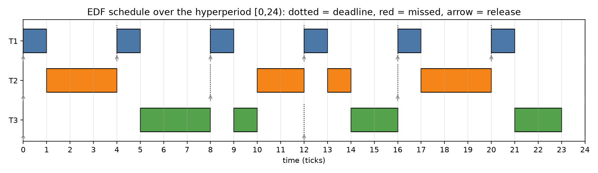
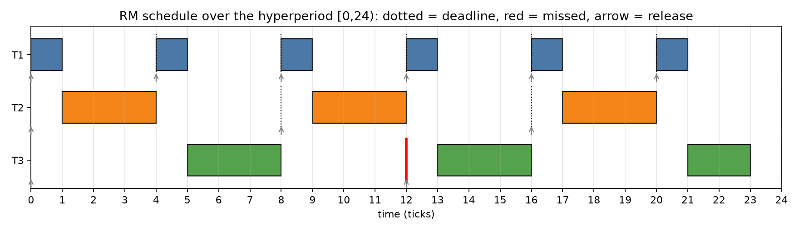

<!-- page 25 -->

## Appendix 1 — What is being scheduled?

This exercise studies three independent periodic tasks on one processor. Each task is described by worst-case execution time C, period T, and relative deadline D. In the selected task set, D=T for all three tasks and all tasks are released at phase zero. Each release creates a separate job with an absolute deadline. The analysis is limited to this model; it makes no claim about dependent tasks, multiprocessors, or arbitrary deadlines.

<!-- page 26 -->

## Appendix 2 — Task parameter table

| Task | Execution C | Period T | Relative deadline D | Utilization C/T |
|---|---:|---:|---:|---:|
| T1 | 1 | 4 | 4 | 0.2500 |
| T2 | 3 | 8 | 8 | 0.3750 |
| T3 | 4 | 12 | 12 | 0.3333 |
| Total | — | — | — | 23/24 ≈ 0.9583 |

This table is the input to the manual solution. Release times, fixed priorities, deadlines, and utilization must all be derived from these parameters using one consistent time unit.

<!-- page 27 -->

## Appendix 3 — Hyperperiod

The hyperperiod is the least common multiple of the periods: LCM(4,8,12)=24. Therefore [0,24) is sufficient to observe one complete release pattern; the pattern repeats at the end of this interval. T1 releases at 0, 4, 8, 12, 16, and 20; T2 at 0, 8, and 16; and T3 at 0 and 12. This list is used to construct the job table and to check that no release has been omitted.

<!-- page 28 -->

## Appendix 4 — Relative versus absolute deadlines

If a job of task i is released at time r, its absolute deadline is d=r+D_i. Thus the first T1 job released at zero has deadline 4, and the second T1 job released at 4 has deadline 8. The first two T2 jobs have deadlines 8 and 16; the two T3 jobs have deadlines 12 and 24. EDF makes its decisions using these absolute deadlines, not merely the relative period.

<!-- page 29 -->

## Appendix 5 — Rate Monotonic priority order

RM assigns fixed priorities: a shorter period receives a higher priority. The order in this task set is T1, then T2, then T3, because 4<8<12. When a new T1 job is released, execution of a lower-priority job may be preempted. This is a preemptive fixed-priority policy. For equal periods, a separate tie-breaking rule would be required.

<!-- page 30 -->

## Appendix 6 — EDF dispatch rule

At each decision point, EDF selects the released and unfinished job with the earliest absolute deadline. After a new release or completion, the ready set is evaluated again. EDF priority is therefore dynamic and may change over time. A complete specification should state how equal deadlines are broken; if no tie occurs in this teaching example, that is a property of this task set rather than a universal EDF rule.

<!-- page 31 -->

## Appendix 7 — Utilization test

Total utilization is Σ(C_i/T_i)=1/4+3/8+4/12=23/24≈0.9583. It is below one, so average processor demand does not exceed theoretical capacity. For independent tasks on a fully preemptive uniprocessor with D=T, this condition is both necessary and sufficient for EDF. The theorem depends on those assumptions; context-switch overhead, jitter, resource constraints, or arbitrary deadlines may change the conclusion.

<!-- page 32 -->

## Appendix 8 — Classical sufficient RM bound

For n independent periodic tasks with deadlines equal to periods, the Liu–Layland sufficient bound is U≤n(2^(1/n)−1). For n=3, it is approximately 0.780. The task set utilization 0.9583 exceeds this bound, so the sufficient test does not guarantee RM success. Exceeding the bound alone does not prove infeasibility; fixed-priority response-time analysis is needed for a more specific result.

<!-- page 33 -->

## Appendix 9 — Response-time analysis for T1 and T2

T1 has no higher-priority interference, so R1=C1=1, below its deadline of 4. For T2, T1 is the only higher-priority task. Iterating R2=C2+ceil(R2/T1)C1 from 3 gives 4 and then 4 again. The fixed point is R2=4, and 4≤D2=8, so the response-time test passes for T2.

<!-- page 34 -->

## Appendix 10 — Response-time analysis for T3

T3 is interfered with by both higher-priority tasks. Iterate R3=C3+ceil(R3/T1)C1+ceil(R3/T2)C2, starting at 4. The next values are 8, 9, and 13. At the third iteration, ceil(9/4)=3 and ceil(9/8)=2, hence R3=4+3×1+2×3=13. This exceeds D3=12, so RM cannot guarantee T3's deadline in this model.

<!-- page 35 -->

## Appendix 11 — Sufficient versus response-time tests

The two tests answer different questions. The RM utilization bound is a simple sufficient condition: a task set below it is guaranteed schedulable; a task set above it is inconclusive. Response-time analysis accounts for interference from higher-priority tasks and provides more specific information under its periodic-task assumptions. Here R3=13 exceeds the deadline 12, which is a stronger analytical warning than merely exceeding the utilization bound.

<!-- page 36 -->

## Appendix 12 — Reading the EDF Gantt chart

Each Gantt segment should identify a job and show its execution interval from start to finish. Follow the time axis across the hyperperiod and mark the releases and deadlines from the job table. This helps map every segment to a job and determine whether it finishes before its deadline. The chart is a visual summary of an execution trace; the event table and input file remain the calculation sources.

<!-- page 37 -->

## Appendix 13 — Reading the RM Gantt chart

RM uses a fixed priority order. When a higher-priority job is released, the processor may interrupt a lower-priority job. For each deadline, compare the job's received execution with its required C. Delay to a lower-priority job may cause a deadline miss even when all jobs eventually execute by the end of the hyperperiod. Success is completion of every job by its own deadline, not merely completion of all work by the end of the observation window.

<!-- page 38 -->

## Appendix 14 — Why EDF and RM differ

EDF updates priority using the nearest absolute deadline; RM keeps priority fixed according to period. Under high utilization, these different rules can matter. RM may repeatedly interrupt a longer-period task when shorter-period work arrives, while EDF distributes service according to current deadlines. This is an intuition, not a proof. The result for this task set should be supported by EDF's utilization criterion and RM's response-time analysis.

<!-- page 39 -->

## Appendix 15 — Context-switch overhead

The basic analytical model treats context switches as free. Real systems incur costs when saving and restoring state and may experience cache and TLB effects. If each switch costs δ, this time must be included in the demand model or measured separately. Since the exercise does not specify δ, its conclusions apply to the idealized model rather than to a particular hardware platform.

<!-- page 40 -->

## Appendix 16 — Idle time and deadlines

Utilization 23/24 corresponds to average use of about 95.83% over a long horizon, but the exact placement of idle time depends on release phases and scheduling decisions. An idle interval alone does not prove that every deadline is feasible; likewise, no idle interval does not by itself imply a miss. The check must be performed per job and deadline. The hyperperiod defines one repeating observation window.

<!-- page 41 -->

## Appendix 17 — Manual-solution checklist

A clear manual solution begins with the C/T/D table and utilization; computes the hyperperiod and all releases; records each job's absolute deadline; applies the policy at each event; draws execution and preemption intervals; and checks every completion against its deadline. For RM, show the priority order and response-time analysis separately. For EDF, explain why the selected job has the earliest active deadline.

<!-- page 42 -->

## Appendix 18 — Reproduction and independent checking

The branch code is useful for independently checking the hand-worked table and Gantt trace. Record the command, Python version, input file, and commit revision to reproduce a result. If the manual solution differs from the program, first check preemption assumptions, releases, absolute deadlines, and tie-breaking. Code can detect arithmetic mistakes, but the report should retain the reasoning behind each dispatch decision.

# شکل‌های تکمیلی

<!-- page 43 -->

## EDF scheduling trace

This figure is generated from the outputs in this branch. Read its axes and scale together with the input scenario; the image alone does not replace the raw data and experiment settings.

<!-- page 44 -->

## RM scheduling trace

This figure is generated from the outputs in this branch. Read its axes and scale together with the input scenario; the image alone does not replace the raw data and experiment settings.
