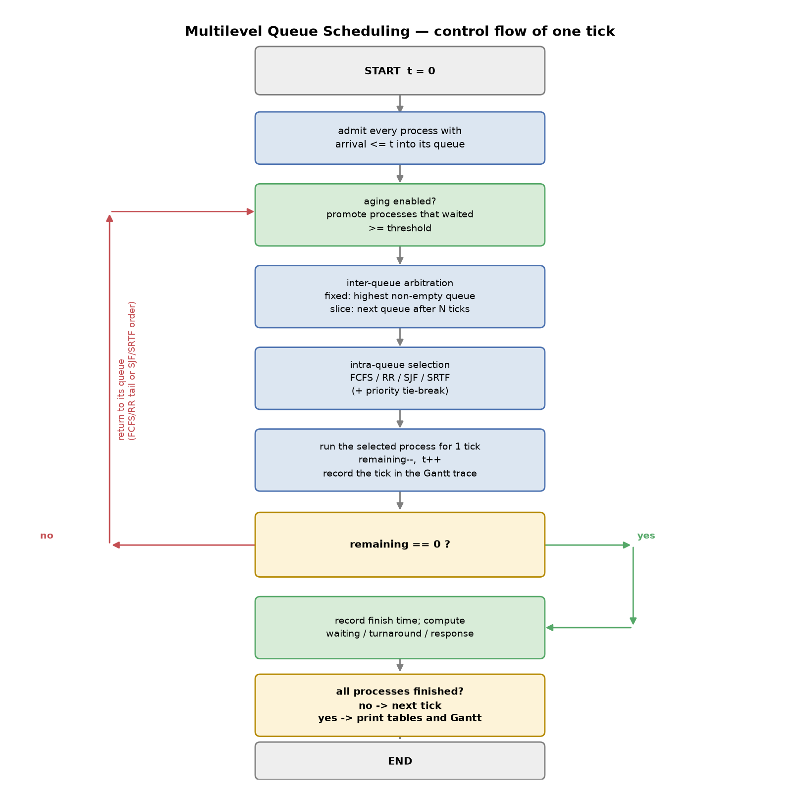
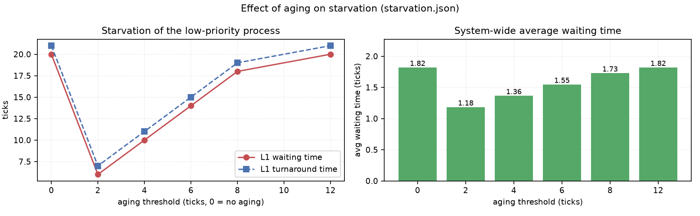

<!-- page 36 -->

## Appendix 1 — Workload taxonomy

Queue assignment should follow an explicit workload model. Interactive work often values first response; batch work is more sensitive to turnaround and throughput; background work can tolerate lower priority. This classification is a policy choice, not an automatic discovery of process behavior. A wrong class label can produce a poor schedule even when the scheduler is implemented correctly. Experiments should record both each process's class and the reason for its assignment.

<!-- page 37 -->

## Appendix 2 — MLQ versus MLFQ

In basic MLQ, a process remains in its assigned queue. Moving processes between queues according to observed CPU or I/O behavior is characteristic of MLFQ, not a consequence of merely having multiple queues. This distinction changes how starvation, fairness, and adaptation should be interpreted. The aging option in this branch can alter effective priority, but it should not be described as a complete MLFQ feedback mechanism.

<!-- page 38 -->

## Appendix 3 — Two scheduling decisions

The scheduler makes two separate choices: the inter-queue policy selects an eligible queue, and the intra-queue policy selects a process from that queue. Fixed priority between queues combined with RR inside the first queue does not mean that all processes participate in global round robin. If a high-priority queue stays non-empty, a lower queue may receive no service. This risk follows from the combination of policies and must be assessed separately from FCFS or RR in isolation.

<!-- page 39 -->

## Appendix 4 — Interpreting metrics

For a process with arrival A, first start S, and finish F, response time is S−A, turnaround is F−A, and in the simple no-I/O model waiting time is turnaround minus CPU burst. These identities assume a known CPU burst and no intervening I/O model. Compute each process's metric before averaging. Aggregate means can hide the behavior of a small queue or a single unusually long process.

<!-- page 40 -->

## Appendix 5 — Aging and starvation

Starvation occurs when a ready process can be postponed indefinitely by repeated scheduling decisions. Aging may reduce this risk by increasing the effective priority of long-waiting work, but its effect depends on the threshold, promotion order, and tie-breaking rule. The starvation scenario in this repository demonstrates only its configured process set and parameter values. Broader conclusions require workload variation in arrivals, bursts, and queue assignments.

<!-- page 41 -->

## Appendix 6 — Scheduling overhead

A context-switch count is not the same as context-switch cost. The count records events; actual cost depends on hardware, cache and TLB state, saving/restoring execution state, and operating-system implementation. This simulator does not measure kernel-level cost and assumes zero overhead in its base model. Counts are useful for explaining algorithm behavior, but converting them into milliseconds without a separate model or measurement is not justified.

<!-- page 42 -->

## Appendix 7 — Reproducibility and validity

A reproducible result records the code revision, scenario file, queue parameters, Python version, and command line. The JSON scenario is part of the experimental data, not incidental input. Changing a quantum or aging threshold can change both the Gantt order and the aggregate metrics. Raw outputs should accompany figures so readers can recompute each number. This educational simulator is not a substitute for measurement of a real kernel scheduler.

# شکل‌های تکمیلی

<!-- page 43 -->

## MLQ scheduler decision flowchart

This figure is generated from the outputs in this branch. Read its axes and scale together with the input scenario; the image alone does not replace the raw data and experiment settings.

<!-- page 44 -->

## Aging and waiting-time trend

This figure is generated from the outputs in this branch. Read its axes and scale together with the input scenario; the image alone does not replace the raw data and experiment settings.
