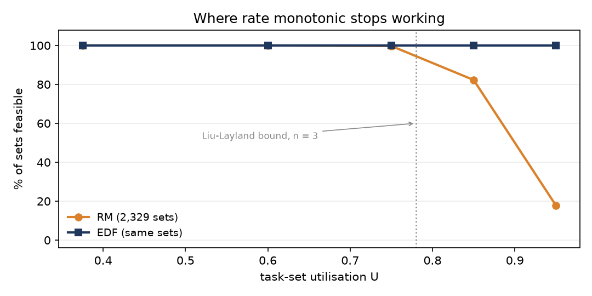
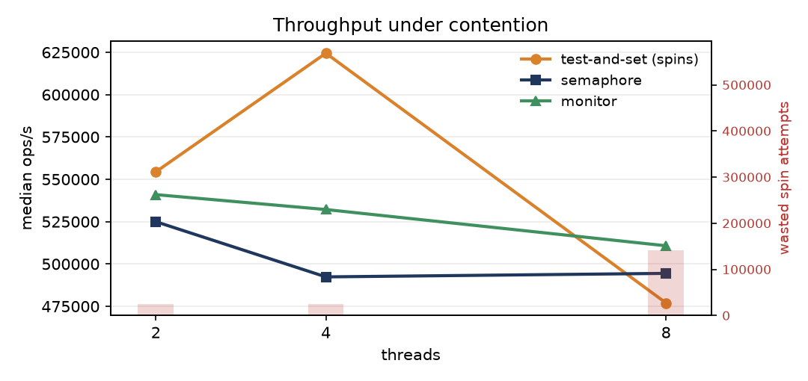

<!-- page 32 -->

## ضمیمه ۱ ـ پرسش پژوهش و دامنهٔ پاسخ

پرسش این مقاله این نیست که یک الگوریتم در همهٔ شرایط «بهترین» است؛ پرسش این است که هر سازوکار چه تضمینی می‌دهد، چه هزینه‌ای دارد و در چه وضعیتی محدود می‌شود. پایگاه کد چند خانوادهٔ مسئله را کنار هم قرار می‌دهد: طبقه‌بندی بار کاری با MLQ، وظایف دوره‌ای بلادرنگ با EDF و RM، انحصار متقابل و مسئلهٔ خوانندگان/نویسندگان. این مسائل از نظر هدف و مدل یکسان نیستند؛ بنابراین مقاله آن‌ها را در یک رتبه‌بندی عددی واحد ادغام نمی‌کند.

<!-- page 33 -->

## ضمیمه ۲ ـ نقشهٔ ادعا و شاهد

هر ادعای کمی باید به خروجی برنامه و تنظیم آزمایش وصل شود؛ هر ادعای درستی باید به مدل و بررسی‌گر قابل بازتولید متکی باشد؛ و هر ادعای کتاب‌شناختی باید به منبعی با مشخصات قابل راستی‌آزمایی ارجاع دهد. نقشهٔ ادعا-شاهد کمک می‌کند متن نتیجه‌گیری از شواهد فراتر نرود. برای نمونه، یک نمودار زمان پاسخ شاهدی دربارهٔ همان بار کاری است، نه اثبات رفتار همهٔ سیستم‌ها؛ و یک بررسی کامل فضای حالت محدود، فقط همان مدل و اندازهٔ مشارکت‌کنندگان را پوشش می‌دهد.

<!-- page 34 -->

## ضمیمه ۳ ـ تفاوت اندازه‌گیری و اثبات

اندازه‌گیری، یک نمونهٔ مشاهده‌شده از رفتار برنامه را در اختیار می‌گذارد و به محیط اجرا، بار کاری و تنظیمات حساس است. اثبات یا بررسی مدل، درستی گزاره را در مدل انتزاعی تعریف‌شده می‌سنجد و لزوماً هزینهٔ واقعی سیستم را نشان نمی‌دهد. این دو روش مکمل‌اند: اندازه‌گیری هزینه و اثر عملی را روشن می‌کند؛ بررسی مدل می‌تواند ترتیب‌های اجرایی را که در چند آزمایش محدود رخ نداده‌اند آشکار سازد. نتیجه‌گیری باید نوع شاهد را کنار هر ادعا حفظ کند.

<!-- page 35 -->

## ضمیمه ۴ ـ طراحی آزمایش زمان‌بندی

در آزمایش زمان‌بندی، سیاست‌ها باید تا حد ممکن روی ورودی‌های همسان مقایسه شوند. برای MLQ، کلاس و صف هر پردازه بخشی از تعریف بار کاری است؛ برای وظایف بلادرنگ، C، T، D و زمان آزادسازی ضروری‌اند. معیارهایی مانند انتظار، گردش، پاسخ و تعویض زمینه به پرسش‌های متفاوت پاسخ می‌دهند. برای کار بلادرنگ، شمار تخطی از deadline و تحلیل زمان پاسخ اهمیت جداگانه دارند. گزارش بار کاری و پارامترها امکان می‌دهد خواننده بداند نتیجه دقیقاً به کدام مسئله مربوط است.

<!-- page 36 -->

## ضمیمه ۵ ـ تفسیر مطالعهٔ تصادفی زمان‌بندی‌پذیری

مطالعهٔ تصادفی مقاله شامل ۲۳۲۹ مجموعه‌وظیفه است و نتایج را در بازه‌های بهره‌وری گروه‌بندی می‌کند. نتیجهٔ گزارش‌شده در بالاترین بازهٔ بهره‌وری، تفاوت روشنی میان RM و EDF نشان می‌دهد؛ با این حال درصد مشاهده‌شده تابع مولد مجموعه‌وظیفه، توزیع پارامترها، seed و قواعد مدل است. نباید آن را به احتمال عمومی شکست RM در هر کاربرد تعبیر کرد. مقدار ۱۰۰ درصد EDF نیز فقط به مجموعه‌های تولیدشده و فرضیات آزمون‌شده مربوط است.

<!-- page 37 -->

## ضمیمه ۶ ـ مطالعهٔ موردی وظایف سنگین

در وظایف دوره‌ای با تقاضای بالا، تفاوت سیاست اولویت ثابت و پویا اهمیت بیشتری پیدا می‌کند. RM دورهٔ کوتاه‌تر را اولویت می‌دهد و این اولویت در طول اجرا ثابت می‌ماند؛ EDF مهلت مطلق نزدیک‌تر را در هر تصمیم می‌سنجد. تحلیل زمان پاسخ برای RM و آزمون تقاضای پردازنده برای EDF، دو مسیر تحلیلی مستقل‌اند. توافق میان تحلیل و شبیه‌سازی در موارد پوشش‌داده‌شده یک کنترل متقابل مفید است، اما جایگزین اثبات فرضیات ورودی نیست.

<!-- page 38 -->

## ضمیمه ۷ ـ خواندن نمودار پرتگاه بهره‌وری

نمودار افت زمان‌بندی‌پذیری RM باید همراه بازه‌های محور افقی و تعداد نمونه‌های هر بازه خوانده شود. مقدار درصد بدون مخرج نمونه گمراه‌کننده است؛ به‌ویژه اگر تعداد مجموعه‌ها در هر bin متفاوت باشد. مقایسهٔ EDF و RM باید از یک مجموعه‌وظیفهٔ مشترک استفاده کند. اگر بخشی از مجموعه‌ها با فرضیات یک آزمون تحلیلی سازگار نباشند، آن‌ها باید جداگانه علامت‌گذاری شوند و در محاسبهٔ نرخ موفقیت با موارد معتبر مخلوط نشوند.

<!-- page 39 -->

## ضمیمه ۸ ـ شواهد همگام‌سازی

در بخش همگام‌سازی، مدل‌بررسی برای شمارش درهم‌تنیدگی‌های قابل دسترسی و یافتن شاهد نقض ویژگی‌ها به کار می‌رود. آزمون نخ‌محور، رفتار مکانیزم را در محیط اجرای مشخص مشاهده می‌کند. اگر مدل‌بررسی safety را تأیید کند اما آزمایش نخ‌محور رفتار نامطلوب نشان دهد، باید تفاوت فرضیات، ترتیب حافظه، زمان‌بندی نخ‌ها و اثر runtime بررسی شود. این اختلاف الزاماً تناقض نیست؛ ممکن است دو روش، دو لایهٔ متفاوت از سامانه را توصیف کنند.

<!-- page 40 -->

## ضمیمه ۹ ـ شواهد در مسئلهٔ خوانندگان و نویسندگان

ویژگی مسئله فقط جلوگیری از هم‌زمانی نویسنده با دیگران نیست؛ امکان ورود هم‌زمان چند خواننده نیز بخشی از نیازمندی است. به همین دلیل یک قفل انحصاری ساده ممکن است ایمنی را حفظ کند ولی هدف هم‌زمانی خواندن را برآورده نکند. علاوه بر safety باید progress، starvation freedom و سیاست اولویت نیز بررسی شوند. نتایج روی بار خواننده‌محور یا نویسنده‌محور وابسته به ترکیب ورودهاست و بدون شرح workload قابل تعمیم نیست.

<!-- page 41 -->

## ضمیمه ۱۰ ـ محدودیت‌ها و تهدیدهای اعتبار

مدل زمان گسسته، هزینهٔ صفر تعویض زمینه، فرض تک‌پردازنده یا تعداد محدود مشارکت‌کنندگان و ساده‌سازی ترتیب حافظه، دامنهٔ نتیجه را محدود می‌کنند. در آزمایش نخ‌محور، سیستم‌عامل، runtime، تعداد هسته‌ها، بار پس‌زمینه و GIL می‌توانند نتایج را تغییر دهند. در مطالعهٔ تصادفی، انتخاب توزیع و seed بر نمونه‌ها اثر می‌گذارد. گزارش علمی باید این محدودیت‌ها را کنار نتیجه بیاورد، نه آن‌که آن‌ها را فقط در جملهٔ پایانی پنهان کند.

<!-- page 42 -->

## ضمیمه ۱۱ ـ کنترل منابع علمی

فهرست منابع شاخه دو گروه جدا دارد: مدخل‌هایی که مشخصات کتاب‌شناختی‌شان بررسی شده و کتاب‌هایی که صرفاً برای زمینه استفاده شده‌اند و metadata نسخه/صفحهٔ آن‌ها تثبیت نشده است. این تفکیک برای اعتبار مقاله مهم است. عنوان، سال، جلد، شماره، صفحات و DOI فقط وقتی باید در استناد نهایی بیایند که قابل تأیید باشند. اگر نسخهٔ مورد استفاده از کتاب در دسترس نیست، بهتر است سال یا شماره صفحه حذف شود تا آن‌که اطلاعات حدس زده شود.

<!-- page 43 -->

## ضمیمه ۱۲ ـ چارچوب ارائهٔ سمینار

برای ارائه، ابتدا مسئله و پرسش پژوهش را با یک مثال ساده معرفی کنید؛ سپس نشان دهید چرا معیارها با هم تعارض دارند؛ بعد روش اندازه‌گیری و بررسی مدل را از هم جدا کنید؛ و در پایان، سه یافتهٔ اصلی و محدودیت‌های آن‌ها را جمع‌بندی کنید. هر نمودار باید یک پیام مشخص داشته باشد و قبل از نمایش، محور، واحد، تعداد نمونه و نوع شاهد توضیح داده شود. متن اسلاید نباید جای توضیح شفاهی را بگیرد؛ یک گزاره و یک شاهد بصری در هر اسلاید معمولاً خواناتر است.

# شکل‌های تکمیلی

<!-- page 44 -->

## افت زمان‌بندی‌پذیری در بار زیاد

این شکل از فایل‌های خروجی همین شاخه برداشت شده است. محور و مقیاس را همراه با سناریوی ورودی بخوانید؛ تصویر به‌تنهایی جایگزین دادهٔ خام و تنظیمات آزمایش نیست.

<!-- page 45 -->

## رقابت در آزمایش نخ‌محور

این شکل از فایل‌های خروجی همین شاخه برداشت شده است. محور و مقیاس را همراه با سناریوی ورودی بخوانید؛ تصویر به‌تنهایی جایگزین دادهٔ خام و تنظیمات آزمایش نیست.
