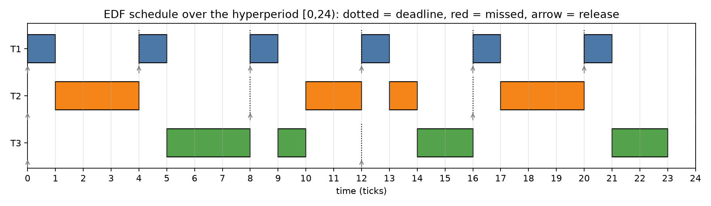

<!-- page 25 -->

## ضمیمه ۱ ـ مسئله دقیقاً چه چیزی را زمان‌بندی می‌کند؟

در این تمرین سه وظیفهٔ دوره‌ای مستقل روی یک پردازنده بررسی می‌شوند. هر وظیفه با سه پارامتر معرفی می‌شود: زمان اجرای بدترین حالت C، دورهٔ تناوب T و مهلت نسبی D. در مجموعهٔ انتخاب‌شده، برای هر سه وظیفه D=T است و همهٔ وظایف در فاز صفر آزاد می‌شوند. این تعریف، مجموعهٔ کار را به jobهای منفرد تبدیل می‌کند: هر آزادسازی یک نمونهٔ اجرایی تازه با مهلت مطلق مشخص تولید می‌کند. تحلیل بعدی به همین مدل محدود است و دربارهٔ وظایف وابسته، چندپردازنده یا deadline دلخواه ادعایی ندارد.

<!-- page 26 -->

## ضمیمه ۲ ـ جدول مشخصات وظایف

| وظیفه | زمان اجرا C | دوره T | مهلت نسبی D | بهره‌وری C/T |
|---|---:|---:|---:|---:|
| T1 | ۱ | ۴ | ۴ | ۰٫۲۵۰۰ |
| T2 | ۳ | ۸ | ۸ | ۰٫۳۷۵۰ |
| T3 | ۴ | ۱۲ | ۱۲ | ۰٫۳۳۳۳ |
| مجموع | — | — | — | ۲۳/۲۴ ≈ ۰٫۹۵۸۳ |

این جدول دادهٔ پایهٔ حل است. هر محاسبهٔ آزادسازی، اولویت ثابت، مهلت و بهره‌وری باید از همین پارامترها نتیجه شود. واحد زمان در سراسر جدول و گانت یکسان فرض می‌شود.

<!-- page 27 -->

## ضمیمه ۳ ـ محاسبهٔ ابر‌دوره

ابر‌دوره کوچک‌ترین مضرب مشترک دوره‌هاست: LCM(4,8,12)=24. بنابراین یک بازهٔ [0,24) برای مشاهدهٔ الگوی کامل آزادسازی کافی است؛ در انتهای این بازه، فازهای آزادسازی دوباره تکرار می‌شوند. در این بازه T1 در زمان‌های ۰، ۴، ۸، ۱۲، ۱۶ و ۲۰ آزاد می‌شود؛ T2 در ۰، ۸ و ۱۶؛ و T3 در ۰ و ۱۲. این فهرست برای نوشتن جدول jobها و کنترل این‌که هیچ آزادسازی از قلم نیفتاده باشد به کار می‌رود.

<!-- page 28 -->

## ضمیمه ۴ ـ تبدیل مهلت نسبی به مطلق

اگر یک job از وظیفهٔ i در زمان r آزاد شود، مهلت مطلق آن d برابر r+D_i است. مثلاً job اول T1 که در زمان صفر آزاد می‌شود مهلت ۴ دارد؛ job دوم همان وظیفه که در زمان ۴ آزاد می‌شود مهلت ۸ خواهد داشت. برای T2، دو job نخست به‌ترتیب مهلت‌های ۸ و ۱۶ دارند؛ برای T3 نیز مهلت‌های ۱۲ و ۲۴. EDF بر اساس این مهلت‌های مطلق تصمیم می‌گیرد، نه صرفاً بر اساس دورهٔ نسبی.

<!-- page 29 -->

## ضمیمه ۵ ـ ترتیب اولویت Rate Monotonic

در RM اولویت ثابت است و دورهٔ کوتاه‌تر، اولویت بالاتری دارد. پس ترتیب این مجموعه T1 سپس T2 سپس T3 است، زیرا ۴<۸<۱۲. با آزاد شدن job جدید T1، اجرای یک job با اولویت پایین‌تر می‌تواند متوقف شود. این ویژگی پیش‌دستی است. درون jobهای یک وظیفه، ترتیب آزادسازی و رعایت قواعد مدل حفظ می‌شود؛ برای وظایفی با دوره‌های برابر باید قاعدهٔ رفع تساوی نیز جداگانه تعریف شود.

<!-- page 30 -->

## ضمیمه ۶ ـ روش انتخاب در EDF

در هر لحظه، EDF میان jobهای آزادشده و هنوز تکمیل‌نشده، job دارای نزدیک‌ترین مهلت مطلق را انتخاب می‌کند. پس از آزادسازی job جدید یا پایان اجرای job جاری، مجموعهٔ آماده دوباره ارزیابی می‌شود. بنابراین اولویت EDF پویاست و ممکن است در طول زمان تغییر کند. برای جلوگیری از ابهام باید مشخص باشد که در زمان برابر شدن دو مهلت چه قاعده‌ای به کار می‌رود؛ اگر در مدل آموزشی چنین حالتی رخ ندهد، این موضوع باید به‌عنوان ویژگی همین نمونه ذکر شود، نه یک قاعدهٔ عمومی.

<!-- page 31 -->

## ضمیمه ۷ ـ آزمون بهره‌وری

بهره‌وری مجموعه برابر مجموع C_i/T_i است: 1/4+3/8+4/12=23/24≈0.9583. مقدار کمتر از یک است، پس تقاضای متوسط پردازنده از ظرفیت نظری آن بیشتر نیست. با فرض وظایف مستقل، تک‌پردازنده، پیش‌دستی کامل و D=T، این شرط برای EDF نه فقط لازم، بلکه کافی نیز هست. این گزاره به فرض‌های مدل وابسته است؛ هزینهٔ تعویض زمینه، jitter، محدودیت منابع و deadlineهای متفاوت می‌توانند نتیجه را تغییر دهند.

<!-- page 32 -->

## ضمیمه ۸ ـ کران کافی کلاسیک RM

برای n وظیفهٔ مستقل و دوره‌ای با deadline برابر دوره، کران کافی لیو و لی‌لند U≤n(2^(1/n)−1) است. برای n=3، مقدار کران حدود ۰٫۷۸۰ است. بهره‌وری این مجموعه ۰٫۹۵۸۳ و بالاتر از این کران است؛ بنابراین آزمون کافی، موفقیت RM را تضمین نمی‌کند. اما شکست این آزمون به‌تنهایی به معنی غیرقابل‌زمان‌بندی بودن مجموعه نیست. برای نتیجهٔ دقیق‌تر باید تحلیل زمان پاسخ با اولویت ثابت اجرا شود.

<!-- page 33 -->

## ضمیمه ۹ ـ تحلیل زمان پاسخ برای T1 و T2

برای T1 هیچ وظیفهٔ با اولویت بالاتر وجود ندارد؛ بنابراین R1=C1=1 و از deadline برابر ۴ کوچک‌تر است. برای T2، تنها مزاحم با اولویت بالاتر T1 است. تکرار رابطهٔ R2=C2+ceil(R2/T1)C1 از مقدار آغازین ۳ شروع می‌شود: مقدار بعدی ۴ و تکرار بعدی نیز ۴ است. نقطهٔ ثابت R2=4 به دست می‌آید و چون ۴≤D2=8 است، آزمون زمان پاسخ برای T2 موفق است.

<!-- page 34 -->

## ضمیمه ۱۰ ـ تحلیل زمان پاسخ برای T3

برای T3 هر دو T1 و T2 اولویت بالاتر دارند. تکرار R3=C3+ceil(R3/T1)C1+ceil(R3/T2)C2 از ۴ آغاز می‌شود. مقدار بعدی ۸، مقدار بعدی ۹ و سپس ۱۳ است: در گام سوم، ceil(9/4)=3 و ceil(9/8)=2؛ پس R3=4+3×1+2×3=13. این مقدار از D3=12 بزرگ‌تر است. بنابراین تحلیل زمان پاسخ، رعایت deadline برای T3 را در RM تضمین نمی‌کند.

<!-- page 35 -->

## ضمیمه ۱۱ ـ تفاوت نتیجهٔ آزمون کافی و دقیق

دو گزاره را نباید با هم اشتباه گرفت. کران بهره‌وری RM یک شرط کافی ساده است: اگر مجموعه زیر آن باشد، زمان‌بندی‌پذیری تضمین می‌شود؛ اگر بالاتر باشد، نتیجه نامعین است. تحلیل زمان پاسخ با محاسبهٔ تداخل وظایف با اولویت بالاتر اطلاعات دقیق‌تری برای مدل وظایف دوره‌ای مستقل و پیش‌فرض‌های مشخص فراهم می‌کند. در این نمونه، R3=13 از deadline دوازده بیشتر است و از این رو هشدار تحلیلی روشن‌تری از عبور صرف از کران بهره‌وری داریم.

<!-- page 36 -->

## ضمیمه ۱۲ ـ خواندن نمودار گانت EDF

هر قطعهٔ گانت باید به job مشخصی تعلق داشته باشد و بازهٔ آن از زمان شروع تا زمان پایان اجرای آن job را نشان دهد. محور زمان را از صفر تا انتهای ابر‌دوره دنبال کنید؛ سپس آزادسازی‌ها و deadlineهای جدول را روی همان محور علامت بزنید. این کار کمک می‌کند تشخیص دهید هر قطعه متعلق به کدام job است و آیا پیش از deadline تکمیل شده است. نمودار، خلاصهٔ بصری ردّ اجراست؛ جدول رویدادها و فایل ورودی همچنان منبع محاسبه‌اند.

<!-- page 37 -->

## ضمیمه ۱۳ ـ خواندن نمودار گانت RM

در گانت RM ترتیب اولویت ثابت است؛ با آزاد شدن یک job با اولویت بالاتر، پردازنده ممکن است اجرای job سطح پایین‌تر را قطع کند. برای هر deadline باید مجموع زمان اجرای دریافت‌شده تا آن نقطه را با C موردنیاز job مقایسه کرد. تأخیر یک job پایین‌اولویت ممکن است به معنی نقض deadline باشد، حتی اگر در پایان ابر‌دوره همهٔ CPUها اجرا شده باشند. معیار موفقیت، تکمیل هر job تا مهلت خودش است، نه صرفاً تکمیل همهٔ کارها در پایان بازه.

<!-- page 38 -->

## ضمیمه ۱۴ ـ چرا EDF و RM پاسخ متفاوت می‌دهند؟

EDF اولویت را بر اساس نزدیک‌ترین deadline مطلق به‌روزرسانی می‌کند؛ RM اولویت را براساس دوره و به‌صورت ثابت تعیین می‌کند. در بار کاری با بهره‌وری بالا، تفاوت میان این دو قاعده می‌تواند مهم شود: RM ممکن است job بلندمدت‌تر را بارها به‌دلیل ورود وظایف دوره‌ای کوتاه‌تر متوقف کند، در حالی که EDF با تغییر اولویت‌ها کار را براساس مهلت‌های جاری توزیع می‌کند. این توضیح شهودی است؛ برای اثبات نتیجهٔ همین مجموعه باید به آزمون بهره‌وری EDF و تحلیل زمان پاسخ RM استناد کرد.

<!-- page 39 -->

## ضمیمه ۱۵ ـ اثر هزینهٔ تعویض زمینه

در مدل تحلیلی پایه، تعویض زمینه بدون هزینه فرض می‌شود. در سیستم واقعی، ذخیره و بازیابی وضعیت پردازه، اثر cache و TLB و سیاست کرنل هزینه دارند. اگر هزینهٔ هر تعویض برابر δ باشد، باید این زمان به مدل تقاضا افزوده یا به‌شکل سربار جداگانه اندازه‌گیری شود. چون مقدار δ در تمرین تعیین نشده، نتیجه‌های گزارش باید به‌عنوان نتیجهٔ مدل ایده‌آل خوانده شوند، نه تضمین برای سخت‌افزار مشخص.

<!-- page 40 -->

## ضمیمه ۱۶ ـ زمان آزاد CPU و deadline

بهره‌وری ۲۳/۲۴ به‌معنی استفادهٔ متوسط ۹۵٫۸۳ درصدی از ظرفیت در افق طولانی است؛ با این حال محل دقیق زمان آزاد در هر بازه به فاز آزادسازی و تصمیم سیاست بستگی دارد. وجود زمان آزاد در یک قطعهٔ گانت، به تنهایی اثبات نمی‌کند همهٔ deadlineها قابل رعایت‌اند؛ و نبود زمان آزاد هم به تنهایی به معنی نقض مهلت نیست. بررسی باید در سطح job و deadline انجام شود. ابر‌دوره فقط افق مشاهدهٔ الگوی تکراری را مشخص می‌کند.

<!-- page 41 -->

## ضمیمه ۱۷ ـ چک‌لیست حل دستی قابل تحویل

برای یک حل دستی روشن، ابتدا جدول C/T/D و بهره‌وری را بنویسید؛ سپس ابر‌دوره و همهٔ releaseها را محاسبه کنید؛ deadline مطلق هر job را کنار release ثبت کنید؛ قاعدهٔ انتخاب الگوریتم را در هر رویداد اعمال کنید؛ بازه‌های اجرا و پیش‌دستی را در گانت رسم کنید؛ و سرانجام هر deadline را با زمان تکمیل job تطبیق دهید. در RM، محاسبهٔ اولویت و تحلیل زمان پاسخ را جداگانه ارائه کنید. در EDF نیز توضیح دهید چرا job انتخاب‌شده مهلت نزدیک‌تری دارد.

<!-- page 42 -->

## ضمیمه ۱۸ ـ بازتولید و کنترل مستقل

کد شاخه برای کنترل جدول و گانت دستی مفید است، زیرا می‌توان ورودی‌ها و ردّ زمان‌بندی را مستقل از محاسبهٔ کاغذی تولید کرد. برای بازتولید نتیجه باید فرمان اجرا، نسخهٔ Python، فایل ورودی و نسخهٔ commit ثبت شود. در اختلاف میان حل دستی و خروجی برنامه، ابتدا فرض‌های پیش‌دستی، releaseها، deadlineهای مطلق و tie-break را بررسی کنید. برنامه می‌تواند خطای محاسباتی را پیدا کند، اما استدلال دلیل انتخاب هر job باید در گزارش باقی بماند.

# شکل‌های تکمیلی

<!-- page 43 -->

## ردّ زمان‌بندی EDF

این شکل از فایل‌های خروجی همین شاخه برداشت شده است. محور و مقیاس را همراه با سناریوی ورودی بخوانید؛ تصویر به‌تنهایی جایگزین دادهٔ خام و تنظیمات آزمایش نیست.

<!-- page 44 -->

## ردّ زمان‌بندی RM

این شکل از فایل‌های خروجی همین شاخه برداشت شده است. محور و مقیاس را همراه با سناریوی ورودی بخوانید؛ تصویر به‌تنهایی جایگزین دادهٔ خام و تنظیمات آزمایش نیست.
