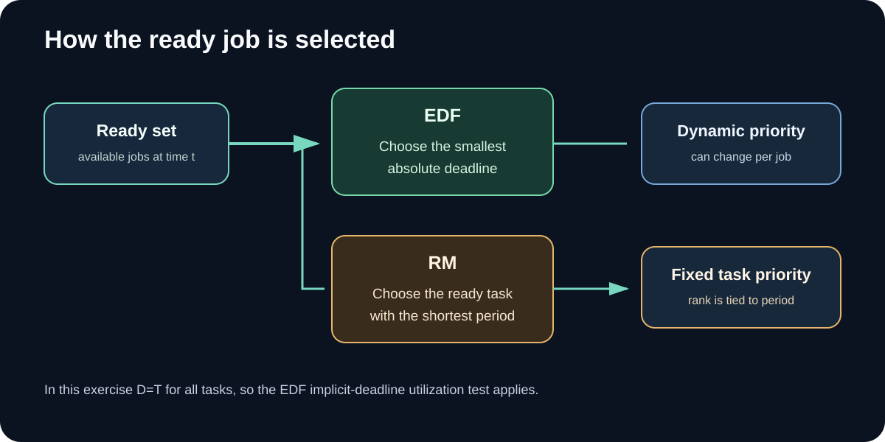
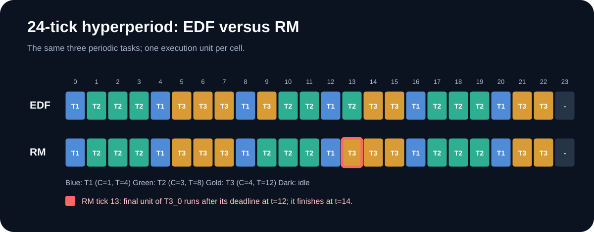
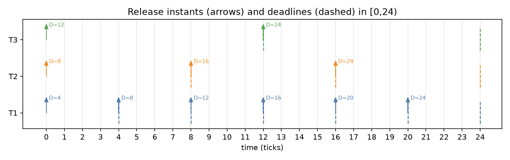
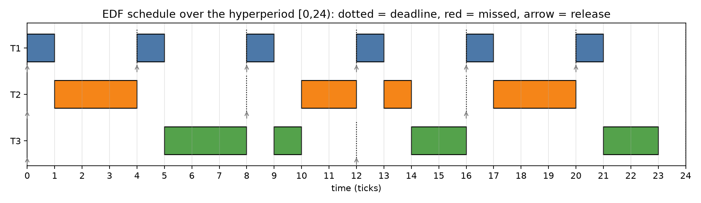
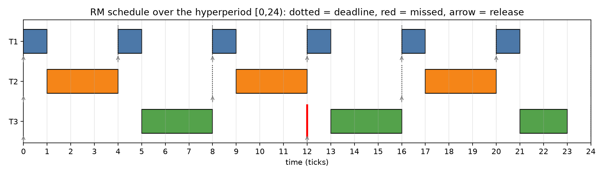
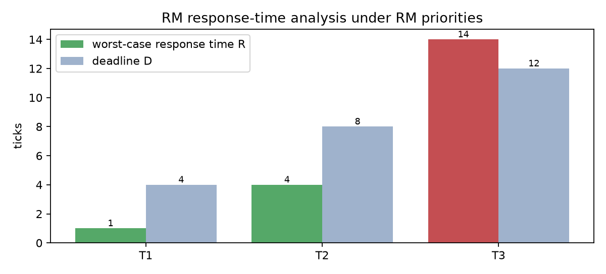
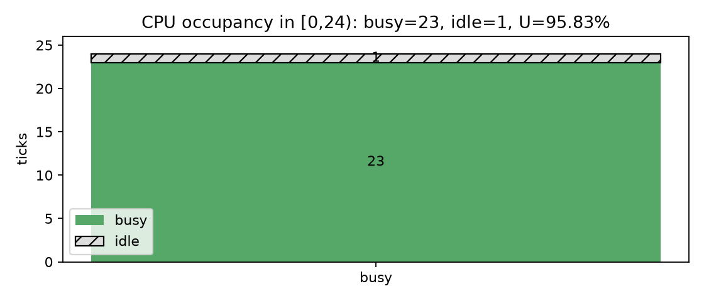

# راهنمای تکمیلی و تصویری — تمرین ۳

این راهنما برای بازخوانی حل دستی و تطبیق آن با برنامه طراحی شده است. ابتدا پارامترهای وظایف و سپس قاعده انتخاب در EDF و RM را بررسی کنید.

## ۱. مجموعه وظایف
| Task | C | T | D | آزادسازی‌ها در بازه [0,24) |
|---|---:|---:|---:|---|
| T1 | 1 | 4 | 4 | 0, 4, 8, 12, 16, 20 |
| T2 | 3 | 8 | 8 | 0, 8, 16 |
| T3 | 4 | 12 | 12 | 0, 12 |

## ۲. قواعد انتخاب

- **EDF:** از میان jobهای آماده، job دارای نزدیک‌ترین مهلت مطلق انتخاب می‌شود.
- **RM:** اولویت هر task بر اساس دوره آن تعیین می‌شود؛ دوره کوتاه‌تر اولویت ثابت بالاتری دارد.

## ۳. دو خط زمان روی یک افق مشترک

در تصویر، هر خانه یک واحد زمان است. خانه قرمز در ردیف RM لحظه‌ای را نشان می‌دهد که آخرین واحد اجرای T3_0 پس از deadline برابر 12 اجرا می‌شود و job در t=14 پایان می‌یابد.

## ۴. محاسبات قابل بازبینی
- بهره‌برداری: U = 1/4 + 3/8 + 4/12 = 23/24 ≈ 0.9583.
- ابر‌دوره: H = lcm(4, 8, 12) = 24.
- مجموع تقاضا در یک ابر‌دوره: 6×1 + 3×3 + 2×4 = 23 واحد؛ بنابراین 1 واحد بیکاری وجود دارد.
- کران Liu–Layland برای RM با سه task حدود 0.7798 است؛ چون U از آن بیشتر است، این شرط کافی نتیجه قطعی نمی‌دهد.
- تحلیل زمان پاسخ RM: R(T1)=1≤4، R(T2)=4≤8، و R(T3)=14>12؛ پس RM زمان‌بندی‌پذیر نیست.
- چون در این مجموعه D=T برای همه taskها و U≤1 است، آزمون بهره‌برداری EDF برای مهلت ضمنی نتیجه مثبت می‌دهد.

## ۵. نمودارهای پشتیبان






## ۶. روش بازتولید
```bash
pip install -r requirements.txt
python code/run_experiments.py
python code/make_figures.py
python -m pytest tests -q
```
آزمون‌های خودکار، جدول‌های ۲۴ تیکی را به‌عنوان خروجی مرجع کنترل می‌کنند تا متن حل و خروجی برنامه از هم فاصله نگیرند.

## ۷. دامنه نتیجه
نتیجه تحلیلی زمان‌بندی‌پذیری با مشاهده یک خط زمان یکسان نیست. این گزارش برای مجموعه وظایف مشخص، تحلیل زمان پاسخ RM و شرط EDF را به کار می‌برد؛ شبیه‌سازی یک ابر‌دوره، به‌تنهایی اثبات کلی برای همه مجموعه وظایف نیست. مدل نیز هزینه تعویض زمینه، اثر Cache، blocking، اشتراک منابع و release jitter را نادیده می‌گیرد.

## ۸. فایل‌های تحویلی
- [حل دستی فارسی](../MANUAL_SOLUTION_FA.md) · [English hand solution](../MANUAL_SOLUTION_EN.md)
- [Word فارسی](MANUAL_SOLUTION_FA.docx) · [PDF فارسی](MANUAL_SOLUTION_FA.pdf)
- [English Word](MANUAL_SOLUTION_EN.docx) · [English PDF](MANUAL_SOLUTION_EN.pdf)
- [شبیه‌ساز](../code/edf_rm.py) · [جدول‌های گام‌به‌گام](../output/) · [تست‌ها](../tests/)

---
**English quick guide.** The task set, 24-tick traces, analytical verdicts, and limitations are collected here so that the hand calculation can be checked against the program output without confusing a finite trace with a general proof.