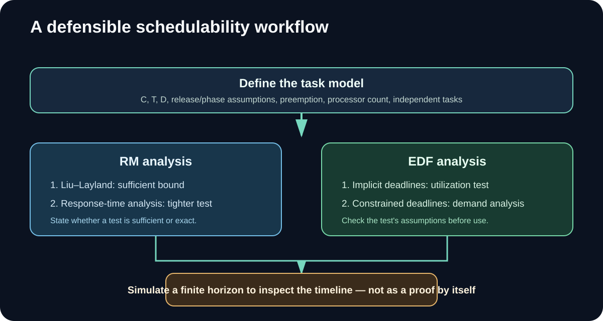

# راهنمای تکمیلی و تصویری — تمرین ۲

این راهنما کنار گزارش‌های فارسی و انگلیسی قرار دارد و منطق مقایسه را به شکل تصویری و گام‌به‌گام توضیح می‌دهد.

## ۱. ابتدا تفاوت سه قاعده اولویت را ببینید

MLQ انتخاب را در دو سطح انجام می‌دهد: ابتدا صف، سپس پردازه داخل صف. EDF در هر تصمیم، مهلت مطلق نزدیک‌تر را انتخاب می‌کند. RM به هر وظیفه اولویت ثابت می‌دهد و دوره کوتاه‌تر به معنی اولویت بالاتر است.

## ۲. از مدل وظیفه تا نتیجه تحلیلی

برای مقایسه معتبر، پیش از اجرای هر آزمون باید پارامترهای C، T و D، فاز/زمان آزادسازی، پیش‌دستی، تعداد پردازنده‌ها و فرض استقلال وظایف روشن شوند. شرط‌های RM و EDF تحت فرضیات مشخص معنا دارند؛ شبیه‌سازی محدود به افق زمانی، جایگزین آزمون تحلیلی نیست.

## ۳. تصاویر و نتایج سناریوها
### سناریوی A — مقایسه منصفانه


### تحلیل کران و زمان‌بندی‌پذیری


## ۴. تفسیر نتایج ثبت‌شده
گزارش این شاخه چهار سناریو را بررسی می‌کند: بار منصفانه، فشار بالا، بار غیرمتناوب و اضافه‌بار. نتیجه‌ها باید همراه با افق شبیه‌سازی و آزمون تحلیلی همان سناریو خوانده شوند. برای مثال، در سناریوی A با U=0.800 هر سه الگوریتم در افق گزارش‌شده هیچ مهلتی را از دست نداده‌اند؛ اما این مشاهده به‌تنهایی حکم عمومی درباره برتری یک الگوریتم نیست.

در سناریوی B، آزمون دقیق RM وظیفه B را با R_B=8 و D_B=7 رد می‌کند، در حالی که آزمون EDF آن سناریوی تعریف‌شده را تأیید می‌کند. در سناریوی D، بار کل U=1.2333 از ظرفیت تک‌پردازنده بیشتر است و آزمون EDF نیز رد می‌شود.

## ۵. شاخص‌ها را درست بخوانید
- **Utilization:** مجموع سهم اجرای وظایف از ظرفیت پردازنده در مدل موردنظر.
- **Deadline miss:** تعداد jobهایی که پس از مهلتشان تکمیل شده‌اند.
- **Response time:** فاصله آزادسازی یک job تا نخستین اجرای آن.
- **Jitter:** تغییرپذیری زمانی معیار پاسخ در سناریوی مورد استفاده.
- **Context switch:** تعداد جابه‌جایی‌های اجرای CPU؛ این عدد معادل هزینه زمانی واقعی نیست.

## ۶. اجرای مجدد
از ریشه Branch:
```bash
pip install -r requirements.txt
python code/run_experiments.py
python -m pytest tests/ -q
```
خروجی‌های داده‌ای در پوشه output و نمودارها در diagrams قرار دارند.

## ۷. محدودیت‌ها
مدل تک‌پردازنده و پیش‌گیرانه است؛ انسداد، اشتراک منابع و وارونگی اولویت در آزمایش‌های گزارش‌شده مدل نشده‌اند و هزینه تعویض زمینه صفر فرض شده است. آزمون هر الگوریتم فقط در محدوده فرضیات خودش معتبر است.

## ۸. فایل‌های تحویلی
- [گزارش فارسی Markdown](../COMPARISON_FA.md) · [گزارش انگلیسی Markdown](../COMPARISON_EN.md)
- [Word فارسی](COMPARISON_FA.docx) · [PDF فارسی](COMPARISON_FA.pdf)
- [English Word](COMPARISON_EN.docx) · [English PDF](COMPARISON_EN.pdf)
- [شبیه‌ساز و آزمون‌های تحلیلی](../code/rt_sched.py) · [آزمایش‌ها](../code/run_experiments.py) · [تست‌ها](../tests/)

---
**English quick guide.** This companion page explains the distinct priority rules, the analytical schedulability workflow, and how to interpret the four workload scenarios. The simulator illustrates finite traces; analytical tests support the schedulability verdicts under their stated assumptions.