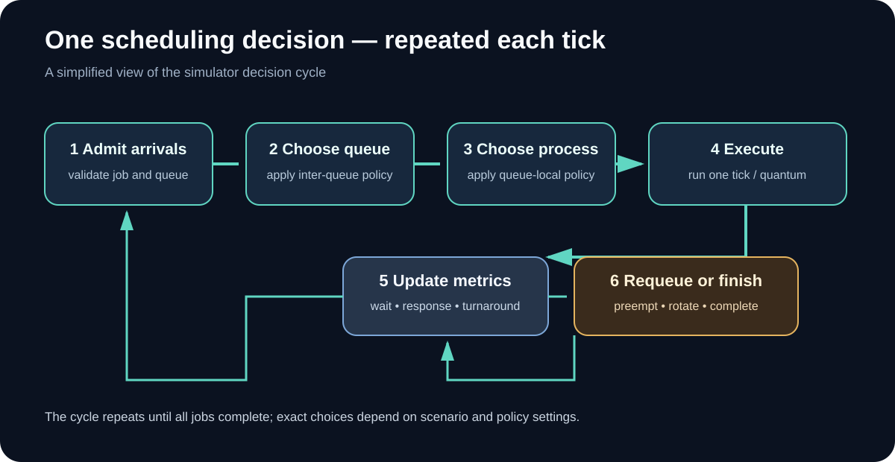
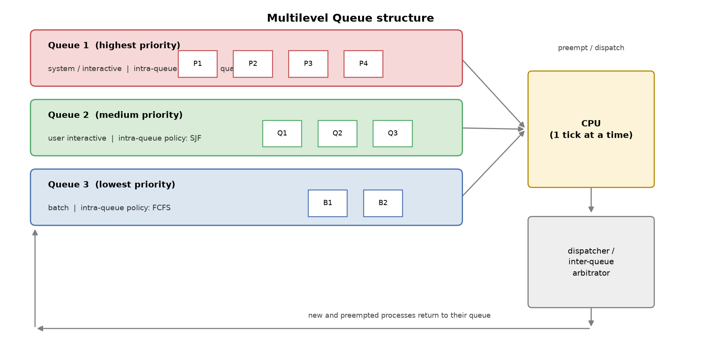
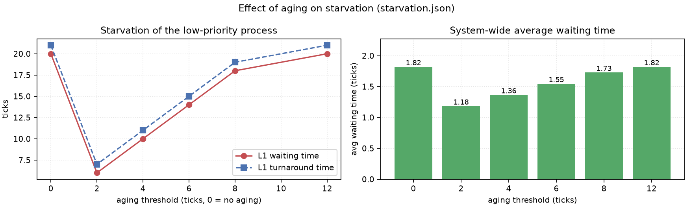

# راهنمای تکمیلی و تصویری — تمرین ۱

این پوشه شامل نسخه‌های تحویلی Word و PDF گزارش فارسی و انگلیسی است. این فایل، راهنمای همراه آن‌هاست: ترتیب مطالعه، نقشه مفهومی، راهنمای شکل‌ها و مسیر بازتولید نتایج را یک‌جا توضیح می‌دهد.

## از کجا شروع کنم؟
1. برای فهم سریع مسئله، تصویر معماری صف‌ها را ببینید.
2. سپس گزارش فارسی یا انگلیسی را بخوانید: [گزارش فارسی](../REPORT_FA.md) | [English report](../REPORT_EN.md).
3. برای دنبال‌کردن منطق زمان‌بند، فلوچارت را با چرخه تصمیم‌گیری مقایسه کنید.
4. در پایان، سناریوی پایه و جدول نتایج را با خروجی شبیه‌ساز تطبیق دهید.

## ۱. معماری Multilevel Queue

در این مدل، پردازه‌ها بر اساس طبقه‌بندی سناریو به صف‌های مجزا هدایت می‌شوند. دو تصمیم جداگانه وجود دارد: سیاست بین صف‌ها مشخص می‌کند کدام صف فرصت اجرا بگیرد؛ سیاست درون صف، پردازه بعدی همان صف را انتخاب می‌کند. این دو لایه را با هم اشتباه نگیرید.

## ۲. چرخه تصمیم زمان‌بند

چرخه نشان می‌دهد که ورود پردازه، انتخاب صف، انتخاب پردازه، اجرای CPU و به‌روزرسانی معیارها یک فرایند تکرارشونده‌اند. پس از اجرا، پردازه ممکن است تمام شود، پیش‌دستی شود یا طبق سیاست صف دوباره در صف قرار بگیرد.

## ۳. تصاویر تکمیلی موجود در شاخه
### ساختار و منطق اجرا


### زمان‌بندی و معیارها




## ۴. معنی معیارهای گزارش
- **Waiting Time:** مجموع زمانی که پردازه آماده بوده اما CPU نگرفته است.
- **Turnaround Time:** فاصله ورود پردازه تا پایان اجرای آن.
- **Response Time:** فاصله ورود پردازه تا اولین نوبت اجرای آن.
- **Context Switch:** جابه‌جایی اجرای CPU از یک پردازه به پردازه دیگر؛ تعداد و هزینه آن دو مفهوم متفاوت‌اند.
- **Throughput:** تعداد پردازه‌های تکمیل‌شده در واحد زمان.
در مقایسه نمودارها، ابتدا سناریو و سیاست‌های فعال را بررسی کنید؛ عدد یک سناریوی مصنوعی کوچک، قانون عمومی برای همه بارهای کاری نیست.

## ۵. بازتولید و بررسی
از ریشه Branch اجرا کنید:
```bash
pip install -r requirements.txt
python code/run_experiments.py
python code/make_diagrams.py
python -m pytest tests/ -q
```
خروجی‌های متنی و داده‌ای در پوشه output و نمودارهای بازتولیدشده در پوشه diagrams ذخیره می‌شوند.

## ۶. فرضیات و محدوده اعتبار
مدل این شاخه آموزشی و تک‌پردازنده‌ای است؛ زمان گسسته، Burst معلوم و هزینه Context Switch صفر فرض شده است. سناریوها برای تحلیل و بازتولیدپذیری طراحی شده‌اند و جایگزین اندازه‌گیری زمان‌بند یک سیستم‌عامل واقعی نیستند.

## ۷. فایل‌های تحویلی
- [Word فارسی](REPORT_FA.docx) · [PDF فارسی](REPORT_FA.pdf)
- [English Word](REPORT_EN.docx) · [English PDF](REPORT_EN.pdf)
- [گزارش فارسی Markdown](../REPORT_FA.md) · [English Markdown](../REPORT_EN.md)
- [کد شبیه‌ساز](../code/mlq.py) · [سناریوها](../code/scenarios/) · [تست‌ها](../tests/)

---
**English quick guide.** This folder contains the submitted DOCX/PDF reports. This companion guide explains the queue architecture, the repeated scheduling cycle, the meaning of the metrics, and how to reproduce the branch figures and tests. The diagrams are illustrative views of the actual scenario model; consult the scenario JSON files for exact settings.