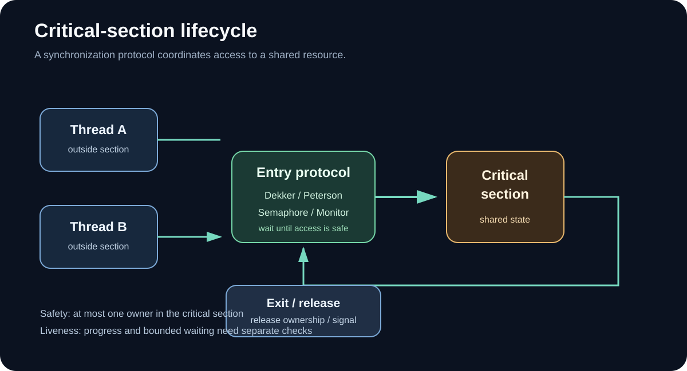
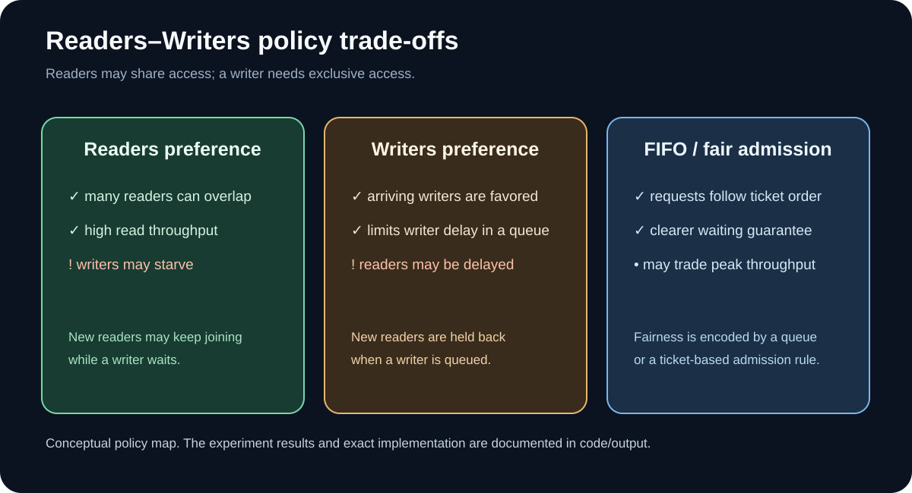
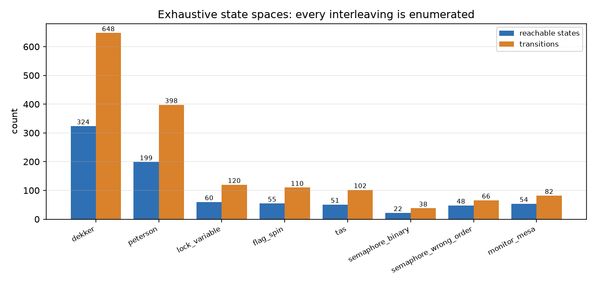
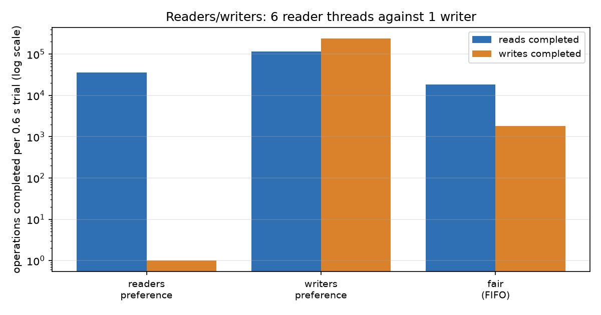
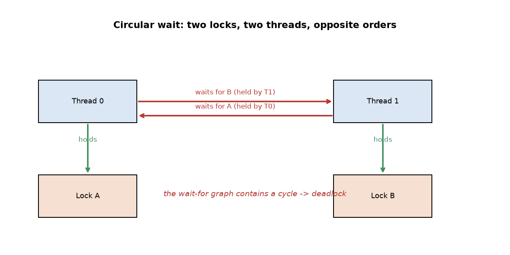
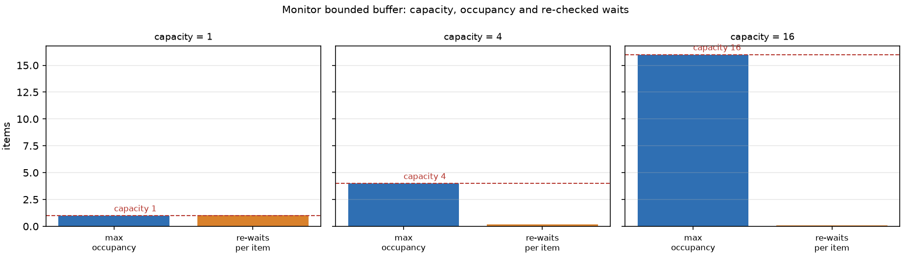

# راهنمای تکمیلی و تصویری — تمرین ۴

این راهنما به‌عنوان نقشه مطالعه گزارش‌های فارسی و انگلیسی عمل می‌کند. محور اصلی تمرین، تفاوت «درستی» و «کارایی» در همگام‌سازی است: اجرای موفق چندباره به‌تنهایی اثبات درستی نیست.

## ۱. چرخه ورود و خروج از ناحیه بحرانی

الگوریتم باید ورود هم‌زمان غیرمجاز را مهار کند. در کنار Mutual Exclusion، ویژگی‌های Progress و Bounded Waiting نیز باید جداگانه بررسی شوند؛ امن بودن، به‌تنهایی نبود گرسنگی یا بن‌بست را تضمین نمی‌کند.

## ۲. مسئله خوانندگان و نویسندگان

خواندن‌های هم‌زمان می‌توانند مجاز باشند، اما نوشتن باید انحصاری باشد. سیاست اولویت خواننده ممکن است نویسنده را گرسنه کند؛ اولویت نویسنده می‌تواند خواننده را معطل کند؛ صف FIFO تلاش می‌کند ترتیب درخواست‌ها را منصفانه‌تر رعایت کند.

## ۳. شواهد صحت در برابر اندازه‌گیری هزینه
این شاخه دو نوع شواهد را جدا نگه می‌دارد:
- **Model checking:** پیمایش کامل فضای حالت مدل‌شده و استخراج trace برای موارد نقض ویژگی‌ها.
- **Thread benchmarks:** اندازه‌گیری throughput، contention و زمان اجرا در محیط واقعی Python؛ این‌ها اندازه‌گیری تجربی‌اند و اثبات صحت نیستند.




## ۴. نتایج Readers-Writers

در آزمایش ثبت‌شده با ۶ خواننده و ۱ نویسنده، نسخه readers-preference فقط ۵ نوشتن را در بازه اندازه‌گیری تکمیل کرده است؛ این مشاهده با خطر گرسنگی نویسنده در این سیاست سازگار است. نتیجه یک benchmark وابسته به محیط و سناریوی مشخص است، نه یک نرخ تضمین‌شده برای همه سیستم‌ها.

## ۵. بن‌بست و Monitor


برای Condition Variable با semantics مانیتور Mesa، شرط انتظار باید پس از بیدارشدن دوباره بررسی شود؛ الگوی رایج استفاده از while برای بازبینی predicate است.

## ۶. اجرای آزمایش‌ها
```bash
pip install -r requirements.txt
python code/sync_model.py
python code/run_experiments.py
python code/make_diagrams.py
python -m pytest tests -q
```
نتایج عددی در output/experiments.json، traceهای بررسی مدل در output/model_check.txt و خلاصه تست‌ها در output/pytest_result.txt قرار دارند.

## ۷. محدودیت‌ها و تفسیر محتاطانه
- مدل Dekker و Peterson دو شرکت‌کننده را با فرض سازگاری ترتیبی بررسی می‌کند؛ این نتیجه مستقیماً به مدل‌های حافظه ضعیف یا تعداد بیشتر Thread تعمیم داده نمی‌شود.
- بنچمارک‌ها روی CPython و محیط اشتراکی اجرا شده‌اند؛ GIL و نوسان ماشین می‌توانند اعداد را تحت تأثیر قرار دهند.
- تست Thread به‌تنهایی اثبات صحت نیست؛ شواهد اثباتی از مدل بررسی‌شده و فرضیات آن می‌آیند.

## ۸. فایل‌های تحویلی
- [گزارش فارسی](../COMPARISON_FA.md) · [گزارش انگلیسی](../COMPARISON_EN.md)
- [Word فارسی](COMPARISON_FA.docx) · [PDF فارسی](COMPARISON_FA.pdf)
- [English Word](COMPARISON_EN.docx) · [English PDF](COMPARISON_EN.pdf)
- [Model checker](../code/sync_model.py) · [پیاده‌سازی‌ها](../code/sync_algorithms.py) · [تست‌ها](../tests/)

---
**English quick guide.** This visual companion separates formal properties checked in the finite model from runtime costs measured on CPython threads. Readers–Writers policies are compared by the fairness-throughput trade-off, and all empirical values should be read with their workload and environment.