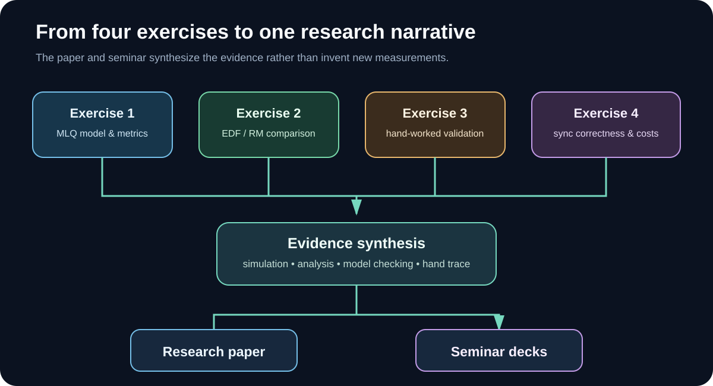
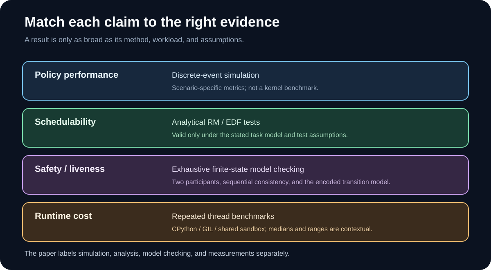
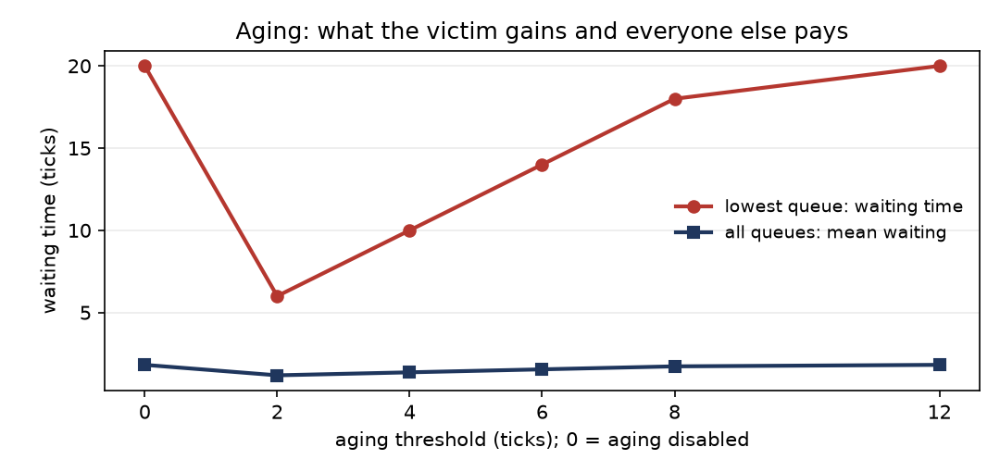
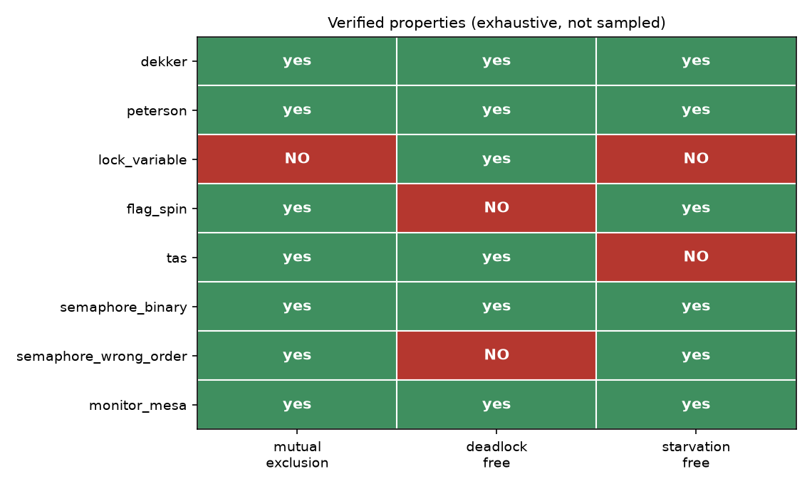
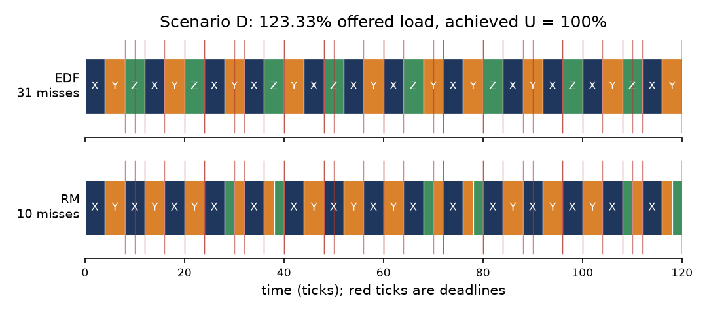
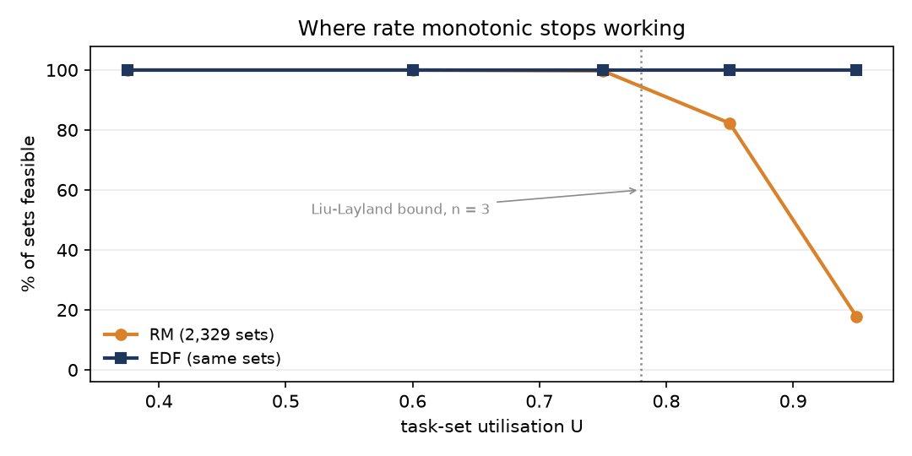
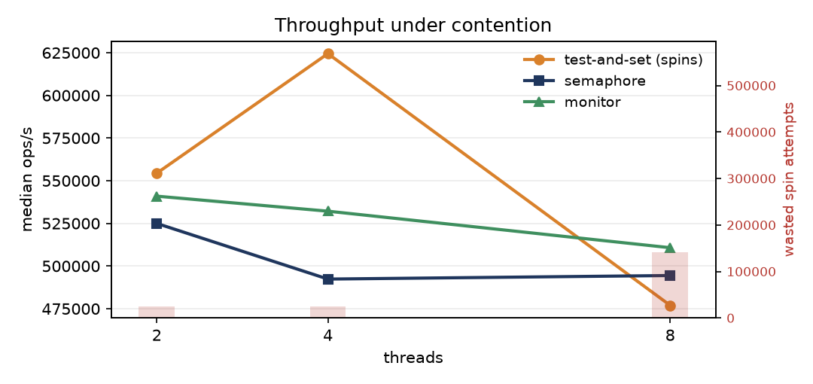

# راهنمای تکمیلی و تصویری — تمرین ۶

این پوشه محل نسخه‌های Word و PDF مقاله و دو فایل پاورپوینت سمینار است. این راهنما ارتباط بین چهار تمرین قبلی و استدلال مقاله را توضیح می‌دهد و مسیر مشاهده شکل‌ها و استفاده از اسلایدها را مشخص می‌کند.

## ۱. نقشه ارتباط تمرین‌ها با مقاله و سمینار

تمرین ۱ مدل MLQ و معیارهای آن را فراهم می‌کند؛ تمرین ۲ آن را در کنار EDF و RM می‌سنجد؛ تمرین ۳ یک مجموعه وظیفه را با محاسبه دستی و کد تطبیق می‌دهد؛ تمرین ۴ شواهد مربوط به صحت همگام‌سازی و هزینه تجربی را تولید می‌کند. مقاله و سمینار باید این شواهد را ترکیب کنند، نه اینکه اعداد جدید و بدون منبع بسازند.

## ۲. هر ادعا چه نوع مدرکی لازم دارد؟

- عملکرد سیاست‌ها: شبیه‌سازی گسسته و سناریوهای ثبت‌شده.
- زمان‌بندی‌پذیری: آزمون‌های تحلیلی RM و EDF با فرضیات مدل وظیفه.
- ویژگی‌های همگام‌سازی: model checking برای فضای حالت و انتقال‌های تعریف‌شده.
- هزینه اجرا: بنچمارک Thread؛ نتیجه تجربی و وابسته به محیط.

## ۳. تصاویر اصلی مورد استفاده در ارائه






## ۴. ترتیب پیشنهادی ارائه
1. مسئله زمان‌بندی CPU و نیاز به معیارهای مختلف را معرفی کنید.
2. معماری MLQ و سیاست‌های انتخاب صف را توضیح دهید.
3. تفاوت اولویت EDF و RM را با مثال نشان دهید.
4. نتایج تحلیلی را از نتایج شبیه‌سازی جدا کنید.
5. از مسئله Critical Section وارد مدل‌های Dekker، Peterson، Semaphore و Monitor شوید.
6. Readers-Writers را برای بحث عدالت و گرسنگی مثال بزنید.
7. در پایان، محدودیت روش‌ها و نتیجه‌های قابل دفاع را جمع‌بندی کنید.

## ۵. فایل‌های ارائه و مقاله
- [مقاله فارسی Markdown](../PAPER_FA.md) · [مقاله انگلیسی Markdown](../PAPER_EN.md)
- [Word فارسی](PAPER_FA.docx) · [PDF فارسی](PAPER_FA.pdf)
- [English Word](PAPER_EN.docx) · [English PDF](PAPER_EN.pdf)
- [پاورپوینت فارسی](SEMINAR_FA.pptx) · [پاورپوینت انگلیسی](SEMINAR_EN.pptx)
- [طرح اسلایدها](../SEMINAR_SLIDES.md) · [منابع](../REFERENCES.md) · [سازنده اسلاید](../code/build_deck.py)

## ۶. بررسی و بازتولید
```bash
pip install -r requirements.txt
python code/build_deck.py
python -m pytest tests -q
```
برای بازتولید اعداد و شکل‌های مقاله، باید از داده‌های خروجی تمرین‌های ۱ تا ۴ استفاده شود. سازنده اسلاید در این Branch از فایل اعداد ذخیره‌شده استفاده می‌کند؛ بنابراین اعداد ارائه بدون وجود خروجی‌های تمرین‌های دیگر به‌صورت مستقل از نو محاسبه نمی‌شوند.

## ۷. محدوده و محدودیت ادعاها
- مطالعه تصادفی زمان‌بندی‌پذیری، نمونه‌ای با یک مولد و یک seed است؛ قضیه عمومی نیست.
- مدل بررسی همگام‌سازی دو شرکت‌کننده و فرض sequential consistency دارد؛ به مدل‌های حافظه ضعیف تعمیم خودکار داده نمی‌شود.
- زمان‌های بنچمارک از CPython تحت GIL در محیط اشتراکی می‌آیند و مقادیر مطلق یا قابل تعمیم به همه سخت‌افزارها نیستند.
- شبیه‌سازهای زمان‌بندی مدل سیاست‌اند و هزینه دقیق یک پیاده‌سازی درون Kernel را اندازه نمی‌گیرند.

## ۸. وضعیت ویدئوی تمرین پنجم
کلیپ تمرین پنجم به‌صورت خصوصی برای استاد ارسال شده است و مدت آن طبق اعلام دانشجو **۵ ثانیه** است. فایل ویدئو در این مخزن قرار ندارد. محتوای کلیپ در اینجا قابل بررسی نیست؛ بنابراین کفایت آن نسبت به انتظار استاد تأیید نشده و در صورت لزوم باید جداگانه بررسی شود.

---
**English quick guide.** This page maps Exercises 1–4 to the evidence used by the bilingual paper and seminar decks. Read every chart with its workload and method: simulation, analytical schedulability tests, finite-state model checking, and runtime benchmarking answer different questions.