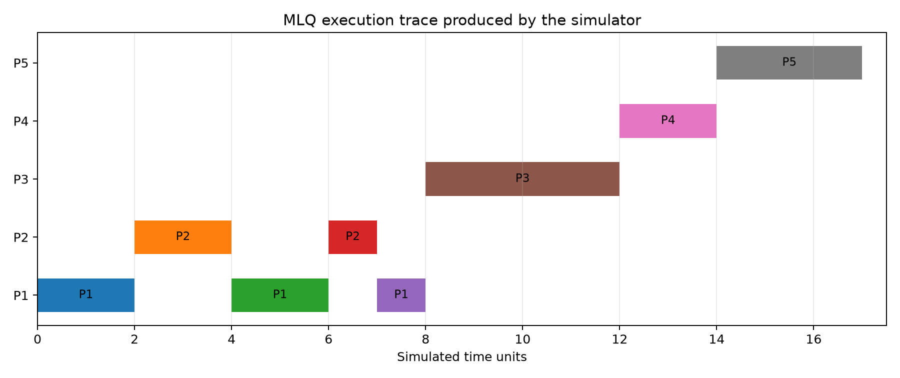
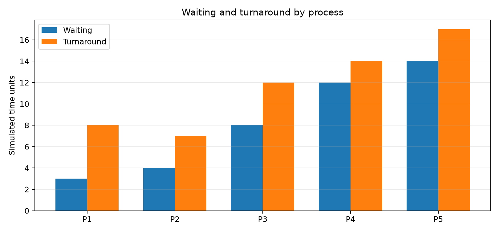
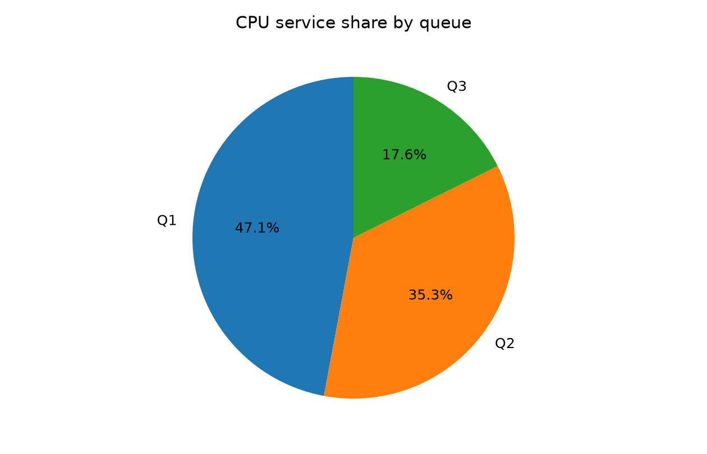

<!-- page 1 -->

## Abstract

This report studies an educational Multilevel Queue (MLQ) scheduler with three ways to guard shared state: a semaphore, a monitor, and a combined guard. The scheduler has three fixed queues. Queue 1 uses Round Robin with a quantum of two time units; queues 2 and 3 use FCFS. Five example processes arrive at time zero, and the resulting trace finishes at time 17. The report explains the model, derives the trace, calculates metrics, states limitations, and provides reproducible commands. The program is a discrete-event simulation, not an operating-system kernel scheduler and not a lock-throughput benchmark.

<!-- page 2 -->

## Exercise objective and scope

The exercise illustrates that scheduling and synchronization are related but distinct problems. A scheduler chooses which ready process receives CPU service; a synchronization mechanism protects shared data from incompatible accesses. This implementation provides a small example of both ideas, but only the scheduling behavior is simulated deterministically. It makes no claim about kernel scheduling, parallel process execution, or the performance superiority of any lock. Conclusions are limited to the defined queue policy, burst values, simultaneous arrivals, and this code revision.

<!-- page 3 -->

## The Multilevel Queue concept

In MLQ, processes are assigned to separate queues according to class or priority. Each queue can use its own internal policy, while an inter-queue policy decides which queue receives service next. This separation lets a system define different behavior for different workload classes. However, fixed priority can leave a lower-priority queue waiting for a long time. This project has three queues, with Q1 above Q2 and Q2 above Q3; queue selection starts from the first non-empty queue.

<!-- page 4 -->

## MLQ versus MLFQ

Basic MLQ should not be confused with Multilevel Feedback Queue (MLFQ). In MLQ, process-to-queue assignment is fixed and does not automatically change because of observed execution behavior. In MLFQ, the system may promote or demote processes according to CPU use or waiting history. This program uses fixed assignments and is therefore MLQ. Round Robin in the first queue and FCFS in the lower queues do not turn it into MLFQ. Any feedback, promotion, or demotion mechanism would be a separate extension.

<!-- page 5 -->

## Inter-queue policy

The inter-queue policy is strict priority: when Q1 is non-empty, Q2 and Q3 are not selected; Q2 is considered only when Q1 is empty; Q3 is selected only when both higher queues are empty. This rule is applied at dispatch boundaries. A lower queue may therefore wait until the higher queues drain. In the sample workload, Q1 receives service from time zero through time eight, followed by Q2 and then Q3. This is a property of the chosen policy and workload, not a universal result for all inputs.

<!-- page 6 -->

## Intra-queue policy in Q1

Q1 uses Round Robin with a quantum of two. A selected process receives at most two CPU time units; if its burst remains unfinished, it is appended to the end of Q1. This gives processes at the same priority level a chance to share service. A smaller quantum usually creates more dispatch boundaries, while a larger quantum can make the behavior closer to FCFS. This model treats context-switch cost as zero and records simulated intervals only; real overhead requires measurements on an operating system.

<!-- page 7 -->

## Intra-queue policy in Q2 and Q3

Q2 and Q3 use First-Come, First-Served. A selected process runs its entire remaining burst in one segment. Unlike RR, no quantum is applied to these queues. This reduces dispatch boundaries but can make later processes wait behind a long burst. In the sample input, P3 enters Q2 before P4 and runs from time 8 to 12; P4 then runs from 12 to 14. Q3 contains only P5, whose three-unit burst runs from 14 to 17. Changing arrival order can change FCFS order.

<!-- page 8 -->

## Process data model

The Process class stores the process identifier, queue number, original burst, and remaining burst. Queue numbers are restricted to 1, 2, or 3, and burst time must be positive. The remaining value is initialized from the original burst. This lets the simulator preserve the initial value for metrics while updating the amount left at each dispatch. The example uses five independent objects, and every identifier must be unique so that completion and metric records are not assigned to the wrong process.

<!-- page 9 -->

## Execution-slice data model

The Slice class represents one execution segment using a process identifier, queue, start time, and end time. A process such as P1 may be dispatched several times under RR, so its timeline contains multiple slice records. The sum of its slice lengths must equal its original burst. Each segment's end must also align with the next event on the simulated time axis. The timeline list is the source for Gantt rendering and provides raw data that can be checked by unit tests.

<!-- page 10 -->

## Arrival assumptions

All processes in the base example are ready at time zero. This makes each turnaround time equal its completion time, and waiting time can be computed as turnaround minus burst. The current program does not store a separate arrival time for each process, so the results should not be generalized to staggered arrivals without changing the code. With arrival times, the ready queues would contain only processes released by the current decision point, and each waiting metric would depend on that process's actual arrival time.

<!-- page 11 -->

## Ready-queue structures

The implementation stores one deque for each queue level. A deque is convenient for removing from the head and appending to the tail, which supports both FCFS and RR rotation. Dictionary keys 1, 2, and 3 refer to the corresponding queues. Each scheduler iteration finds the first non-empty queue. Because the queues are separate, the inter-queue selection policy can be changed without changing the internal deque representation; queue selection can be reviewed independently from the service rule within a queue.

<!-- page 12 -->

## Input validation

The program rejects queue identifiers outside 1–3, non-positive burst times, non-positive quantums, unknown synchronization modes, and duplicate process identifiers. These checks prevent common failure modes: a zero burst can break scheduling assumptions, while duplicate identifiers can overwrite metric records. Unit tests should check for a clear exception rather than merely expecting the program to continue. Future validation could also cover input types, empty identifiers, and extremely large values.

<!-- page 13 -->

## Shared-state invariant

At any time, each process should be ready, running, or completed. Remaining burst must never become negative, and a recorded finish time must follow the start of the final slice. In the simple single-scheduler model, one process receives CPU service in each interval. If a true multithreaded scheduler is added, queue changes, remaining bursts, completion records, and the timeline must be updated under a consistent atomic protocol so that two workers cannot dispatch the same process or record a segment twice.

<!-- page 14 -->

## Binary semaphore guard

SemaphoreGuard creates a semaphore with an initial value of one and pairs acquire/release through context-manager entry and exit. This pattern helps ensure that the protected section is released even when control exits through an exception. In this program, the semaphore guards scheduler queue state; however, the scheduling loop runs in one thread, so real contention between scheduler workers is not observed. It is therefore a structural demonstration of semaphore use, not proof of safety under every interleaving or a performance measurement.

<!-- page 15 -->

## Monitor and condition variable

MonitorGuard uses Python's Condition and Lock. Entering the monitor acquires the underlying lock; leaving calls notify_all and releases it. The monitor illustrates encapsulation of shared state and the operations permitted on that state. If consumers are actually waiting for a condition, the condition must be checked in a loop: waking does not guarantee that the condition is still true. This example does not run a multithreaded waiting path, so it demonstrates the guard structure and notification pattern only.

<!-- page 16 -->

## Combined semaphore and monitor

CombinedGuard acquires the semaphore first and the condition lock second, then releases them in reverse order: condition followed by semaphore. Keeping lock acquisition order consistent across all code paths helps avoid wait cycles. A different path that takes the locks in the opposite order could create deadlock. A consistent order alone is not a complete proof of deadlock freedom; every path, wait point, and release condition must be considered. In this example, only one scheduler thread uses the guard.

<!-- page 17 -->

## Lock-order discipline

With multiple locks, acquisition order is part of the design. If thread A obtains X and then requests Y, while thread B obtains Y and then requests X, each may wait for the lock held by the other. CombinedGuard chooses semaphore followed by condition. This contract must remain consistent in every path that uses both resources. Ordinary unit tests may not trigger a rare interleaving; stronger claims require dedicated concurrency tests or model analysis.

<!-- page 18 -->

## The scheduler critical section

The protected region in run includes queue selection, removal of the process, duration calculation, time and remaining-burst updates, and timeline recording. In a multithreaded implementation, splitting these operations without a lock could allow two workers to act on the same queue snapshot. The guard should protect the complete state transition invariant, not just one append operation. The critical section should also not be unnecessarily long; in a real program, lengthy work under a lock can block other threads.

<!-- page 19 -->

## Deterministic simulation

For fixed input, queue policy, and quantum, the program produces the same trace. Determinism is useful for teaching because a manual calculation and unit test can be compared with the program output. However, the scheduler has no real worker-thread contention, and operating-system thread scheduling does not affect the dispatch choices. All three synchronization modes therefore produce the same trace. This equality does not prove equal lock cost or equal performance under real parallel load.

<!-- page 20 -->

## Scheduling-loop pseudocode

The scheduling loop can be summarized as follows: while any queue is non-empty, enter the selected guard; find the first non-empty queue; remove its first process; run min(remaining, quantum) for Q1 or all remaining work for Q2/Q3; update time and remaining burst; record the slice; and append an unfinished process to the tail of its original queue. If the remaining burst reaches zero, record its completion time. These steps define the manual trace and the expected unit-test output.

<!-- page 21 -->

## Round Robin behavior

RR limits the CPU share given to each Q1 process in one turn. If a process finishes before the quantum expires, it consumes less than the quantum; otherwise it consumes the full quantum and returns to the queue tail. This lets peer processes receive another turn. In the sample, P1 with burst five runs in intervals 0–2, 4–6, and 7–8; P2 runs in 2–4 and 6–7. Their total CPU service is five and three units, respectively.

<!-- page 22 -->

## FCFS behavior

In Q2 and Q3, FCFS runs the selected process until its remaining burst is complete. No quantum applies to these queues. This reduces dispatch boundaries but allows a long process to increase the waiting time of later queue members. In the sample, P3 with burst four runs before P4 with burst two. If P3 were longer, P4 would wait for the full P3 execution interval. This effect should be visible in the waiting-time metrics.

<!-- page 23 -->

## Sample workload definition

The base input contains five processes: P1 in Q1 with burst five, P2 in Q1 with burst three, P3 in Q2 with burst four, P4 in Q2 with burst two, and P5 in Q3 with burst three. All arrive at time zero. Total CPU burst demand is 17 units. This workload demonstrates RR in the first queue, FCFS in the second, and lower priority in the third. It is not sufficient to prove algorithm superiority because it has neither random arrivals nor broad variation in bursts.

<!-- page 24 -->

## Manual derivation of the trace

Q1 first runs P1 for two units, then P2 for two. P1 receives another two units, P2 completes its remaining one unit, and P1 runs its final one unit. Q1 is empty at time 8. Q2 then runs P3 for four units and P4 for two, becoming empty at time 14. Finally, P5 in Q3 runs for three units, so the entire workload completes at time 17. The segment lengths must sum to exactly 17.

<!-- page 25 -->

## Generated Gantt chart

The following Gantt chart is generated from the program's schedule trace rather than from hypothetical hand-entered timings. Each rectangle represents an execution slice, and its label identifies the process. Segment boundaries reveal dispatch points and the return of unfinished processes to the queue. The horizontal axis is simulated time, not wall-clock seconds. Read the chart together with the workload, quantum, and inter-queue policy. When the input changes, the Gantt chart should be regenerated from the new trace.

<!-- page 26 -->

## Completion time

A process completion time is the moment its final execution slice ends. In the sample, P1 completes at 8, P2 at 7, P3 at 12, P4 at 14, and P5 at 17. Completion time depends on queue position, bursts ahead, and the inter-queue policy. In particular, P5 in Q3 receives no CPU service until both higher-priority queues have drained. Completion order is not necessarily the same as process creation order or burst length.

<!-- page 27 -->

## Turnaround time

Turnaround time equals completion minus arrival. Because every arrival in the sample is zero, each process's turnaround equals its completion: P1 is 8, P2 is 7, P3 is 12, P4 is 14, and P5 is 17. Mean turnaround is 11.6 time units. This summary can hide the larger delay experienced by the Q3 process, so the distribution and queue-specific metrics should also be reported. For non-zero arrivals, subtract each process's own arrival time.

<!-- page 28 -->

## Waiting time

In a model without I/O, waiting time equals turnaround minus CPU burst. The sample values are 3 for P1, 4 for P2, 8 for P3, 12 for P4, and 14 for P5. Mean waiting time is 8.2 units. P5's high waiting time follows from strict priority and the execution of Q1 and Q2 first. The simulator's waiting dictionary accumulates time while other processes are served; metrics also uses completion minus burst, which is consistent for this simultaneous-arrival, no-I/O workload.

<!-- page 29 -->

## Response time

Response time is measured from arrival until the first start of execution. In this input, response times are 0 for P1, 2 for P2, 8 for P3, 12 for P4, and 14 for P5; the mean is 7.2. The current metrics output does not expose this as a separate field, so it must be derived from the first start recorded for each process. Response time is not the same as total waiting time: waiting includes every ready-but-not-running interval, whereas response ends at first dispatch.

<!-- page 30 -->

## Process-metric table

| Process | Queue | Burst | Completion | Waiting | Turnaround | First response |
|---|---:|---:|---:|---:|---:|---:|
| P1 | 1 | 5 | 8 | 3 | 8 | 0 |
| P2 | 1 | 3 | 7 | 4 | 7 | 2 |
| P3 | 2 | 4 | 12 | 8 | 12 | 8 |
| P4 | 2 | 2 | 14 | 12 | 14 | 12 |
| P5 | 3 | 3 | 17 | 14 | 17 | 14 |

Response time is calculated from each process's first start and is not printed as a separate CLI metric in the current version. These values apply to simultaneous arrival at time zero.

<!-- page 31 -->

## Unit-test design

Unit tests should validate both local invariants and the complete trace. The expected-trace test checks process ordering and exact interval boundaries. The RR test limits each Q1 slice by the quantum. The priority test verifies that Q1 drains before Q2 and Q2 before Q3. The completion test ensures all remaining bursts reach zero and completion values are recorded. The SVG test checks that an output file exists and includes process and queue labels.

<!-- page 32 -->

## Trace equivalence across modes

For a fixed workload and queue policy, semaphore, monitor, and combined modes should produce the same trace because the guard protects simulator state but does not change scheduling decisions. A trace-equivalence test checks this contract. A difference would suggest that one guard path changed queue state, order, or simulated time. This test is useful for deterministic logic, but it does not test races between independent worker threads; that requires real concurrent consumers.

<!-- page 33 -->

## Quantum verification

For Q1, no execution slice may exceed the quantum, and an unfinished process must be eligible for a later turn. The current test uses quantum two, checks slice lengths, and matches total Q1 CPU service against the sum of its process bursts. Changing the quantum to one or three may change Gantt boundaries and waiting times even though total CPU demand remains constant. Quantum must be positive; zero or negative values are invalid.

<!-- page 34 -->

## Strict priority and starvation

Fixed inter-queue priority creates a starvation risk for lower queues. If Q1 continuously has ready work, Q2 may receive no service; similarly, Q3 can wait while Q1 or Q2 remains continuously busy. In the finite sample all queues eventually drain, so every process completes. That completion is not a general fairness guarantee. Aging, inter-queue time shares, or dynamic priority could reduce starvation; each extension should be evaluated under sustained load and maximum-wait metrics.

<!-- page 35 -->

## Empty workload

When the process list is empty, all queues are empty and the run loop does not execute. The timeline remains empty and metrics returns an empty dictionary. This behavior should be accepted without error because an empty workload is a valid boundary case. Rendering an empty Gantt chart should create a minimal output without division by zero. The empty-workload unit test checks this contract and makes the simulator more robust than a script that only works for one hard-coded example.

<!-- page 36 -->

## Invalid inputs and duplicate identifiers

A queue outside 1–3 or a non-positive burst causes Process to raise ValueError. An unsupported mode or invalid quantum is rejected by the scheduler constructor. Duplicate process identifiers are also rejected so the processes dictionary cannot overwrite one object with another. Tests should check these exceptions explicitly. In an application, error messages could include the process identifier and offending value to make input correction easier.

<!-- page 37 -->

## SVG Gantt generation

The render_gantt function creates a standalone SVG and maps each Slice to a rectangle on the time axis. Rectangle width is proportional to the slice duration, and its fill distinguishes the queue. Process identifiers appear inside each block, while start and finish labels appear along the axis. SVG is useful in a README because it scales without pixelation. In a report, the caption should identify the colors and state that this is a simulated trace, not an observation of a real kernel scheduler.

<!-- page 38 -->

## Meaning of synchronization

Semaphores, monitors, and condition locks coordinate access; they do not choose which process receives service. The MLQ logic decides whether Q1 or Q2 is selected. The guard protects shared queue and timeline state. In a multithreaded architecture, a producer adding processes and a scheduler removing them must follow a shared protocol. A thread awakened by notify must re-check its condition; a notification alone does not guarantee that ready work exists.

<!-- page 39 -->

## Races and race conditions

A race condition occurs when a result depends on the timing of multiple threads accessing shared state. Two workers might observe the same process at the head of a queue and both dispatch it, or both write its completion record. The guards in this exercise illustrate protection, but the base loop has only one scheduler thread, so these races are not activated. A serious race test needs concurrent requesters, repeated operations under load, and invariant checks during execution.

<!-- page 40 -->

## Fairness and waiting policy

Fairness cannot be inferred merely from equality of the three traces. Fairness concerns how turns are distributed among requesters and depends on the waiting-queue and wake-up contract. A semaphore or Condition does not provide the same FIFO guarantee in every implementation. A concurrent experiment should record request time, critical-section entry time, and how many requests moved ahead. If bounded waiting is required, an explicit queueing policy must be designed and tested or proved separately.

<!-- page 41 -->

## Why the clip is not a benchmark

The attached clip shows the same deterministic trace in three synchronization modes. It is a visual teaching aid for architecture and event order. It does not time acquire or release operations, does not run multiple independent scheduler workers in contention, and does not record statistical repetitions. It is therefore useful for explaining the design but cannot compare lock throughput, latency, or lock cost. The clip's title and annotation state this limitation to avoid misleading interpretation.

<!-- page 42 -->

## Scheduling and context-switch cost

The simulator advances discrete burst units and does not measure actual CPU wall time. Real operating systems incur context-switch costs and are affected by cache misses, TLB activity, kernel scheduling, and I/O. The number of timeline slices can be counted as modeled dispatch events, but must not be converted directly to milliseconds. Estimating real cost requires running a defined workload on the target system and recording wall-clock and CPU times with suitable tools.

<!-- page 43 -->

## Model limitations

The current model assumes simultaneous arrival at time zero, a single processor, no I/O, known burst times, zero context-switch cost, and fixed queue assignments. Inter-queue priority is strict, and only Q1 uses RR with quantum two. The program does not model process migration between queues, deadlines, periodic release, or preemption within FCFS bursts. These simplifications are suitable for teaching but restrict the scope of conclusions. Every result should be stated with its relevant assumption.

<!-- page 44 -->

## Threats to validity

A five-process workload cannot represent all MLQ arrival and burst distributions. P5's high waiting time follows from the selected strict-priority policy and this particular sample. Comparing the three guards without concurrent contention cannot support a performance ranking. Broader validity requires varying workload size, arrival order, quantum, queue mix, and number of worker threads. Python version, hardware, operating system, and run commands should be recorded so environment effects are not confused with algorithm effects.

<!-- page 45 -->

## Reproducibility

A reproducible experiment records the branch commit, Python version, command, mode, quantum, and workload. Running `python exercise-5/mlq_sync_demo.py --all --gantt exercise-5/gantt.svg` executes all three modes and generates SVG output. Unit tests run with `python -m unittest discover -s exercise-5 -p 'test_*.py' -v`. Keep terminal output and Gantt files beside the report. If code or parameters change, regenerate both the figure and metric table from the new trace.

<!-- page 46 -->

## Future extensions

Useful extensions include per-process arrival times, response time as an explicit metric, a command-line quantum option, JSON workload input, alternative inter-queue policies, aging, preemptive lower queues, I/O bursts, and genuine multithreaded experiments. Each extension should begin with a behavioral contract and invariants, followed by code and tests. A chart without retained raw data has limited scientific value; the plotting tool should consume the same trace or experiment data that supports the reported conclusions.

<!-- page 47 -->

## Conclusion

This exercise provides a reproducible MLQ example with RR in Q1, FCFS in Q2 and Q3, and three synchronization guards protecting the scheduler's internal state. The sample trace completes at time 17, with mean waiting time 8.2 and mean turnaround 11.6. Equal traces are expected because the scheduling logic is deterministic; they do not measure lock speed. A claim about real contention requires a separate multithreaded experiment, wall-clock measurements, and an explicit fairness analysis.
