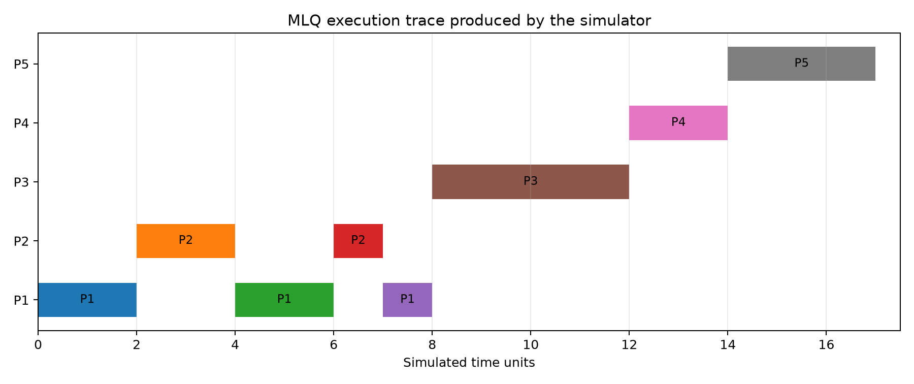
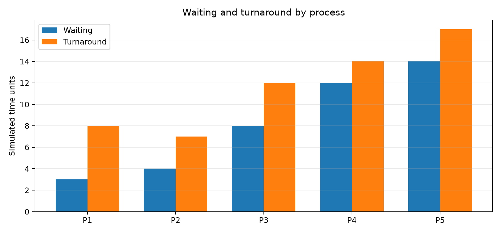
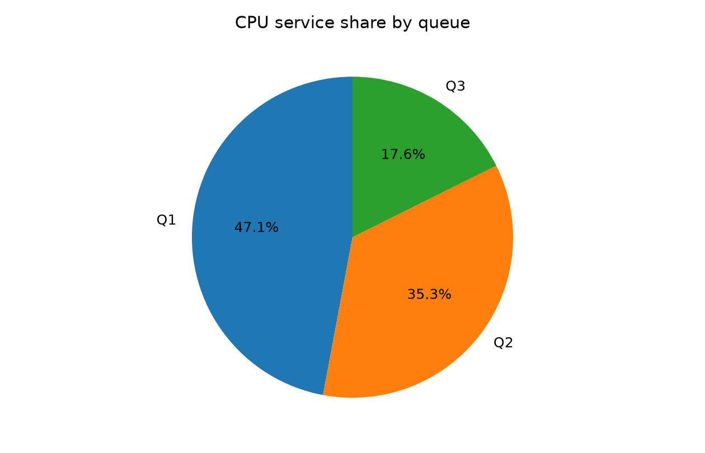

<!-- page 1 -->

## چکیده

این گزارش یک نمونهٔ آموزشی از زمان‌بندی صف چندسطحی (MLQ) را همراه سه شیوهٔ محافظت از وضعیت مشترک بررسی می‌کند: سمافور، مانیتور و ترکیب آن‌ها. برنامه سه صف ثابت دارد؛ صف اول با Round Robin و quantum برابر دو واحد زمانی کار می‌کند و صف‌های دوم و سوم با FCFS اجرا می‌شوند. پنج پردازهٔ نمونه در زمان صفر وارد می‌شوند و ردّ اجرای حاصل تا زمان ۱۷ ادامه دارد. هدف گزارش توضیح مدل، تحلیل دستی trace، محاسبهٔ معیارها، شرح محدودیت‌ها و امکان بازتولید نتیجه است. خروجی برنامه یک شبیه‌سازی گسسته است، نه زمان‌بند کرنل سیستم‌عامل و نه بنچمارک سرعت قفل‌ها.

<!-- page 2 -->

## هدف و محدودهٔ تمرین

هدف تمرین نمایش این نکته است که زمان‌بندی و همگام‌سازی دو مسئلهٔ مرتبط اما متمایزند. زمان‌بند انتخاب می‌کند کدام پردازه از صف آماده اجرا شود؛ سازوکار همگام‌سازی از ساختارهای دادهٔ مشترک در برابر دسترسی ناسازگار محافظت می‌کند. این پیاده‌سازی برای هر دو مفهوم یک مثال کوچک فراهم می‌آورد، اما فقط زمان‌بندی را به‌صورت قطعی شبیه‌سازی می‌کند. هیچ ادعایی دربارهٔ زمان‌بندی واقعی هسته، موازی‌سازی پردازه‌ها یا برتری عملکردی یکی از قفل‌ها مطرح نمی‌شود. دامنهٔ نتیجه به سیاست صف‌ها، مقادیر burst، ورود هم‌زمان پردازه‌ها و نسخهٔ همین کد محدود است.

<!-- page 3 -->

## مفهوم صف چندسطحی

در MLQ پردازه‌ها بر اساس کلاس یا اولویت به صف‌های جداگانه تخصیص می‌یابند. هر صف می‌تواند سیاست درون‌صفی ویژه‌ای داشته باشد و سیاست بین‌صفی مشخص می‌کند کدام صف در گام بعد سرویس بگیرد. جداسازی صف‌ها به مدیر سیستم اجازه می‌دهد رفتار متفاوتی برای بارهای کاری مختلف تعریف کند. با این حال، اولویت ثابت ممکن است باعث شود صف پایین‌اولویت مدت زیادی منتظر بماند. در این پروژه سه صف با اولویت Q1 بالاتر از Q2 و Q2 بالاتر از Q3 وجود دارند و انتخاب صف از اولین صف غیرخالی آغاز می‌شود.

<!-- page 4 -->

## تفاوت MLQ و MLFQ

MLQ را نباید با Multilevel Feedback Queue یا MLFQ یکی دانست. در MLQ پایه، انتساب پردازه به صف ثابت است و رفتار آن در طول اجرا باعث ارتقا یا تنزل خودکار نمی‌شود. در MLFQ، سامانه معمولاً بر اساس الگوی مصرف CPU و انتظار، سطح صف را تغییر می‌دهد. این برنامه انتساب ثابت دارد؛ بنابراین نام دقیق آن MLQ است. استفاده از RR در صف اول یا FCFS در صف‌های پایین، به‌تنهایی آن را به MLFQ تبدیل نمی‌کند. هرگونه بحث دربارهٔ feedback، promotion یا demotion باید به‌عنوان توسعه‌ای جداگانه معرفی شود.

<!-- page 5 -->

## سیاست بین‌صفی

سیاست بین‌صفی این نمونه، اولویت سخت‌گیرانه است: هرگاه Q1 غیرخالی باشد، از Q2 و Q3 انتخاب نمی‌شود؛ اگر Q1 خالی باشد Q2 بررسی می‌شود؛ و فقط در نبود کار در هر دو صف، Q3 اجرا می‌شود. این تصمیم در مرز dispatch اعمال می‌شود. بنابراین یک صف پایین‌تر ممکن است تا پایان تخلیهٔ صف‌های بالاتر منتظر بماند. در بار نمونه، Q1 از زمان صفر تا هشت واحد سرویس می‌گیرد و سپس Q2 و Q3 اجرا می‌شوند. چنین نتیجه‌ای ویژگی سیاست و ورودی انتخاب‌شده است و نباید به همهٔ workloadها تعمیم یابد.

<!-- page 6 -->

## سیاست درون صف اول

صف اول از Round Robin با quantum دو استفاده می‌کند. پردازهٔ انتخاب‌شده حداکثر دو واحد زمانی CPU می‌گیرد؛ اگر burst باقی‌مانده داشته باشد به انتهای Q1 بازمی‌گردد. این قاعده اجازه می‌دهد پردازه‌های هم‌سطح نوبت را با هم تقسیم کنند. quantum کوچک‌تر معمولاً تعداد dispatch و تعویض‌های منطقی را افزایش می‌دهد، درحالی‌که quantum بزرگ‌تر می‌تواند رفتار را به FCFS نزدیک کند. مدل حاضر هزینهٔ تعویض زمینه را صفر می‌گیرد و فقط بازه‌های شبیه‌سازی را ثبت می‌کند؛ بنابراین تحلیل سربار واقعی به دادهٔ سیستم‌عامل نیاز دارد.

<!-- page 7 -->

## سیاست درون صف‌های دوم و سوم

صف‌های Q2 و Q3 با First-Come, First-Served اجرا می‌شوند. در این سیاست، پردازه‌ای که زودتر در صف قرار گرفته است، تمام burst باقی‌مانده‌اش را در یک قطعه اجرا می‌کند. در workload نمونه، P3 قبل از P4 در Q2 قرار گرفته و به همین دلیل از زمان ۸ تا ۱۲ اجرا می‌شود؛ سپس P4 در بازهٔ ۱۲ تا ۱۴ اجرا می‌شود. Q3 فقط P5 را دارد و تمام burst سه واحدی آن در بازهٔ ۱۴ تا ۱۷ اجرا می‌شود. تغییر ترتیب ورود می‌تواند ترتیب FCFS را تغییر دهد.

<!-- page 8 -->

## مدل پردازه

کلاس Process در کد شناسهٔ پردازه، شمارهٔ صف، burst اولیه و burst باقی‌مانده را نگهداری می‌کند. شمارهٔ صف فقط می‌تواند ۱، ۲ یا ۳ باشد و burst باید مثبت باشد. مقدار remaining در زمان ساخت از burst مقداردهی می‌شود. این جداسازی اجازه می‌دهد برنامه هم مقدار اولیه را برای گزارش معیارها حفظ کند و هم مقدار باقی‌مانده را در هر dispatch تغییر دهد. دادهٔ نمونه پنج شیء مستقل است و هر شناسه باید یکتا باشد تا completion و metrics به پردازهٔ اشتباه نسبت داده نشوند.

<!-- page 9 -->

## مدل قطعهٔ اجرا

کلاس Slice یک قطعه از اجرای پردازه را با شناسه، صف، زمان شروع و زمان پایان توصیف می‌کند. استفاده از قطعه‌ها باعث می‌شود پردازه‌ای مانند P1 که در RR چند بار اجرا می‌شود، در trace چند رکورد مجزا داشته باشد. مجموع طول قطعه‌های یک پردازه باید برابر burst اولیهٔ آن شود. همچنین پایان هر قطعه باید با شروع قطعهٔ بعدی روی محور زمان سازگار باشد. لیست timeline منبع ساخت Gantt است و دادهٔ خامی فراهم می‌کند که می‌توان با آزمون‌های واحد آن را کنترل کرد.

<!-- page 10 -->

## فرض ورود پردازه‌ها

در مثال پایه همهٔ پردازه‌ها در زمان صفر آماده‌اند. این فرض باعث می‌شود زمان گردش هر پردازه با زمان پایان آن برابر باشد و زمان انتظار از رابطهٔ turnaround منهای burst به دست آید. برنامهٔ فعلی ورودی arrival time مجزا برای هر پردازه ندارد؛ بنابراین نباید نتایج این مثال را بدون تغییر کد به سناریوهای ورود تدریجی تعمیم داد. اگر arrival time اضافه شود، صف آماده باید فقط پردازه‌هایی را شامل شود که تا لحظهٔ تصمیم آزاد شده‌اند و محاسبهٔ انتظار نیز به زمان ورود هر پردازه وابسته خواهد شد.

<!-- page 11 -->

## ساختار صف‌های آماده

پیاده‌سازی برای هر سطح یک deque جدا نگه می‌دارد. deque برای برداشتن عنصر از ابتدای صف و افزودن مجدد به انتهای آن مناسب است؛ این عملیات برای FCFS و گردش نوبت در RR ساده و خواناست. کلیدهای دیکشنری ۱، ۲ و ۳ به صف‌های متناظر اشاره می‌کنند. در هر دور حلقه، اولین صف غیرخالی پیدا می‌شود. چون صف‌ها جدا هستند، تغییر سیاست بین‌صفی نیازمند دستکاری ساختار داخلی dequeها نیست و می‌توان انتخاب صف را مستقل از نحوهٔ اجرای درون آن بررسی کرد.

<!-- page 12 -->

## اعتبارسنجی ورودی

کد شمارهٔ صف خارج از مجموعهٔ ۱ تا ۳، burst غیرمثبت، quantum غیرمثبت، حالت همگام‌سازی ناشناخته و شناسهٔ تکراری را رد می‌کند. این کنترل‌ها جلوی بخشی از خطاهای رایج را می‌گیرند؛ برای مثال burst صفر می‌تواند حلقهٔ زمان‌بندی را دچار منطق نامعتبر کند و شناسهٔ تکراری نتایج را مبهم می‌سازد. آزمون ورودی نامعتبر باید وجود استثنای روشن را بررسی کند، نه آن‌که فقط انتظار داشته باشد برنامه بدون توقف ادامه دهد. کنترل نوع داده، شناسهٔ خالی و مقادیر بسیار بزرگ نیز می‌توانند در توسعهٔ بعدی افزوده شوند.

<!-- page 13 -->

## ناوردای وضعیت مشترک

در هر لحظه هر پردازه باید در یکی از وضعیت‌های آماده، در حال اجرا یا تکمیل‌شده باشد. remaining نباید منفی شود و پایان ثبت‌شده باید پس از شروع قطعه قرار گیرد. در مدل سادهٔ تک‌زمان‌بند، فقط یک پردازه در هر قطعهٔ زمانی CPU را می‌گیرد. اگر اجرای واقعی چندنخی به پروژه افزوده شود، تغییر صف، remaining، completion و timeline باید تحت یک پروتکل اتمی انجام شود تا دو نخ یک پردازه را هم‌زمان انتخاب نکنند یا یک قطعه را دوبار ثبت نکنند.

<!-- page 14 -->

## سمافور دودویی

کلاس SemaphoreGuard یک سمافور با مقدار اولیهٔ یک می‌سازد و acquire/release را در متدهای ورود و خروج context manager انجام می‌دهد. این الگو کمک می‌کند بخش محافظت‌شده حتی در صورت خروج استثنایی از بلوک آزاد شود. در این برنامه سمافور از دسترسی به ساختار صف‌ها محافظت می‌کند؛ اما چون حلقهٔ زمان‌بند در یک نخ اجرا می‌شود، رقابت واقعی میان چند نخ مشاهده نمی‌شود. بنابراین این بخش نمایش ساختاری کاربرد سمافور است، نه اثبات ایمنی در هر interleaving یا اندازه‌گیری کارایی.

<!-- page 15 -->

## مانیتور و شرط

MonitorGuard از Condition و Lock پایتون استفاده می‌کند. ورود به monitor قفل underlying را می‌گیرد و هنگام خروج notify_all فراخوانی می‌شود و سپس قفل آزاد می‌شود. مانیتور مفهوم کپسوله‌سازی دادهٔ مشترک و عملیات مجاز روی آن را نشان می‌دهد. اگر نخ‌های مصرف‌کننده واقعاً منتظر یک شرط باشند، شرط باید در حلقه بررسی شود؛ بیدار شدن به معنی تضمین برقرار بودن شرط نیست. مثال حاضر مسیر انتظار چندنخی را اجرا نمی‌کند و بنابراین صرفاً ساختار محافظت و اعلان را به‌صورت آموزشی نشان می‌دهد.

<!-- page 16 -->

## ترکیب سمافور و مانیتور

CombinedGuard ابتدا سمافور و سپس قفل شرط را می‌گیرد و هنگام خروج به همان ترتیب معکوس آزاد می‌کند: ابتدا condition و سپس semaphore. یکسان نگه‌داشتن ترتیب اخذ قفل‌ها در همهٔ مسیرها به جلوگیری از چرخهٔ انتظار کمک می‌کند. اگر مسیر دیگری ترتیب متفاوتی داشته باشد، امکان deadlock افزایش می‌یابد. با این حال یک الگوی ثابت گرفتن قفل به‌تنهایی اثبات کامل نبود بن‌بست نیست؛ تمام مسیرهای کد، نقاط انتظار و شرایط آزادسازی باید تحلیل شوند. در مثال حاضر فقط یک نخ زمان‌بند از این guard استفاده می‌کند.

<!-- page 17 -->

## ترتیب گرفتن قفل‌ها

در برنامه‌های دارای چند قفل، ترتیب اخذ منابع بخشی از طراحی است. اگر نخ A ابتدا قفل X و سپس Y را بگیرد و نخ B ابتدا Y و سپس X را بخواهد، ممکن است هر دو در انتظار قفل متعلق به دیگری بمانند. CombinedGuard ترتیب semaphore سپس condition را انتخاب می‌کند. این قرارداد باید در تمام بخش‌هایی که هر دو منبع را استفاده می‌کنند حفظ شود. آزمون واحد معمولی ممکن است چنین interleaving نادری را ایجاد نکند؛ برای ادعای قوی‌تر باید آزمون هم‌روندی یا تحلیل مدل جداگانه طراحی شود.

<!-- page 18 -->

## بخش بحرانی در زمان‌بند

بخش محافظت‌شده در run شامل انتخاب صف، برداشتن پردازه، محاسبهٔ مدت اجرا، به‌روزرسانی زمان، remaining و ثبت قطعهٔ timeline است. اگر در یک پیاده‌سازی چندنخی این عملیات تکه‌تکه و بدون قفل انجام شود، دو نخ می‌توانند بر اساس snapshot یکسان تصمیم ناسازگار بگیرند. قفل باید از invariant کل انتقال وضعیت حفاظت کند، نه فقط یک دستور append را. محدودهٔ قفل نیز نباید بی‌دلیل طولانی شود؛ در برنامهٔ واقعی ممکن است اجرای کار طولانی داخل قفل، سایر نخ‌ها را متوقف کند.

<!-- page 19 -->

## قطعی بودن شبیه‌سازی

برای ورودی ثابت، سیاست صف ثابت و quantum مشخص، برنامه trace یکسانی تولید می‌کند. این قطعی بودن برای آموزش مفید است، زیرا می‌توان محاسبهٔ دستی و آزمون واحد را با خروجی برنامه تطبیق داد. در عوض، زمان‌بند هیچ رقابت واقعی بین نخ‌های scheduler ندارد و thread scheduling سیستم‌عامل ترتیب تصمیم‌ها را تغییر نمی‌دهد. سه حالت همگام‌سازی به همین دلیل trace برابر تولید می‌کنند. از این برابری نمی‌توان نتیجه گرفت هزینهٔ سه guard برابر است یا در بار موازی واقعی کارایی یکسانی دارند.

<!-- page 20 -->

## شبه‌کد حلقهٔ زمان‌بندی

منطق حلقه را می‌توان چنین خلاصه کرد: تا وقتی یکی از صف‌ها غیرخالی است، guard انتخاب‌شده را بگیر؛ اولین صف غیرخالی را پیدا کن؛ پردازهٔ ابتدای صف را خارج کن؛ برای Q1 حداکثر min(remaining, quantum) و برای Q2/Q3 کل remaining را اجرا کن؛ زمان و remaining را به‌روز کن؛ قطعهٔ اجرا را ثبت کن؛ و اگر باقی‌مانده وجود دارد پردازه را به انتهای صف خودش بازگردان. اگر remaining صفر شد، زمان تکمیل آن ثبت می‌شود. این گام‌ها مبنای کنترل trace دستی هستند.

<!-- page 21 -->

## رفتار Round Robin

RR به پردازهٔ Q1 سهم زمانی محدود می‌دهد. اگر پردازه قبل از پایان quantum تمام شود، زمان مصرفی واقعی کمتر از quantum است؛ وگرنه دقیقاً quantum زمان می‌گیرد و به انتهای صف برمی‌گردد. این جابه‌جایی، نوبت سایر پردازه‌های همان صف را ممکن می‌سازد. در مثال، P1 با burst پنج در بازه‌های ۰–۲، ۴–۶ و ۷–۸ اجرا می‌شود؛ P2 نیز در ۲–۴ و ۶–۷ اجرا می‌شود. مجموع زمان CPU آن‌ها به‌ترتیب پنج و سه واحد است.

<!-- page 22 -->

## رفتار FCFS

در Q2 و Q3 سیاست FCFS پردازهٔ انتخاب‌شده را تا اتمام burst باقی‌مانده اجرا می‌کند. برخلاف RR، quantum برای این دو صف اعمال نمی‌شود. این تصمیم تعداد مرزهای dispatch را در صف‌های پایین کاهش می‌دهد، اما ممکن است یک پردازهٔ طولانی، انتظار پردازه‌های بعدی همان صف را بیشتر کند. در ورودی نمونه P3 با burst چهار پیش از P4 با burst دو اجرا می‌شود. اگر P3 طولانی‌تر بود، P4 باید کل مدت اجرای P3 را منتظر می‌ماند؛ این اثر را باید در شاخص انتظار دید.

<!-- page 23 -->

## تعریف workload نمونه

ورودی پایه شامل پنج پردازه است: P1 در Q1 با burst پنج، P2 در Q1 با burst سه، P3 در Q2 با burst چهار، P4 در Q2 با burst دو و P5 در Q3 با burst سه. همه در زمان صفر آماده‌اند. مجموع burstها ۱۷ واحد CPU است. این workload برای نمایش RR در صف اول، FCFS در صف دوم و پایین‌ترین اولویت در صف سوم انتخاب شده است. این نمونه برای اثبات برتری یک الگوریتم کافی نیست، زیرا نه ورودی تصادفی دارد و نه تنوع گسترده‌ای از اندازه‌های burst و arrival.

<!-- page 24 -->

## محاسبهٔ دستی trace

در Q1 ابتدا P1 دو واحد و سپس P2 دو واحد اجرا می‌شود. P1 دوباره دو واحد می‌گیرد و P2 پس از باقی ماندن یک واحد، آن را تکمیل می‌کند؛ سپس P1 یک واحد آخر را اجرا می‌کند. در نتیجه Q1 در زمان ۸ تخلیه می‌شود. Q2 سپس P3 را چهار واحد و P4 را دو واحد اجرا می‌کند و در زمان ۱۴ تخلیه می‌شود. در پایان P5 در Q3 سه واحد اجرا می‌شود و زمان تکمیل کل workload برابر ۱۷ خواهد بود. جمع قطعه‌ها باید دقیقاً ۱۷ باشد.

<!-- page 25 -->

## نمودار گانت واقعی

نمودار زیر از trace تولیدشده توسط برنامه ساخته می‌شود، نه از زمان‌بندی دستی فرضی. هر مستطیل یک قطعهٔ اجراست و برچسب داخل آن شناسهٔ پردازه را نشان می‌دهد. مرز قطعه‌ها محل‌های dispatch و بازگشت پردازهٔ نیمه‌تمام به صف را آشکار می‌کند. محور افقی زمان شبیه‌سازی است؛ واحدهای آن ثانیهٔ دیواری نیستند. برای تفسیر درست، نمودار را همراه با workload، quantum و سیاست بین‌صفی بخوانید. اگر ورودی تغییر کند، شکل گانت نیز باید دوباره از trace محاسبه شود.

<!-- page 26 -->

## زمان تکمیل

زمان تکمیل پردازه لحظه‌ای است که آخرین قطعهٔ اجرای آن پایان می‌یابد. در workload نمونه، P1 در ۸، P2 در ۷، P3 در ۱۲، P4 در ۱۴ و P5 در ۱۷ تکمیل می‌شوند. زمان تکمیل هر پردازه به جایگاه آن در صف، burst پردازه‌های قبل و سیاست بین‌صفی وابسته است. به‌ویژه پردازهٔ Q3 تا زمان اتمام صف‌های اول و دوم هیچ سهمی از CPU نمی‌گیرد. ترتیب تکمیل، لزوماً با ترتیب ایجاد پردازه یا بزرگی burst یکسان نیست.

<!-- page 27 -->

## زمان گردش

زمان گردش برابر زمان تکمیل منهای زمان ورود است. چون در مثال همهٔ ورودها صفر هستند، زمان گردش هر پردازه همان completion است: P1 برابر ۸، P2 برابر ۷، P3 برابر ۱۲، P4 برابر ۱۴ و P5 برابر ۱۷. میانگین زمان گردش ۱۱٫۶ واحد است. این عدد یک خلاصهٔ workload است و ممکن است تأخیر بالای پردازهٔ Q3 را پنهان کند؛ به همین دلیل توزیع مقادیر و معیارهای صفی نیز باید گزارش شوند. در ورودهای غیرصفر، کم کردن arrival برای هر پردازه ضروری است.

<!-- page 28 -->

## زمان انتظار

در مدل بدون I/O، زمان انتظار برابر turnaround منهای burst است. برای نمونه P1 سه، P2 چهار، P3 هشت، P4 دوازده و P5 چهارده واحد انتظار دارند. میانگین انتظار ۸٫۲ واحد می‌شود. انتظار بالای P5 مستقیماً از اولویت پایین Q3 و اجرای کامل Q1 و Q2 ناشی می‌شود. فیلد waiting در شبیه‌ساز هنگام سرویس‌دهی به سایر پردازه‌های آماده افزایش می‌یابد؛ metrics نیز از completion−burst استفاده می‌کند که برای ورود هم‌زمان و بدون I/O با این workload سازگار است.

<!-- page 29 -->

## زمان پاسخ

زمان پاسخ از ورود پردازه تا اولین شروع اجرای آن اندازه‌گیری می‌شود. در ورودی نمونه، زمان پاسخ P1 صفر، P2 دو، P3 هشت، P4 دوازده و P5 چهارده واحد است؛ میانگین ۷٫۲ می‌شود. نسخهٔ فعلی metrics این مقدار را به‌صورت فیلد مستقل چاپ نمی‌کند؛ برای ثبت رسمی باید اولین start هر پردازه در timeline استخراج شود. زمان پاسخ با زمان انتظار یکسان نیست: انتظار کل فاصله‌های آماده‌بودن بدون اجرا را می‌شمارد، اما پاسخ فقط تا اولین شروع را در نظر می‌گیرد.

<!-- page 30 -->

## جدول شاخص‌های پردازه

| پردازه | صف | Burst | تکمیل | انتظار | گردش | پاسخ اولیه |
|---|---:|---:|---:|---:|---:|---:|
| P1 | ۱ | ۵ | ۸ | ۳ | ۸ | ۰ |
| P2 | ۱ | ۳ | ۷ | ۴ | ۷ | ۲ |
| P3 | ۲ | ۴ | ۱۲ | ۸ | ۱۲ | ۸ |
| P4 | ۲ | ۲ | ۱۴ | ۱۲ | ۱۴ | ۱۲ |
| P5 | ۳ | ۳ | ۱۷ | ۱۴ | ۱۷ | ۱۴ |

زمان پاسخ از نخستین start محاسبه شده و در نسخهٔ کنونی خروجی CLI چاپ نمی‌شود. اعداد به workload با arrival صفر محدودند.

<!-- page 31 -->

## طراحی آزمون‌های واحد

آزمون‌های واحد باید هم خواص محلی و هم رفتار کلی trace را کنترل کنند. آزمون trace مورد انتظار ترتیب پردازه‌ها و مرزهای زمانی را دقیقاً با مقادیر شناخته‌شده مقایسه می‌کند. آزمون RR طول هر قطعهٔ Q1 را با quantum کنترل می‌کند. آزمون اولویت صف بررسی می‌کند Q1 پیش از Q2 و Q2 پیش از Q3 تخلیه شود. آزمون تکمیل اطمینان می‌دهد همهٔ remainingها صفر و completionها ثبت شده باشند. آزمون SVG نیز وجود خروجی و برچسب‌های پردازه و صف را بررسی می‌کند.

<!-- page 32 -->

## برابری سه حالت

برای یک workload و سیاست ثابت، حالت semaphore، monitor و both باید trace یکسانی بسازند، زیرا guard فقط دسترسی به وضعیت شبیه‌ساز را محافظت می‌کند و تصمیم زمان‌بندی را تغییر نمی‌دهد. آزمون برابری trace این قرارداد را کنترل می‌کند. اگر traceها تفاوت کنند، احتمالاً یکی از guardها باعث تغییر وضعیت، ترتیب صف یا به‌روزرسانی زمان شده است. این آزمون برای درستی منطق قطعی مفید است، اما رفتار race در چند نخ مستقل را بررسی نمی‌کند؛ برای آن باید مصرف‌کنندگان واقعی هم‌زمان اضافه شوند.

<!-- page 33 -->

## کنترل quantum

برای Q1 هر قطعهٔ اجرا نباید از quantum بیشتر باشد و هر قطعه‌ای که پردازه پس از آن باقی می‌ماند باید در نوبت بعدی دوباره قابل انتخاب باشد. آزمون حاضر با quantum دو، طول قطعه‌ها را کنترل می‌کند و مجموع زمان CPU Q1 را با مجموع burst پردازه‌های آن صف تطبیق می‌دهد. تغییر quantum به یک یا سه می‌تواند ترتیب مرزهای گانت و زمان انتظار را عوض کند، هرچند مجموع CPU مورد نیاز ثابت می‌ماند. quantum باید مثبت باشد؛ صفر یا مقدار منفی ورودی نامعتبر است.

<!-- page 34 -->

## اولویت سخت‌گیرانه و گرسنگی

اولویت ثابت بین صف‌ها خطر گرسنگی برای صف پایین‌تر ایجاد می‌کند. اگر Q1 دائماً پردازهٔ آماده داشته باشد، Q2 ممکن است سرویس نگیرد؛ به همین ترتیب Q3 در حضور بار پایدار در Q1 یا Q2 منتظر می‌ماند. در نمونهٔ محدود، هر سه صف نهایتاً خالی می‌شوند، پس همه تکمیل می‌شوند. این تکمیل، تضمین عدالت نامحدود نیست. برای کاهش گرسنگی می‌توان aging، سهم زمانی بین‌صفی یا اولویت پویا طراحی کرد؛ هر توسعه باید با سناریوهای بار پیوسته و شاخص بیشینهٔ انتظار آزموده شود.

<!-- page 35 -->

## حالت workload خالی

اگر فهرست پردازه‌ها خالی باشد، هیچ صفی غیرخالی نیست و حلقهٔ run اجرا نمی‌شود؛ timeline خالی و metrics نیز دیکشنری خالی خواهد بود. این رفتار باید بدون خطا باشد، زیرا workload خالی یک ورودی مرزی معتبر است. تولید Gantt خالی باید محور یا تصویر حداقلی بسازد و به تقسیم بر صفر منجر نشود. آزمون empty workload همین قرارداد را بررسی می‌کند. مدیریت حالت خالی یکی از تفاوت‌های کد آموزشی پایدار با اسکریپتی است که فقط روی مثال ثابت کار می‌کند.

<!-- page 36 -->

## ورودی نامعتبر و شناسهٔ تکراری

اگر queue خارج از ۱ تا ۳ یا burst غیرمثبت باشد، Process خطای ValueError می‌دهد. اگر mode در مجموعهٔ guardها نباشد یا quantum معتبر نباشد، سازندهٔ scheduler نیز خطا می‌دهد. شناسهٔ تکراری رد می‌شود تا دیکشنری processes دو پردازه را روی یک کلید بازنویسی نکند. تست‌ها باید نوع خطا را کنترل کنند تا تغییرات آینده پیامد نامعتبر را به سکوت تبدیل نکند. در کاربرد واقعی، پیام خطا باید شناسه و مقدار ورودی ناسازگار را برای رفع سریع‌تر مشکل نشان دهد.

<!-- page 37 -->

## تولید نمودار SVG

تابع render_gantt خروجی SVG مستقل تولید می‌کند و هر Slice را به یک مستطیل روی محور زمان تبدیل می‌کند. عرض مستطیل با طول قطعه متناسب است و رنگ آن صف را مشخص می‌کند. شناسهٔ پردازه در وسط بلوک نوشته می‌شود و زمان شروع/پایان روی محور درج می‌گردد. SVG برای README و بزرگ‌نمایی بدون افت کیفیت مناسب است. در گزارش، نمودار باید همراه با توضیح رنگ‌ها و تصریح «trace شبیه‌سازی‌شده» ارائه شود تا خواننده آن را خروجی زمان‌بندی واقعی هسته تلقی نکند.

<!-- page 38 -->

## معنای همگام‌سازی

سمافور، مانیتور و قفل شرط ابزارهایی برای هماهنگی دسترسی‌اند، نه الگوریتم انتخاب پردازه. انتخاب اینکه Q1 یا Q2 سرویس بگیرد در منطق MLQ انجام می‌شود. guard صرفاً از وضعیت مشترک صف‌ها و timeline محافظت می‌کند. در معماری چندنخی، لازم است نخ producer هنگام افزودن پردازه و نخ scheduler هنگام برداشتن آن قرارداد مشترکی داشته باشند. اگر notify به کار رود، نخ بیدارشده باید شرط را دوباره بررسی کند؛ اعلان به‌تنهایی وجود کار آماده را تضمین نمی‌کند.

<!-- page 39 -->

## رقابت و شرایط مسابقه

شرایط مسابقه زمانی پدید می‌آیند که نتیجه به ترتیب زمانی دسترسی چند نخ به دادهٔ مشترک وابسته شود. مثلاً دو نخ ممکن است هم‌زمان یک پردازه را از ابتدای صف مشاهده کنند و هر دو آن را اجرا کنند، یا completion را دوبار بنویسند. guardهای این تمرین برای نمایش حفاظت طراحی شده‌اند، اما حلقه فقط یک نخ زمان‌بند دارد؛ پس چنین رقابتی در اجرای پایه فعال نمی‌شود. آزمون جدی race باید چند نخ درخواست‌کننده بسازد، عملیات را تحت بار تکرار کند و invariantها را در حین اجرا بسنجد.

<!-- page 40 -->

## عدالت و سیاست انتظار

عدالت را نباید صرفاً از برابری trace سه حالت نتیجه گرفت. fairness به ترتیب تخصیص نوبت میان درخواست‌کنندگان اشاره دارد و به قرارداد صف انتظار و سیاست بیدارسازی وابسته است. سمافور یا Condition به‌تنهایی در تمام پیاده‌سازی‌ها تضمین FIFO یکسان نمی‌دهند. در یک سناریوی چندنخی باید زمان درخواست، زمان ورود به بخش بحرانی و تعداد درخواست‌های جلو افتاده ثبت شود. اگر نیاز به انتظار محدود وجود دارد، باید سیاست نوبت‌دهی صریح طراحی و جداگانه اثبات یا آزمون شود.

<!-- page 41 -->

## چرا این ویدئو بنچمارک نیست

کلیپ پیوست‌شده سه حالت همگام‌سازی را با trace یکسان نشان می‌دهد. این یک نمایش آموزشی از اجرای قطعی یک زمان‌بند است. هیچ زمان دیواری برای acquire یا release اندازه‌گیری نشده، چند نخ مستقل به‌طور هم‌زمان به صف‌ها رقابت نمی‌کنند و تکرارهای آماری ثبت نشده‌اند. بنابراین ویدئو برای توضیح معماری و ترتیب رخدادها مناسب است، اما مقایسهٔ throughput، latency یا هزینهٔ قفل‌ها نیست. عنوان و زیرنویس ویدئو نیز همین محدودیت را بیان می‌کنند تا از برداشت نادرست جلوگیری شود.

<!-- page 42 -->

## هزینهٔ زمان‌بندی و تعویض زمینه

شبیه‌ساز زمان هر burst را به واحدهای گسسته جلو می‌برد و زمان واقعی CPU را اندازه نمی‌گیرد. در سیستم‌عامل واقعی، تعویض زمینه، cache miss، TLB، زمان‌بند کرنل و I/O بر تأخیر اثر می‌گذارند. تعداد قطعه‌های timeline را می‌توان به‌عنوان شمار dispatchهای مدل‌شده شمرد، اما نباید آن را مستقیماً به میلی‌ثانیه تبدیل کرد. برای برآورد هزینهٔ واقعی، بار مشخص باید روی سیستم هدف اجرا و زمان‌های wall-clock و CPU با ابزار مناسب ثبت شوند.

<!-- page 43 -->

## محدودیت‌های مدل

مدل فعلی ورود هم‌زمان در زمان صفر، تک‌پردازنده، نبود I/O، burst معلوم، هزینهٔ صفر تعویض زمینه و صف‌های ثابت را فرض می‌کند. اولویت بین صف‌ها سخت‌گیرانه است و Q1 فقط با quantum دو RR دارد. برنامه مهاجرت پردازه بین صف‌ها، deadline، periodic release و preemption داخل burst صف‌های FCFS را مدل نمی‌کند. این ساده‌سازی‌ها برای آموزش قابل قبول‌اند، اما دامنهٔ نتیجه را محدود می‌سازند. هر نتیجهٔ گزارش باید با فرض مربوط همراه باشد تا خواننده آن را بیش از اندازه تعمیم ندهد.

<!-- page 44 -->

## تهدیدهای اعتبار

یک workload پنج‌پردازه‌ای نمی‌تواند رفتار MLQ را روی همهٔ توزیع‌های ورود و burst نشان دهد. نتیجهٔ انتظار بالا برای P5 به اولویت سخت‌گیرانه و بار همین نمونه مربوط است. مقایسهٔ سه guard نیز بدون رقابت هم‌زمان نمی‌تواند ادعای برتری عملکردی بسازد. برای اعتبار بیشتر باید اندازهٔ workload، ترتیب ورود، quantum، بار صف‌های مختلف و تعداد نخ‌های مصرف‌کننده تغییر داده شوند. همچنین نسخهٔ Python، سخت‌افزار، سیستم‌عامل و دستور اجرا باید ثبت شوند تا تفاوت محیط با تفاوت الگوریتم اشتباه نشود.

<!-- page 45 -->

## بازتولیدپذیری

برای بازتولید آزمایش، commit شاخه، نسخهٔ Python، فرمان اجرا، mode، quantum و workload باید ذخیره شوند. اجرای `python exercise-5/mlq_sync_demo.py --all --gantt exercise-5/gantt.svg` هر سه حالت را اجرا و SVG متناظر را می‌سازد. تست‌های واحد با `python -m unittest discover -s exercise-5 -p 'test_*.py' -v` اجرا می‌شوند. خروجی terminal و فایل Gantt باید در کنار گزارش نگهداری شوند. اگر کد یا پارامترها تغییر کند، نمودار و جدول شاخص‌ها باید دوباره تولید شوند.

<!-- page 46 -->

## بهبودهای آینده

گسترش‌های منطقی شامل افزودن arrival time، ثبت response time به‌عنوان metric مستقل، امکان انتخاب quantum از خط فرمان، بارگذاری workload از JSON، سیاست‌های مختلف بین‌صفی، aging، زمان‌بندی پیش‌دستانهٔ صف‌های پایین، I/O burst و آزمایش نخ‌محور واقعی است. برای هر گسترش باید ابتدا قرارداد رفتاری و invariantها تعریف شوند و بعد کد و تست اضافه شود. افزودن یک نمودار بدون ثبت دادهٔ خام ارزش علمی محدودی دارد؛ ابزار تولید نمودار باید از همان trace یا دادهٔ آزمایش استفاده کند.

<!-- page 47 -->

## نتیجه‌گیری

این تمرین یک نمونهٔ قابل بازتولید از MLQ با Q1 مبتنی بر RR و Q2/Q3 مبتنی بر FCFS ارائه می‌دهد و سه guard همگام‌سازی را روی وضعیت داخلی زمان‌بند مقایسه می‌کند. trace نمونه تا زمان ۱۷ ادامه دارد و همهٔ پنج پردازه تکمیل می‌شوند. میانگین انتظار ۸٫۲ و میانگین گردش ۱۱٫۶ واحد است. برابری traceها نتیجهٔ قطعی بودن منطق زمان‌بندی است و معیار سرعت قفل نیست. برای نتیجه‌گیری دربارهٔ رقابت واقعی باید آزمایش چندنخی، اندازه‌گیری wall-clock و تحلیل عدالت جداگانه انجام شود.
