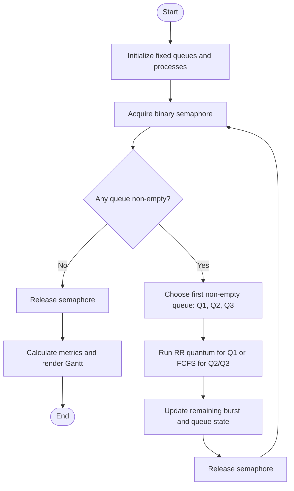
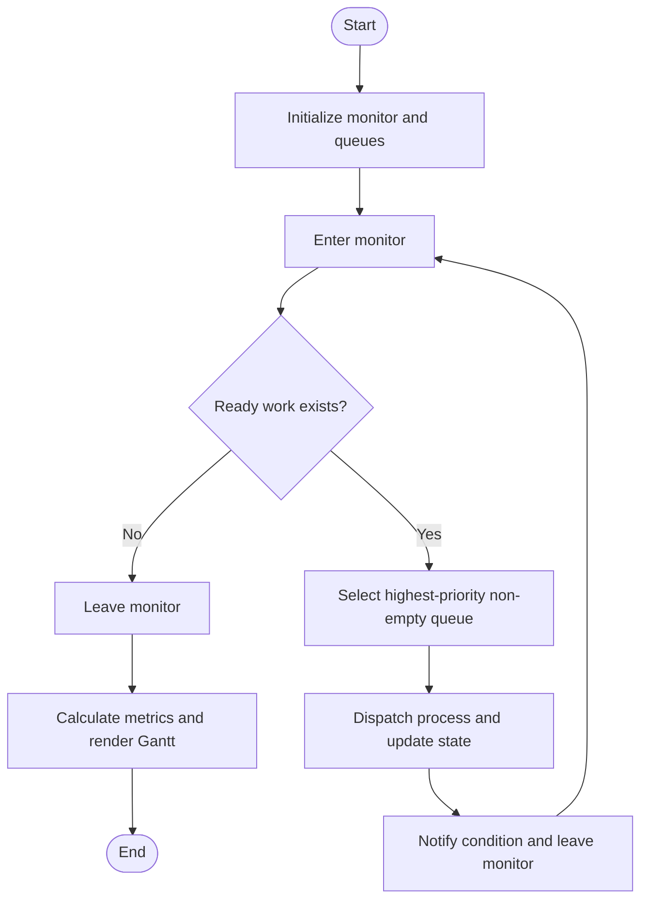
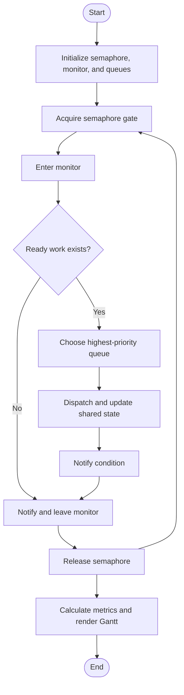

# Exercise 5 — MLQ Scheduling with Synchronization

This folder adds three synchronization variants to the existing Multilevel Queue (MLQ) scheduling project.

## Queue policy used in the experiment

MLQ is **not** Multilevel Feedback Queue (MLFQ): each process remains in its assigned queue.

| Queue | Priority | Intra-queue policy | Example quantum |
|---|---|---|---:|
| Q1 | Highest | Round Robin | 2 time units |
| Q2 | Medium | FCFS | — |
| Q3 | Lowest | FCFS | — |

A non-empty higher-priority queue is selected before any lower-priority queue. Queue 1 runs in RR slices; Q2 and Q3 use FCFS. The sample workload is P1(Q1, burst 5), P2(Q1, burst 3), P3(Q2, burst 4), P4(Q2, burst 2), P5(Q3, burst 3), all arriving at time 0.

## Run the implementations

Requires Python 3.10+; no third-party packages are needed.

```bash
python exercise-5/mlq_sync_demo.py --mode semaphore --gantt exercise-5/gantt-semaphore.svg
python exercise-5/mlq_sync_demo.py --mode monitor --gantt exercise-5/gantt-monitor.svg
python exercise-5/mlq_sync_demo.py --mode both --gantt exercise-5/gantt-both.svg
python -m unittest exercise-5/mlq_sync_demo.py -v
```

Each command prints the simulated Gantt trace and per-process completion, waiting, and turnaround metrics. The SVG chart is generated from the actual trace, not hand-drawn example timings.

## 1. MLQ with a semaphore

A binary semaphore protects access to the shared ready queues.



## 2. MLQ with a monitor

A monitor-style condition lock protects queue state and supports condition notification when state changes.



## 3. MLQ with semaphore and monitor

The semaphore gate and monitor lock are acquired in a consistent order; the monitor is notified after a state update.



## Test plan and expected properties

- **T1 — Trace equivalence:** all three variants produce the same deterministic schedule for the same workload.
- **T2 — RR quantum:** each Q1 time slice is no longer than 2 units.
- **T3 — Queue priority:** Q1 is exhausted before Q2 starts; Q2 is exhausted before Q3 starts.
- **T4 — Completion:** every process reaches zero remaining burst.
- **T5 — Input validation:** invalid queue IDs and non-positive burst times are rejected.

Run the unit tests with the command above. The three variants are educational synchronization designs around a deterministic simulation, not a kernel scheduler or a benchmark of parallel speed. The monitor uses a condition lock to guard the shared state; the combined mode demonstrates a semaphore gate plus the monitor. Because the workload is deterministic and runs in one scheduler thread, equal traces are expected and do not by themselves measure concurrent race behavior.

## Gantt chart

The program generates the Gantt chart from the schedule trace for each mode. Queue colors in the SVG distinguish Q1, Q2, and Q3. Example output is generated by running the commands above.

## Summary

- Semaphore: straightforward mutual exclusion.
- Monitor: encapsulates mutual exclusion and condition notification.
- Combined: demonstrates layered synchronization with a consistent acquisition order.
- MLQ keeps queue assignment fixed; it does not promote or demote processes between queues.
