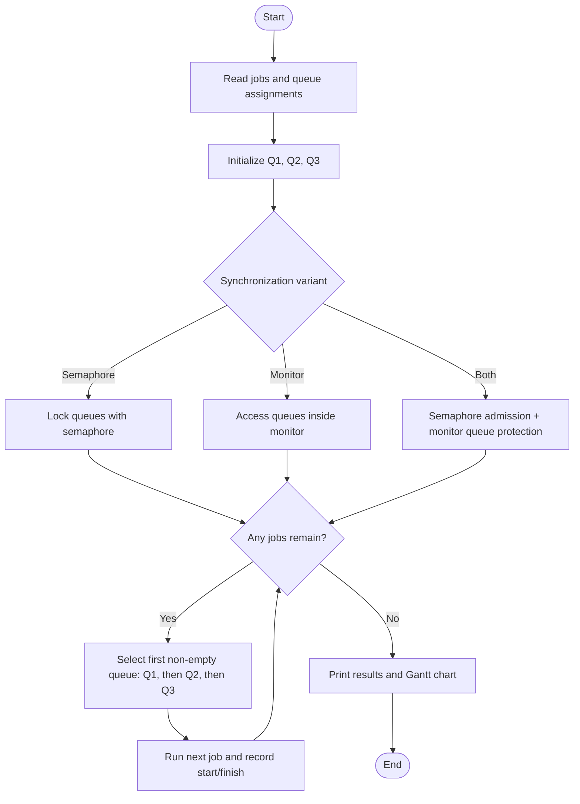

# Exercise 5 — MLQ Synchronization

## Goal
Implement and test Multilevel Queue (MLQ) scheduling in three variants:
1. MLQ with a semaphore
2. MLQ with a monitor (a condition variable protecting shared queue state)
3. MLQ with a semaphore and a monitor

## Policy and assumptions
- Queue 1 has the highest priority, then Queue 2, then Queue 3.
- Jobs are non-preemptive; first-come, first-served within each queue.
- All jobs are ready at time 0; burst times are deterministic simulation units.
- This is a teaching simulation, not a kernel scheduler or a real-time guarantee.

## Run
```bash
python3 mlq_exercise5.py
python3 -m unittest -v
```

## Flowchart



## Example Gantt chart
For the example workload in the script (P1: Q2/3, P2: Q1/2, P3: Q3/1, P4: Q1/1), strict priority and FCFS within each queue produce:

```text
Time: 0       2   3          6  7
      |  P2   |P4 |    P1    |P3|
      Q1       Q1      Q2      Q3
```

| Process | Queue | Burst | Start | Finish | Waiting |
|---|---:|---:|---:|---:|---:|
| P2 | 1 | 2 | 0 | 2 | 0 |
| P4 | 1 | 1 | 2 | 3 | 2 |
| P1 | 2 | 3 | 3 | 6 | 3 |
| P3 | 3 | 1 | 6 | 7 | 6 |

These are calculated simulation values, not measurements of OS process execution.

## Test cases
- Verify priority order and FCFS within each queue for all three synchronization variants.
- Verify empty input.
- Verify invalid queue numbers and non-positive burst times.
